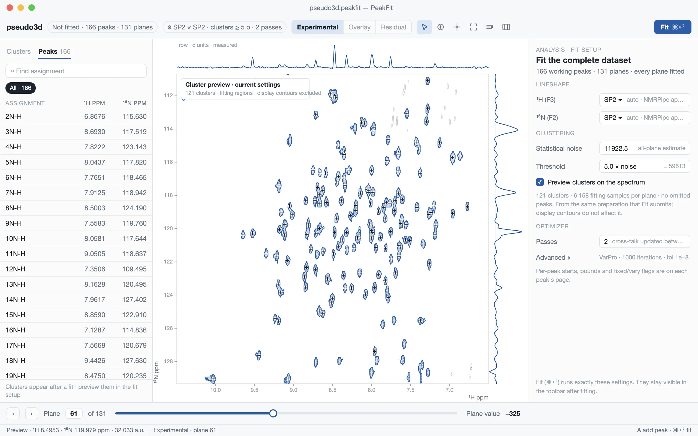
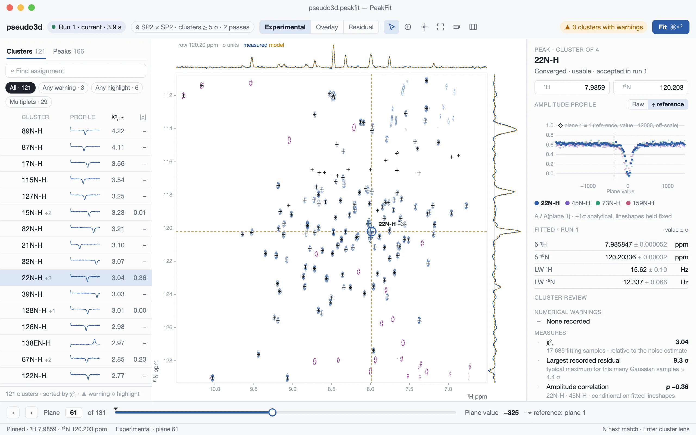
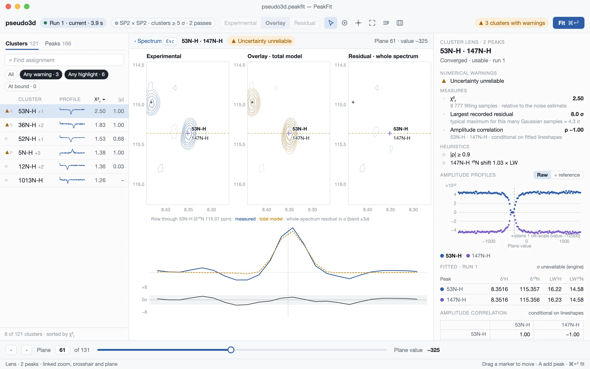

# PeakFit GUI Design Specification v2.0

> **Current storage policy:** [output/project contract](outputs.md) supersedes
> this baseline's JSON persistence examples. Standard saves link a verified external
> spectrum and retain compact fitted authority, exact corrections and reconstruction
> references. Projects never embed experimental or simulated spectra. Scientific
> exports remain compact, share GUI/CLI infrastructure and retain terminal
> corrections. Initial/fitted/adopted coordinates and Current/Outdated distinctions
> below remain required.

**Status:** approved production design baseline; implementation proceeds in complete
vertical slices. **Date:** 29 October 2026.
**Focused revision (30 October 2026):** lightweight analysis persistence with
verified external spectral sources, explicit evidence retention and capability-checked
reopening. Compact refinement and automatic fitted-position adoption remain in force.
**Design revision 2.1 (31 October 2026):** three-column review workspace
(navigator · spectrum · inspector), Cluster lens, separate numerical warnings,
review measures and heuristics, integrated fit setup with clustering preview,
optional reference-normalized profiles and a revised visual system. Sections 1–3,
5–10 and 12–14 change; scientific state, persistence and MCMC contracts do not.
This revision authorizes no storage or export format change (§14).

**Technology decision:** PySide6 + Qt Widgets + PyQtGraph, accepted by the project
owner after hands-on evaluation and reconfirmed by the 31 October 2026 design
review: the observed weaknesses were information-design and visual-system
problems, not toolkit limits. Framework selection is closed. Sections 2 and 12
define the visual and compositional direction; the improved Qt trial remains the
interaction and scientific-rendering reference. This document specifies the
target application, not a claim that these workflows are already implemented.

## 1. Product direction and evidence

PeakFit is one scientific workspace: **open → inspect → edit → fit → review →
refine → quantify uncertainty → save/export**. The spectrum stays visible through
the workflow. There are no separate editing and results applications, dashboard,
wizard on every fit, or hidden changes of scientific scope.

The design follows the domain vocabulary in [GLOSSARY.md](../GLOSSARY.md).
An intensity profile means fitted peak amplitudes across the series dimension;
crosshair intensity and integrated volume are different quantities.

The reviewed evidence is:

- [Final Qt design challenge](https://github.com/gbouvignies/PeakFit/blob/ea98e5c7002bcf94ce5582aa051bea865820960a/experiments/gui-v2/reports/04-final-qt-design-challenge.md)
  and the final React [light overview](https://github.com/gbouvignies/PeakFit/blob/ea98e5c7002bcf94ce5582aa051bea865820960a/experiments/gui-v2/evidence/final-challenge/react-1280-light.jpg)
  and [dark inspector](https://github.com/gbouvignies/PeakFit/blob/ea98e5c7002bcf94ce5582aa051bea865820960a/experiments/gui-v2/evidence/final-challenge/react-1280-dark.jpg).
  Keep their quiet background, joined comparison selector, deliberate spacing,
  short labels and clear primary action. Do not copy their persistent Apply button.
- [Improved Qt interaction trial](https://github.com/gbouvignies/PeakFit/blob/ea98e5c7002bcf94ce5582aa051bea865820960a/experiments/gui-v2/reports/05-qt-interaction-trial.md),
  including commit `ea98e5c` and its interaction implementation in
  `experiments/gui-v2/qt_canvas.py`: separate hover/selection, continuous native
  slices, pinning, atomic movement, precise edits and Undo. Subsequent replay-harness
  corrections do not change the product interaction decision.
- [Current desktop guide](gui.md), [architecture](architecture.md),
  [whole-dataset validation](validation/gui-dataset-fit.md), and
  [completed scientific review contracts](gui-design.md). Existing whole-dataset
  fitting and canonical outputs are foundations, not disposable prototypes.

Concrete problems to resolve, observed in the running application at 1280×800
(design review, 31 October 2026): navigation lists peaks in input order without
status, although fitting, overlap and uncertainty are properties of clusters; the
amplitude profile, the product of the analysis, gets about 100 px of height below
the spectrum; diagnostics are prose in nested scroll areas; peak markers disappear
under contours; layer and sign encodings rely on 1 px dash patterns and reuse ochre
for both model and positive residual; the result line emphasizes convergence counts
while fit-quality evidence stays inside per-cluster text. The production
`PreciseInspector` group commit and the hover/selection/pin model are correct and
are preserved while their placement changes. `CompletedFit`/`FinalFitOutcome`
remain scientific truth.

Historical reports retain their original conclusions and limitations. Their
statements that framework acceptance remained open are superseded by the owner's
decision above. Historical experiment links are immutable Git commit permalinks,
so integration into main does not depend on copying `experiments/`. Native revision
evidence lives with this document in [the compact-view record](validation/gui-v2-refinement.md).
No experiment is merged or copied wholesale into production.

## 2. Permanent workspace

**Three columns: navigator, spectrum, inspector.** The cluster is the unit of
review and the peak is the unit of editing. A 16:10 window has spare width rather
than height, so wide information goes to the sides and the spectrum keeps the full
height. The vertical cross-section stays attached to the 2D plot; the inspector
sits beyond it.

| Area | Permanent responsibility |
| --- | --- |
| Toolbar | One row: analysis name and Modified state; run chip (run number, Current/Outdated, duration) that opens the run record; fit-settings summary that opens the fit setup (§7); joined **Experimental / Overlay / Residual** selector; canvas tools (Select, Add peak, Pin traces, Full spectrum, Display); numerical-warning summary; primary **Fit** button, with Cancel and progress while a job runs. Tools are icon buttons whose tooltips name their shortcut. File/Edit/View/Analysis/Help commands live in normal menus. |
| Navigator (left) | **Clusters / Peaks** tabs, search, filter chips with counts and sortable rows (§8). Before a fit only Peaks exists; rows show assignment and display-precision coordinates. |
| Spectral area | Dominant 2D spectrum, row trace directly above, column trace directly to its right; their frequency axes align exactly with the 2D viewport. In the Cluster lens this area shows the lens (§3). |
| Inspector (right) | Contextual pages chosen by selection (below). |
| Plane strip | Previous/next, exact one-based plane field with count, slider by plane index, plane value with its optional display label (§5). Chosen reference planes are marked on the slider. A 2D dataset shows “Single plane”. No embedded profile plot. |
| Status line | Preview/Pinned, sampled coordinates, raw intensity or residual with units, short contextual gesture hint. Long failures remain available in run details, not a disappearing toast. |

The upper trace is a row at the sampled vertical coordinate; the right trace is a
column at the sampled horizontal coordinate. Neither is a projection or sum.
Traces show measured data and, while a current model exists, the total model in
common units; Residual shows residual traces. Plot labels use the loaded
axis/nucleus names, not hard-coded H/N/F2/F3.

Both side panels are splitter panes with remembered widths (an application
preference) and can be hidden completely with a toolbar toggle and shortcut.
Default widths at 1280×800: navigator 256–280 px, inspector 300–320 px. Resizing
never changes the user's panel choices; selection never opens a hidden panel, and
background work never opens, closes or resizes one. Target minimum window 1040×720
with at least 500×320 px of 2D plot; below that, hiding a panel is the remedy, not
smaller text.

### Inspector pages

The inspector shows one page, chosen by selection and never by hover:

- **Analysis (no selection):** before the first fit, the fit setup (§7); afterwards
  the working settings, the active run's summary, warning counts and changes from
  its parent run. Reachable at any time by clearing selection (Escape on the canvas),
  from the toolbar settings summary or from Analysis → Fit settings.
- **Peak:** identity and working-position editor (group commit, §5); an expandable
  Parameters section with working starts, bounds and fixed/vary flags; accepted
  values of the active run with value, σ and unit, labeled by run; the review items
  of its cluster; and the amplitude profile with the other cluster members.
- **Cluster:** members, numerical warnings, review measures and heuristics (§8),
  amplitude profiles of all members, parameter table and amplitude-correlation
  matrix.
- **Lens:** in the Cluster lens the inspector widens to about 340 px and shows the
  cluster page with every member's parameters side by side.

The profile plot is at least 280×170 px at 1280×800. A page scrolls as a whole;
there are no nested scroll areas. Provenance (optimizer, termination message,
correction revision, run identity) sits behind one disclosure at the foot of each
page rather than inline prose. No selection never shows empty input fields.

Other surfaces: the **Display popover** holds display contour threshold, spacing
and count, labels, fitting-sample regions and stroke weight, never fit settings.
**Open/import and export dialogs** use native file selection followed by compact
validation; errors identify the file, row/axis and remedy.

Use ordinary splitters and layouts. Do not add detachable docks, a ribbon,
per-plot toolbars, an extensible panel framework or freely arranged layouts. Wide
future views (MCMC traces, run history) use the lens area or a separate explicit
window, never a permanent lower panel.

## 3. Representative application states

The mockups below are drawn at 1280×800 from the bundled dataset and a real
two-pass fit: real contours, positions, amplitudes, covariances and fitting regions.
They are compositions, not production screenshots or new fit evidence.

### A. Before the first fit: establish peaks and fit setup

The navigator shows Peaks. The spectrum shows experimental contours with visible
markers. With nothing selected, the inspector shows the fit setup, and **Preview
clusters** draws the clusters of the exact prepared problem on the spectrum (§7).
Only Experimental is available; Overlay and Residual explain why.

### B. Overview after fitting: find what deserves attention

Successful completion selects Overlay and automatically shows optimized positions
in the markers, navigator and inspector. It preserves viewport, selection and panel
visibility; a selected-peak pin follows the optimized peak once, while a free
inspection pin stays fixed. The total model includes every usable cluster. The
navigator switches to Clusters with warnings, measures, heuristics, sorting and
filters (§8). Selecting a cluster highlights its members and recorded fitting
region; it neither isolates its model nor changes the viewport. **Frame cluster**
is an explicit action.
The mockup shows the overview after the user switched to Experimental.

### C. Cluster lens: judge one cluster

Enter or double-click on a Clusters row, or **Open lens** in the inspector or
context menu, replaces the spectral area with the lens; Escape (when no draft,
gesture or dialog is active) or **‹ Spectrum** returns with the overview viewport
unchanged. Three linked panels show the cluster region as **Experimental**,
**Overlay** and **Whole-spectrum residual**, sharing zoom, crosshair, plane and
markers. Below them, the row trace through the selected member shows measured
data, total model and whole-spectrum residual in σ_stat with a ±3 σ band. The
default region is the recorded fitting-sample extent plus a margin; zoom and pan
are free. The comparison selector does not apply inside the lens; leaving restores
the previous mode. The plane strip and profile points change plane in the lens.

### D. Correct and refit

Drafts and commits follow §4–§5 in the overview and in every lens panel. An
uncommitted draft keeps the accepted comparison visible and labeled. A commit
makes the run Outdated; overlay and residual panels then show “Outdated · fit to
compare” rather than stale data. **Fit** refits the whole dataset; the lens stays
open on the cluster identified by its members' stable IDs. If membership changed,
the lens says so and offers the new cluster containing the selected peak.

At 1280×800 with both side panels open, the 2D plot is at least about 560×480 px.
At 1440×900 and above, extra space goes to the spectrum. Large fonts may require
hiding a panel; later resizing preserves choices.

## 4. Scientific state and result lifecycle

| State | Meaning and visible behavior |
| --- | --- |
| Hover | Transient peak identity; halo and row wash. Never changes selection, editor contents, input revision or Undo history. |
| Slice preview | Sampled row/column follows pointer, or a hovered list peak; status says Preview. Does not select a peak. |
| Pinned sample | Explicit sampled location. Survives hover, mode and plane changes. Pin and selection are independent: selecting a peak pins once; moving the pinned sample afterward leaves that peak selected. |
| Selection | Stable peak ID, or run-local cluster identity with members. Owns inspector context. Selection is not a scientific edit. |
| Draft | Uncommitted text or drag position, visibly marked Draft. Keep the valid accepted comparison and committed marker visible. A drag uses a distinct ghost marker; a text draft does not move the marker. No scientific revision or model recomputation until commit; Escape removes the draft without display transitions. |
| Working inputs | Committed peaks, model settings, bounds/freedom, source data and plane mapping used for the next fit. Undoable edits; separate from results. |
| Accepted result | Atomically published completed run with exact submitted input snapshot and a recorded fit-derived working state. Optimized working positions and accepted result arrive together, Current. No Apply/transfer/accept step. Acceptance means retained evidence, not scientific endorsement. |
| Outdated result | Working scientific inputs changed after that run. Preserve its numerical inspection, provenance, warnings and export. Disable live Overlay/Residual and sampling from the working workspace. |

Saving a project is independent of fitting: **Modified** means unsaved analysis;
**Outdated** means working state no longer matches the verified run-derived state.
Show both when applicable. Exporting results does not mark the analysis saved.
Plot navigation and panel changes never
mark a result outdated. Display preferences can be saved without being scientific
edits. Assignment renaming conservatively marks results outdated too: names can
participate in parameter constraints. Stable IDs preserve original run labels and
prevent duplicate names from becoming identity collisions.

### Atomic completion and automatic optimized positions

A successful whole-dataset completion is one transaction:

1. Preserve the exact submitted source fingerprints, ordered planes, stable-ID
   mapping, **initial unfolded positions**, settings, initial bounds/masks and
   immutable completed outcome. This is the problem actually solved.
2. Validate usable finite final chemical shifts against the recorded axis descriptors
   and stable-ID mapping. Prepare a complete post-fit working snapshot: replace each
   eligible peak's **pair** of unfolded positions with its optimized pair; derive
   displayed aliases using the existing spectral conversion. Never shift by a
   rounded display delta or create/remove/reidentify a peak.
3. Publish accepted outcome, post-fit working positions and their provenance mapping
   atomically. Spectrum markers, peak-list coordinate columns and inspector update
   in the same UI delivery. The active result stays **Current**. The project becomes
   Modified until saved. Selection and viewport survive; a pin following the selected
   peak moves once to its new nearest native sample, while a free inspection pin stays.

A completed run may contain usable non-converged fits: adopt their valid positions
with the existing convergence warning. Unreliable uncertainty does not by itself
make a finite usable position ineligible; adopt it and retain the warning. A peak
with unusable/missing/non-finite/unmappable positions retains its prior pair and
gets a specific warning. Do not update only one axis. Fatal result/source/identity
validation failure publishes neither new positions nor a new active result.
Canceled or failed jobs leave all working positions and the previous result intact.
An all-unusable completed run changes no positions and offers no model comparison.

**Currentness is not raw equality with initial seeds.** Record both the execution
input revision `I` and its verified, run-owned completion transition `T_run(I)=W`.
The accepted run is Current only while sources, scientific settings, identities and
committed working values match that recorded `W`, and no subsequent manual
scientific revision has invalidated it. The only automatic difference allowed by
`T_run` is the validated fitted-coordinate replacement above. Bounds, masks,
cluster membership and corrections in the accepted record remain those actually
used; the transition never recertifies them as prepared for a new fit.

Subsequent fitting starts from these current optimized coordinates and prepares
**fresh clusters, masks and valid bounds**. It must not reuse preparation made for
initial positions. Shape starts/settings remain explicit working settings; this
revision introduces no hidden transfer of linewidths or other fitted parameters.
No “Use fitted positions/values as starts” command is needed for ordinary positions.

Manual edits, including moving an optimized position, invalidate comparison and
remain undoable. Undo restores exact working values but does not recertify the
old run. Automatic adoption is not an ordinary Undo entry that silently restores
pre-fit positions under a Current label. History provides **Restore working state
from this run…** for deliberate restoration: it restores the recorded post-fit
state with sources/settings verified, resets any incompatible edit history, and
records the restoration. Exact pre-fit positions remain inspectable/exportable;
restoring them as working seeds is an explicit manual change and makes the fit
Outdated. Reopening restores these relationships, never infers them from rounded values.

### Repeated fitting and bounded history

Keep **one active full result resident**, one running job and a bounded display
cache (initial budget 256 MiB; excluding raw source/active scientific arrays).
Older results load on demand, not into an accumulating in-memory list. The memory
bound scales with one dataset/result, not the number of attempts. Page the history
list rather than instantiate every row/payload.

Every attempt has a compact project journal entry: run/parent identity, timestamp,
settings, exact initial/final coordinate snapshots and final nonlinear parameter/
error tables, status (completed/canceled/failed), concise diagnostics/statistics,
and available evidence level. Completed
full payloads are written to project storage or a recoverable temporary session
store before older resident data are released. Saving moves/copies that journal
and retained payloads into the analysis project; linked spectra remain external.
Temporary recovery is not presented as a saved analysis.

Retain full numerical/reconstruction payloads for the **latest ten completed runs**
by default, subject to a **1 GiB historical-payload budget**; the active run is
always retained, even if it alone exceeds that budget. Older unmarked runs become
**Summary only**: keep their compact journal/coordinates/parameter tables/settings/statistics, remove
historical sample/model payloads, and show that loss of capabilities explicitly.
MCMC evidence follows the protected retention policy in Section 10.
A deliberate **Keep full evidence** flag exempts a named run from automatic pruning
and shows its disk cost. This is a history detail action, not a pre-fit prompt.
Never delete separately exported evidence. Reuse immutable unchanged project
payloads across runs/generations; reference external spectra without copying them.
Do not store full calculated spectra or persistent display caches. The 1 GiB budget
counts historical numerical payloads, including chains, but excludes the active run
and Keep full evidence runs from eviction. It is not a total project-size ceiling:
show active, historical and protected bytes separately and warn when protected
evidence exceeds the budget. Saving never silently downsamples or prunes evidence
to meet a size target.

No Save/Discard/Cancel interruption occurs on the third or any routine later fit.
History shows the retention policy and each run's Full / Summary-only / Pinned
status. Pruning happens only after successful publication, not on starting a
replacement; crash/cancel retains the old active result. Actual disk-full/write
failure is actionable and blocks further evidence eviction rather than silently
losing the sole result. Closing unsaved work retains the normal save guard.

## 5. Interaction and navigation contract

| Input | Action |
| --- | --- |
| Move over spectrum | Continuous sampled slice preview while unpinned; peak hover feedback independently of pin state. |
| Hover list row | Highlight corresponding marker; preview slices at that peak only when unpinned. No selection or scrolling of the list. Clear feedback on leave. |
| Click blank spectrum | Pin sampled crosshair; retain selection. Dragging from blank space pans and must not create a pin on release. |
| Click marker/list row | Select stable peak and pin nearest native sample to its working position. Reveal an offscreen peak with minimum pan, preserving zoom. Keyboard row navigation does the same. |
| Drag already-selected marker | Preview free continuous ppm movement with a ghost marker and Draft label; keep accepted comparison, update nearest native slices; release commits one edit and marks results Outdated. Escape or window deactivation restores the exact pre-drag position/pin. Unselected-marker drag pans. |
| Drag pinned crosshair | Move sampled inspection position; no peak edit. Unpinned crosshair cannot capture pan gestures. Peak handle takes precedence when coincident. |
| Wheel / trackpad | Zoom about pointer; continuous wheel input coalesces to latest view. Do not also change a focused numeric field under the pointer. |
| Full spectrum | Reset ppm ranges only; retain plane, selection and pin. No ambiguous “Reset” that restores scientific inputs. |
| Pin slices / canvas Space | Toggle preview/pinned. Resuming preview keeps selection and editor contents. Space in text inputs remains ordinary input. |
| Add peak / canvas A | One-shot placement cursor; next click places a working peak with a unique placeholder name and selects it. Escape cancels without history. No automatic peak picking. |
| Delete/Backspace in canvas/list | Delete selected peak, one undo entry, no routine confirmation; text fields keep normal text deletion. Multi-selection for deletion is list-only with native modifier keys and a visible count. |
| Double-click marker, or Enter on a Peaks row | Focus the coordinate editor, revealing the inspector explicitly if hidden. |
| Enter or double-click on a Clusters row | Open the Cluster lens on that cluster; Escape returns to the overview. |

Picking uses a consistent logical-pixel tolerance across hover, click and drag,
tested at multiple device pixel ratios. Coincident peaks present one small anchored
chooser with assignment, coordinates and cluster; arrows/Enter choose, Escape
closes. Prefer this over repeated-click cycling: the complete choice is visible
and accessible. An overlap cluster is not a single peak and receives no editable
centroid. Hovering a cluster highlights its members, with no arbitrary slice choice.

Navigation preserves ppm orientation (normally descending), axis calibration and
folding. Working coordinates remain unfolded; indirect-axis aliases use the
existing scientific conversion, direct positions never wrap. Selected/hover labels
show folded and unfolded coordinates when different. Peak placement and dragging
are not snapped to sample centers; only the inspection crosshair is snapped.
Cross-sections follow the visible frequency ranges and have no independent pan.

Plane navigation preserves original acquisition order, including equal or unordered
plane values; the slider moves by plane index and the exact one-based index is
always visible. The plane-axis label is optional, user-defined display metadata,
independent of numerical values and calculations: with plane values the default
label is “Plane value” without a unit; without values it is “Plane number”; the
user may enter a descriptive name and unit when useful. PeakFit never infers the
variable or its unit, whatever the experiment (offsets, frequencies, delays,
temperatures or other series). Until a storage decision (§14) the label is
session-only. Selecting a profile point returns to its original plane. Plane
changes keep ppm ranges and the pinned row/column.

### Precise edits without Apply

Enter or leaving the complete editing group commits all valid changes together.
Tab/Shift+Tab inside it retains the draft. Escape discards the whole group. Clicking
another peak, hiding the inspector, saving/exporting or fitting first resolves the draft.
A valid no-op creates no Undo entry and no scientific revision. Valid/invalid drafts
do not hide an otherwise current comparison; a small Draft label identifies that
the editor differs from the displayed accepted model. Escape leaves mode/scale
unchanged. Commit is the single point where comparison becomes Outdated.

Invalid input remains visible with a short inline error and the offending field
identified. Do not partly commit it or silently replace it with the previous value.
Actions requiring committed inputs stop with “Correct this value or press Escape”.
Spectrum/plane navigation and cancellation remain available; no focus trap.
Menus, popovers and loss of application focus are not accidental group exits.
Deletion explicitly discards that peak's draft, then deletes its committed record.

Store float64 values without display rounding. Unchanged fields retain their exact
value; no-op focus/formatting never changes science. Unfocused coordinates show one
decimal place beyond the axis digital resolution (ppm per point; for the bundled
dataset four decimals in ¹H and three in ¹⁵N); focus and copy reveal full
round-trip precision. Fitted values show σ to two significant figures and the
value to the same decimal position. Display precision never changes stored values.
Accept scientific notation and either an unambiguous local decimal separator or
dot; do not accept thousands separators or ambiguous mixed punctuation. Exports
use canonical round-trip dot-decimal values. Reject non-finite numbers. Show ppm,
Hz, degrees and dimensionless units as appropriate. Bounds and fixed/vary state are
explicit; FWHM is not silently interpreted as sigma or an apodized apparent width.

### Small command set and keyboard access

Menus expose Open dataset, Open analysis, Import peaks/plane values, Save analysis,
Save as, Export, Undo/Redo, Add/Delete peak, Fit dataset, Review/Profile/Uncertainty,
Full spectrum and display preferences. Context menus are shortcuts to these same
commands, not separate features. Show precise Undo names such as “Undo move 3N-H”.

Use platform-standard Cmd on macOS and Ctrl on Linux for Open, Save, Undo and
Redo (Cmd+Shift+Z / Ctrl+Shift+Z; Ctrl+Y also works on Linux). Fit uses
Cmd/Ctrl+Return; Full spectrum Cmd/Ctrl+0; assignment search Cmd/Ctrl+F.
Ctrl+Page Up/Down changes plane on both platforms; visible previous/next buttons
remain available on keyboards without those keys. Arrow keys in lists navigate;
canvas arrows move the pinned sample one point; explicit axis/range fields in
View support navigation without a pointing device. Escape acts on the current
draft/gesture/dialog, never silently cancels a numerical job.

In the navigator, arrows move, Enter opens the lens on a Clusters row (§5 table)
and N / Shift+N move to the next/previous row matching the active filters. With
the canvas focused, E / O / R choose Experimental / Overlay / Residual, [ and ]
change plane, A adds a peak and Space pins. Single-letter keys never act inside
text fields.

Every visible command is keyboard reachable; focus order follows toolbar → navigator →
plots → inspector → plane strip. Labels have buddies; the comparison selector
is one accessible choice group. Provide a keyboard-shortcuts help sheet. Plot
accessibility exposes sampled values, selected identity and numerical tables;
screen-reader access must not depend on reading contour geometry.

## 6. Opening real data and managing assignments

The empty window offers **Open dataset…** and **Open analysis…**, with a short
recent list. Opening a dataset accepts an optional peak list and plane-values file
in the same compact form, while allowing later import. Initial supported spectra
are the existing 2D/pseudo-3D NMRPipe inputs; do not claim arbitrary nD import.
Readers remain the authority for supported peak formats. A preview shows shape,
axis names/units, plane count and sample assignments before replacement commits.

Validate dimensions, axis metadata, finite coordinates, plane-value count and row
parsing off the GUI thread. Explain unsupported formats, incomplete files and
ambiguous axis mappings before publishing a workspace. When peak axis order is
not established by file metadata, require an explicit mapping with preview; never
guess from the field names alone. A failed import leaves the existing analysis
intact. Large imports show cancellable progress; do not publish half-loaded data.

No peak list means inspection and manual placement are available, with Fit disabled
and an explanation. Automatic peak picking remains an experimental separate workflow.
Import peaks offers explicit Replace / Append after showing counts; Append allocates
new stable IDs. Duplicate assignments are allowed with a warning and disambiguating
coordinates/ID. Missing assignments receive unique editable placeholders. Renaming
never silently merges peaks. Working membership can change after moving/adding
peaks; accepted cluster IDs belong only to their original run.

The Peaks list searches assignment text and stable identity; the Clusters list
searches members and run-local cluster ID. Search/filtering never deletes data or
changes scientific scope. A selected item hidden by filtering remains identified
in the inspector with **Reveal in list**. Review navigation follows the navigator's
current sort and filters with Next/Previous and a count (§8). A user acknowledgement
of review would be separate from numerical warnings and could never erase them or
make an outdated run current; recording it is a deferred storage decision (§14).

## 7. Fit setup, execution and acceptance

**Fit dataset always fits the whole working dataset**, independent of selection,
viewport, lens and display mode. Scientific settings are always visible and
explicit; a modal confirmation dialog does not gate fitting.

**Fit setup.** Before the first fit the inspector's Analysis page is the fit setup
and is shown by default: resolved lineshape per axis with its source (for example
“SP2 · from NMRPipe apodization” or “explicit”); statistical noise with value and
method; clustering threshold as a noise factor and as absolute intensity; optimizer
passes (default two, cross-talk updates only between passes, as in the current GUI;
CLI defaults are unaffected). **Advanced** discloses solver, iteration limit,
tolerance and an imported multi-step schedule, which replaces the pass field rather
than competing with it. Phase/coupling controls appear only for models that need
them. Per-peak starts, bounds, position windows and fixed/vary flags live in the
Peak page's Parameters section, not in a dataset-wide table. Setting edits are
working-input drafts with the same group-commit rules as coordinates; a committed
change marks an existing run Outdated. Supported settings round-trip through the
engine configuration; unrepresented settings are never silently discarded. v2
provides no plane-exclusion workflow; every source plane is fitted.

**Clustering preview.** **Preview clusters**, on by default in the fit setup,
prepares the exact fitting problem off Qt with the same preparation function that
Fit submits, and draws its clusters on the spectrum: member grouping and sampled
fitting regions, with cluster and sample counts and any omitted or ambiguous peaks
with reasons. It depends only on working peaks, scientific settings and source
data, never on display contour threshold, spacing or count, which are labeled
display-only. A committed change hides the preview and starts a fresh preparation;
an obsolete preview is never shown. After a fit, the spectrum can show the active
run's recorded fitting regions; a preview for changed settings is labeled “Preview
for current settings”, distinct from “Recorded in run N”.

**Running.** **Fit** (toolbar, Cmd/Ctrl+Return) commits valid drafts and submits
the prepared snapshot that the setup describes; the executed snapshot is the
reviewed one. Safeguards replace the confirmation dialog: the first Fit of an
analysis whose setup has not been displayed in this session reveals the Analysis
page instead of running, and the next Fit runs; Fit is disabled, with the reason
in the setup, when an automatic lineshape cannot be resolved or conflicts with
processing metadata, when bounds are invalid, when statistical noise is not finite
and positive, or when preparation reports newly omitted or ambiguous peaks. No peak
is silently omitted. A statistical-noise override records its value and source.
Display-contour noise/threshold changes never alter clustering, samples,
statistical noise, starts, bounds or run readiness.

**Discoverability after fitting.** The toolbar always shows a compact summary of
the working settings (for example “SP2 × SP2 · clusters ≥ 5 σ · 2 passes”) that
opens the Analysis page; the run chip opens the run record with the settings
actually used. When working settings differ from the active run's, both say so.
Settings are never reachable only through a menu or a button chevron.

During fitting, keep pan/zoom, plane navigation and read-only inspection available.
Pause scientific edits, replacement and sampling, with a short reason. Show actual
stage/pass/cluster and elapsed time. Use determinate progress only when the engine
provides a denominator; correction/finalization stages may be indeterminate. Do not
invent ETA from cluster count. Cancel stays visible in the toolbar.
Cancel requests stop and reaping; until acknowledged show Canceling.
No partial run becomes accepted. Crash/failure identifies the stage and preserves
the old analysis and full diagnostic log. Closing a running analysis offers
Keep running / Stop and close, then the usual unsaved-analysis choice.

The completed outcome and automatic optimized positions are published once, as
specified in §4; canceled or failed execution never adopts positions. Numerical usability, optimizer
convergence, uncertainty reliability and scientific validity remain separate.
Usable non-converged models may be displayed with warnings. Unusable clusters
remain navigable with reasons and no fabricated parameters. Some usable clusters
produce **Incomplete total model · X/Y usable**; no usable clusters means no model
comparison. “Complete” means all fitted clusters usable, not all observed signal
explained. Default Overlay only when there is an evaluable model.

## 8. Comparison and scientific review

One selector controls **all spectral views** outside the Cluster lens (§3), including
crosshair-intensity profiles:

| Mode | 2D and aligned 1D behavior |
| --- | --- |
| Experimental | Signed original data; no fitted contribution. |
| Overlay (default after fit) | Experimental plus sum of every usable accepted cluster, common contour levels and common trace units/scales. Selection never changes this sum. |
| Residual | Native experimental data minus that same total model, displayed as `(D − M) / σ_stat`. Signed residual contours by default in 2D and residual samples/traces in both slices. Crosshair profiles use the same difference and units. |

Layers and signs are encoded twice, by hue and by stroke, with the fixed scientific
palette of §12: measured positive as a graded blue ramp (solid), measured negative
in plum (dashed), model in amber (solid positive, dotted negative) drawn over a
lightened measured layer in Overlay. In-plot legends name each layer; no layer
shares a hue with another.

**Residual default: signed contours**, initially at ±3, ±5, ±8, ±13 and ±21 σ_stat,
positive vermilion solid and negative teal dashed. Display can lower/widen those levels;
they are distinct from experimental contours and scientific clustering thresholds.
The legend always states the first level: absence of a contour means below the
visible threshold, not zero residual. Do not draw zero/noise-level contour forests.
The [real-data comparison](validation/gui-v2-refinement.md) found contours clearer
for locating signed mismatch at overview and overlap scales on planes 1/60/131;
the raster made weak/correlated noise more visible but obscured sparse structure.
This is a design assessment of that dataset, not a universal statistical result.

A contextual **Display → Residual rendering → Raster** remains available for
noise-field inspection, with an explicit teal/neutral/vermilion −3/0/+3 σ scale and
saturation indicators. No extra permanent control. Both renderings use the same
native total residual; no smoothing, denoising or sample interpolation. Contour
geometry interpolates crossings, not observations. Missing samples stay absent.

### Stable signed 1D scale

Use a symmetric signed range `[-S,+S]`, a visible zero and labeled values/units.
Measured and calculated traces use the **same range**, as do the horizontal and
vertical amplitude axes; no independent normalization. Before fit use original
intensity units; after fit keep those units unless σ_stat display is explicitly
selected and labeled. Converting units converts S without changing visual gain.

At load, obtain a rounded-up dataset-wide maximum absolute experimental intensity
off Qt and set S with a modest margin. When a new accepted model first exceeds
that range, expand once to accommodate it, with a visible scale update; never shrink
on completion. Keep S fixed through continuous hover, list navigation, pan/zoom and
plane changes. A user can explicitly **Fit current traces** or enter S through
Display/context menu to inspect weak peaks; this resets the range once, then locks
it again. Model/observed extrema are considered together. No per-pointer or per-plane
rescaling. Residual has a separate persistent range, initially ±8 σ_stat, also locked.

Clipped positive/negative samples receive edge indicators and exact values on
inspection; no silent clipping or automatic pumping. Preserve each mode's range
when switching away and back. Slice updates extract only native row/column data;
full-plane/dataset extrema are not rescanned on hover. Native residual values and
accepted projection remain unchanged. Exact fitting masks remain optional/off by
default and are not residual support. Model tails remain visible without silent cutoffs.

### Two residuals, never mixed

The **recorded optimizer residual** is
`D_cluster − terminal_neighbor_corrections − cluster_model` on a cluster's corrected
fitting samples, normalized by statistical noise, exactly as stored in the outcome.
χ²ᵣ and the largest recorded residual come from it. The **whole-spectrum residual**
is `(D − Σ usable M) / σ_stat` at every native point, including outside fitting
masks; the Residual view, the lens residual panel, residual traces and the
unexplained-signal list use it. They can differ on fitted samples because terminal
corrections need not equal final neighbor models. Every display names which one it
shows; neither is derived from the other, and no statistic comes from the display
raster. No local-fit residual is presented as a total-model residual.

### Review: numerical warnings, measures and heuristics

There is no overall quality score, ranking formula or pass/fail verdict, in the UI
or in exports. Review items belong to three families, kept visually and textually
separate. Each item states its value, definition and source. Unavailable values say
Unavailable with a reason, never zero; inapplicable items say so (for example a
correlation for a one-peak cluster).

| Family | Item | Definition and source |
| --- | --- | --- |
| Numerical warning (objective, engine-recorded) | Unusable | Recorded classification and reason. |
| | Not converged | Usable non-converged classification with its termination message. |
| | Uncertainty unreliable | The engine's recorded uncertainty warning. One message covers several causes today; recording them separately is a deferred storage decision (§14). |
| | At bound | A varied recorded parameter within 10⁻⁶ of its range from a recorded bound; the parameter is named. |
| Review measure (descriptive number) | χ²ᵣ | Recorded statistic on corrected fitting samples; relative to the statistical-noise estimate, so it inherits that estimate's accuracy. An elevated value does not by itself mean a wrong assignment. |
| | Largest recorded residual | Maximum \|normalized recorded residual\| in σ, shown with the sample count. Read it against that count: the largest of 10⁴ independent standard-normal values is typically about 4 σ. |
| | Amplitude correlation | Largest \|ρ\| between members from the recorded amplitude covariance (one matrix per cluster, shared by all planes); the full matrix is on the cluster page. It is conditional on the fitted lineshape parameters. Unavailable when the recorded covariance is unavailable; not applicable for one-peak clusters. A small residual with \|ρ\| near 1 means the decomposition is not determined by the data. |
| Heuristic (descriptive, adjustable threshold) | Large position shift | \|fitted − initial\| position, converted to Hz with the axis spectrometer frequency, relative to the fitted linewidth; default highlight above 0.5. |
| | Linewidth outlier | Fitted linewidth relative to the run's median for that axis over usable peaks; default highlight outside 0.5–2×. |

Numerical warnings appear as a warning glyph with text on every affected row and
page; the toolbar summary counts only these. Measures are sortable navigator
columns. Optional highlight thresholds on measures and all heuristics use a
subdued glyph labeled with the rule (“\|ρ\| ≥ 0.9”, “shift 1.03 × LW”) and never
the warning colour. Thresholds are application display preferences, shown with
each highlight; changing them changes no scientific data or run state, and their
definitions are versioned with this document. Filters offer one chip per warning
type and per highlight plus “Any warning” and “Any highlight”, each with counts.
The default sort is by assignment; any measure sorts with one click. Measures and
highlights cannot prove the absence of structured residuals, so whole-spectrum
residuals remain one key away.

For the bundled dataset (two passes) all 121 clusters converge and are usable;
three carry the uncertainty warning, those same three have amplitude correlation
\|ρ\| = 1.00, and the median χ²ᵣ is 1.97.

### Unexplained signal

**Signal not explained on this plane** is a read-only list computed on request from
the whole-spectrum residual of the current plane: connected regions beyond ±k σ_stat
(default k = 5, a display preference) with location, extreme value, size in samples
and distance to the nearest working peak. Selecting a region frames it. The list
never adds or proposes peaks, never flags a cluster and does not imply a poor fit of
the peaks chosen for analysis; unmodelled signals may be deliberately excluded. It
uses the same off-Qt model projection as the Residual view.

On a plane/mode/revision change, remove mismatched calculated/residual graphics
immediately. Show the experimental plane as an explicitly labeled temporary
fallback (“Residual requested · preparing plane 60”), never under a misleading
Residual label. Coordinate-matched calculated slices may arrive before the model
plane, but each pending view is labeled and never reuses another plane's values.
Only the latest valid request is installed. The mode, zoom and pin survive work.

## 9. Refinement and amplitude profiles

Find a cluster in the navigator → open the lens → judge experimental, overlay and
whole-spectrum residual side by side with profiles, parameters and correlations →
edit a draft while accepted evidence remains visible → commit → **Fit** → review the
new run in the same lens. The inspector labels **Working for next fit** and
**Accepted · run N**; typed values are never presented as fitted. Changing a model
rebuilds its applicable working fields with a preview of removed settings;
incompatible bounds are errors rather than silently adjusted guesses. Each run shows
its changes from the parent run: clusters whose warnings or highlights changed and
peaks whose fitted positions moved by more than their σ.

Whole-dataset refitting is the single production refinement command in v2. Cluster
selection supplies focus, not scope. An isolated cluster optimization cannot
silently replace part of the accepted dataset, because cross-talk and global
completion must remain coherent. The existing isolated Local fit workflow is
retired from the primary v2 UI; its exports remain readable as explicitly local
numerical evidence. A future local-trial feature needs a separate reviewed contract.

Profiles have an explicit quantity:

- **Crosshair intensity:** native observations and matching total model, or total
  residual in Residual mode. Header gives sampled location and units.
- **Peak amplitude:** signed accepted amplitude per original plane with its
  uncertainty availability. Header gives assignment, stable ID and run identity.
  This is a parameter profile, so the spectral comparison selector does not
  transform it into “residual amplitudes”; the quantity label remains visible.

Points remain unconnected; repeated/unordered plane values remain distinct
selectable observations, with source index in tooltips and tables. No response law,
integration or interpolation is implied. A parameter profile from an outdated run
stays read-only and labeled; a crosshair/model profile is disabled when the model
comparison is outdated. Analytical and MCMC intervals have separate names and
explanations and are never interchanged automatically.

**Default: raw signed amplitudes** for every experiment, in recorded units with
engineering axis scaling (for example ×10⁵) and a visible zero. The selected peak is
emphasized and other cluster members are drawn lighter on the same scale. When at
most two observations lie beyond a gap wider than half the span, the plot frames the
rest and labels them off-scale, with **Show all points**.

### Reference-normalized profiles (display only)

**Normalize to reference** is optional. The user chooses an explicit set S of one
or more reference planes by source plane index, never by value, since values can
repeat. PeakFit may point out an isolated plane but never applies a reference by
itself. The axis states the reference, for example “A / A_ref (plane 1)”.
Normalization is a display transform of recorded amplitudes: it never alters
authoritative amplitudes, uncertainties, exports, run records or saved scientific
results. Until a storage decision (§14) the reference choice is session-only.

For a peak with amplitudes A_k and scaled analytical standard errors σ_k:

- R = (1/n) Σ_{j∈S} A_j and r_k = A_k / R.
- Uncertainty uses first-order propagation with the full gradient, so that a
  numerator belonging to S is correlated with R:
  ∂r_k/∂A_k = 1/R − [k∈S]·A_k/(nR²); ∂r_k/∂A_j = −A_k/(nR²) for j ∈ S, j ≠ k;
  σ²(r_k) = Σ_j (∂r_k/∂A_j)² σ_j².
- For k ∉ S this reduces to σ²(r_k) = (σ_k² + r_k² σ_R²) / R², with
  σ_R² = (1/n²) Σ_{j∈S} σ_j².
- The current analytical uncertainties hold lineshape parameters fixed, so
  amplitudes of different planes come from disjoint observations with independent
  noise and have zero covariance. Uncertainty from shared lineshape parameters is
  not included; the authoritative σ has the same limitation and the profile says so.

Special cases:

- **n = 1, k ∈ S:** r_k = 1 exactly with zero uncertainty; it is drawn as a reference
  marker, not as an observation with an error bar.
- **n > 1, k ∈ S:** the correlated expression applies and the point is marked as part
  of the reference.
- **Unavailable:** if R is zero or non-finite, if σ_R is unavailable, or if σ_R/|R|
  exceeds a reliability limit (default 0.1, displayed), normalization is unavailable
  for that peak with the reason (“reference not distinguishable from its uncertainty:
  σ_R/|R| = 0.34”) and the raw profile remains. First-order propagation is not used
  beyond this limit because the ratio's distribution becomes strongly skewed.
- **Unavailable σ for the peak:** the normalized profile is unavailable rather than
  shown without error bars.
- **Negative R** is valid for signed data; ratios keep their sign and the label
  states the reference sign.

When MCMC samples exist, a ratio computed per sample is a separate, named display; it
replaces nothing automatically.

## 10. MCMC uncertainty workflow

From a usable current result, **Uncertainty…** opens in the Cluster lens. Default scope
is the selected peak's whole overlap cluster; no selection requires an explicit
choice of cluster(s) or All fitted clusters. Display all included members. Sampling
is post-fit analysis of a named parent run, not a replacement optimizer or a way
to repair invalid data. Unusable clusters cannot be sampled; non-convergence or
identifiability warnings remain prominent and are not cleared by running MCMC.

Review resolved parameter freedom/bounds, likelihood, priors/noise, exact sampled inputs
and terminal correction context before Run. Show walkers, steps, burn-in policy,
seed and worker limit with validated defaults from the scientific implementation;
never hard-code scientifically impossible walker counts. Explain whether sampled
amplitude intervals include nonlinear uncertainty or are conditional. If the
executor cannot establish that meaning, mark that quantity unavailable.

Use the existing numerical sampling workflow through a validated request, off Qt.
One numerical job at a time. Navigation remains available; scientific editing is
paused during sampling. Progress reports real sampling steps; Cancel retains the
parent fit. Partial chains, if retained, are labeled Incomplete and cannot produce
apparently final intervals. No automatic acceptance from completion alone.

Uncertainty shows trace plots, marginal distributions, correlations, interval
definition/level, effective sample size and diagnostic method/limitations. Report
R-hat only where its independent-chain assumptions and implementation are valid;
ensemble walkers must not be mislabeled independent chains. “Not assessed” is
preferable to invented confidence. Keep diagnostic warnings beside intervals.
Profiles may explicitly switch to available MCMC intervals, recording the method.

Sampling results bind to immutable parent run, cluster IDs, configuration, correction
context and source fingerprints. Refit does not relabel old chains as current.
Completed MCMC marks its parent **Keep full evidence** and exposes the storage cost,
so routine fit-history pruning cannot silently remove expensive uncertainty evidence.
Retain complete chains, sampling configuration, diagnostics and interval definitions
losslessly by default; do not silently thin, truncate or replace chains with summaries
on Save. Show their estimated and actual bytes separately from fit evidence. An
explicit removal of chains must warn which plots, interval recalculations or continuation
capabilities will be lost, preserve existing summaries/provenance, and mark the evidence
level accordingly. Retained incomplete chains are labeled and included in storage
accounting; they never imply a resumable sampler or final intervals.
Saved analyses must reconstruct and validate an executable sampling problem before
offering sampling; numerical review alone is insufficient. Arbitrary pickled
continuation objects are never loaded from a user-selected file.

## 11. Save, reopen and export

GUI v2 has no backward-compatibility requirement with prior PeakFit APIs, CLI,
configuration or formats. Preserve scientific integrity, explicit provenance and
reliable exports; change the representation when that produces a better design.
The current #70 implementation uses lossless gzip around its validated scientific
JSON as a focused storage improvement. That is an interim choice, not a requirement
that JSON remain the internal authority; an array-native record merits a separate
focused scientific review.

**Save analysis** creates a lightweight analysis directory with a `.peakfit`
suffix, referencing original spectral files externally. Saving must be fast and
space-efficient even for very large NMR datasets: neither first Save nor Save as
copies the original spectra. This is a project, distinct from canonical scientific
exports. Initially one analysis contains one dataset and peak list; switching
datasets replaces the analysis or opens another window. Multiple independent
projects may reference the same dataset; saving one never writes into the sources
or changes another project. No shared asset registry or managed source store is needed.

### Project contents and size

Save committed working peaks with stable IDs and unfolded positions, effective
settings/bounds/freedom, compact attempt journal, complete scientific results for
retained full/pinned runs, exact review payloads, provenance, review notes/state,
retained sampling chains/diagnostics and modest view state (plane, pin, selection,
ranges, panel sizes). Retention levels and budgets in Sections 4 and 10 apply both
in memory and on disk; Summary-only entries are explicitly labeled. Preserve
complete evidence for a retained full run rather than silently reducing precision
or dropping observations on Save.

Use a versioned JSON manifest with project-payload checksums and explicit shape,
dtype, axis, cluster/peak and ordered source-plane mappings. The current #70
implementation records completed quantities in losslessly compressed
`summary/fit.json.gz` (scientific JSON schema 4.1.0); lossless
NPZ review arrays retain exact sampled indices, observations, analytical sample
model/residual evidence and terminal corrections. Preserve evaluable model/processing
descriptors, exact input snapshots and the verified post-fit working transition
without duplicating fitted parameters into another authority. Initial positions
belong to the run input; optimized positions belong to its outcome; working
positions are editable state linked by stable IDs. Chain payloads use the sampling
writer's supported lossless format. Numerical arrays load without pickle. See
[existing persistence evidence](gui-design.md#persistence-direction-and-compatibility).
The exact manifest schema remains an implementation deliverable.

Original full spectral arrays and full calculated spectra are not project payloads.
Reconstruct calculated views on demand from verified descriptors and results;
discard display caches. Exact fitted-sample evidence is essential scientific state,
even when substantial; it is not a reason to embed the full dataset. Store resolved
plane values/units and their ordered source-index mapping, plus small scientific
metadata required for review, so these do not depend on an external text file.
Imported peak-file paths remain provenance; committed peaks are stored in the project.
Show fit-evidence, history and MCMC storage costs and Save progress/cancellation.
Reuse unchanged immutable payloads within the project; routine Save must not
rewrite large unchanged review arrays or chains. Save as copies retained project
evidence as needed, preserving external source identities and rebasing relative paths.

### External source identity and verification

For every spectral source, record its original absolute path, a usable path relative
to the project directory where possible, source role/format, byte size, verification
time and a strong content fingerprint (SHA-256 with algorithm/version recorded).
For a multi-file dataset, fingerprint every required data/metadata file with an
ordered member manifest; a directory name alone is not an identity. Record scientific
metadata: dimensions/shape/dtype, axis order, nuclei/units/calibration, processing
and series/plane mapping. The fingerprint must identify the source actually loaded
and used by each run; never attach a later file's digest to an earlier result.
Keep run identities immutable and relink locations separate from those identities.

Compute fingerprints off Qt when establishing source identity, preferably while
reading the data. Confirm the files did not change during reading/hashing; a changed
source requires revalidation before publishing a verified identity. Cache digests
with file identity, size and modification metadata. Routine Save reuses verified
fingerprints and checks cheap metadata; it does not reread/hash large unchanged
sources. Metadata checks are change detection, not proof of content equality.
If changes are detected, preserve the saved run identity, mark the link unverified
and require content verification before further source-dependent work. Saving
retained evidence remains possible while sources are missing or unverified.

Reopen resolves recorded relative and absolute paths as candidates and verifies
content fingerprints and scientific metadata off Qt before enabling source-dependent
capabilities. A matching path, timestamp, filename or shape alone is insufficient.
Missing, moved, changed or unreadable sources offer **Relink source…**, explicit
candidate selection, verification progress/cancellation and a clear outcome.
A moved identical source can restore capabilities without refitting; a mismatched
replacement cannot inherit the old fit or silently rewrite its provenance. It must
be treated as changed scientific input for a new fit. Do not scan disks or substitute
similarly named files automatically. Canceled/failed verification leaves numerical
review available. Update link locations only after successful verification.

### Atomic publication

Save writes a new validated generation, flushes payloads and manifest durably,
and atomically switches the project manifest only when complete; interruption
leaves the last saved generation usable. Save as uses staging and final publication.
Do not remove payloads referenced by the last good generation before publication;
cleanup follows success. Never overwrite the sole good copy in place or mark Saved
before success. Disk-full/permission failures preserve the modified workspace with
an actionable error. External sources are read-only dependencies, outside the save
transaction; a completed Save does not guarantee their future availability. Closing
unsaved work offers Save analysis / Discard changes / Cancel. Undo history need not
survive reopening; committed working state and retained evidence must.

### Reopening capabilities

Reopening has **three explicit capability levels**, validated independently of
historical Current/Outdated state. A source-unavailable run must not appear as a
verified live comparison merely because its saved working state was Current.

1. **Numerical evidence:** validated retained values, errors, diagnostics, initial/
   fitted coordinates, settings, plane mappings, exact terminal corrections,
   amplitude profiles and retained MCMC evidence are readable/exportable without sources.
   Experimental samples/model predictions/residuals are not retained in projects.
   Show exactly which evidence is retained. A Summary-only attempt is a smaller
   subset; no amplitude profiles, chains or sample residuals are invented when pruned.
2. **Verified comparison:** verified linked sources plus supported axis/model/
   processing descriptors and accepted parameters/amplitudes reconstruct an evaluable
   model. Evaluate (never refit/solve amplitudes) at retained samples and compare to
   saved analytical values within declared scientific tolerances before enabling
   Overlay/Residual. Source checksum equality alone does not establish this capability.
   Without verified sources, disable live Experimental/Overlay/Residual, full-spectrum
   slices and figures requiring those sources. Sample review reconstructs observations
   from the verified source and predictions/residuals from saved fitted values.
3. **Validated numerical continuation:** a new fit requires verified spectral inputs
   and fresh preparation from working inputs. MCMC requires an executable exact parent
   problem: sampled observations/indices, terminal corrections, descriptors, bounds/
   freedom, noise, likelihood/priors and parent identities. Display reconstruction alone
   does not establish this capability. With a source unavailable, allow sampling only
   if the retained payload independently reconstructs and verifies that entire problem;
   otherwise disable it with a specific reason. Retained chains alone never guarantee
   sampler resumption. No continuation may invent missing evidence or substitute data.

Reopen performs validation off Qt without segmentation, default preparation,
optimization or amplitude solving; new-fit preparation is a separate action.
Preserve both initial positions and run-derived working state/currentness. If evidence
is valid but source/model reconstruction fails or a descriptor is unsupported, open
labeled **Numerical review only**, explain unavailable actions and offer relinking.
Corrupt project evidence must be reported as such, never repaired by silently
refitting. Unsupported manifest versions are rejected explicitly. Legacy local
results keep their local scope; missing capabilities never imply fabricated models.

Projects never embed original or simulated spectra. Transferring an analysis
requires transferring the independent spectrum and explicitly relinking it when
necessary. Scientific detailed-evidence exports remain a separate operation;
they do not change the project persistence policy.

**Export…** separates Working peaks, Accepted fit results, Profiles/tables,
Uncertainty diagnostics/chains and Figure. Canonical JSON/CSV schemas are versioned and change
when a cleaner design warrants it; a field never changes meaning silently. Add a
versioned companion/table keyed by run/peak ID for `initial_unfolded_ppm`,
`fitted_unfolded_ppm` and adoption status/reason; Working peaks exports current
optimized/manual coordinates and identifies them as working positions. Never
relabel fitted coordinates as original inputs. Scope, run identity and current/outdated status accompany exports;
outdated export explicitly refers to original run inputs. Numerical-only projects
can export retained evidence without claiming graphical reconstruction. Figures
include axes, units, plane and layer legend; export omits hover/selection ornaments
by default and states whether it uses experimental, overlay or residual data.
Exports never rewrite raw spectra. Saving/reopening a complete analysis is a release
criterion, not an optional add-on after GUI v2 is declared complete.

## 12. Visual system

Quiet chrome, loud data: colour belongs to the science, and chrome is neutral and
compact. Implement with Qt layouts and standard inputs; one tokens module that feeds
QPalette, a short scoped QSS, a QProxyStyle over Fusion for control metrics and focus
rings, and every plot pen; no colour literals elsewhere. Keep native menus, dialogs
and standard shortcuts; no custom title bar or scientific canvas renderer. PyQtGraph
views share one plot-style function and an AxisItem subclass for tick formatting.

| Element | Design rule |
| --- | --- |
| Typography | System UI family; 13 px body/controls, 12 px secondary text and plot labels, 11 px minimum for dense captions, 15 px selected identity; respect system font scaling. Tabular numerals (OpenType `tnum`) in every numeric field, table, axis and status. One shared number formatter (§5 display precision; engineering axis scaling, never `2e+06`). Semibold only for selected identity and section titles. Never shrink labels to fit. |
| Rhythm | 4/8/12/16/24 logical-pixel spacing; 24–26 px controls, 28–30 px navigator rows, 10–14 px panel padding. |
| Surfaces | Window, chrome, panel and plot surfaces only; thin dividers; 4–6 px radii; no shadows, gradients or nested cards inside the window. |
| Commands | One filled accent **Fit** action. Canvas tools are icon buttons from one permissively licensed SVG set, tinted from tokens, with tooltips naming shortcuts; the comparison selector is a joined segmented control. Unavailable commands are disabled with an explanation; a command is hidden only when it cannot apply to the dataset (plane controls for a 2D spectrum). |
| Light UI palette | Window `#EEF0F3`, chrome `#F7F8FA`, panel `#FBFBFC`, plot `#FFFFFF`, divider `#E1E5EA`, text `#1D232B`, secondary `#67717D`, accent `#2F5DA8`, selection `#DBE6F6`. |
| Dark UI palette | Window `#0F1318`, chrome `#171C22`, panel `#1A2027`, plot `#13171C`, divider `#29313A`, text `#E1E6EC`, secondary `#99A4B0`, accent `#7EA6E8`, selection `#22324A`. |
| Scientific encoding | Measured positive: graded blue ramp ending at `#1F4F99` light / `#8FB3EA` dark, low levels thinner and lighter. Measured negative: plum `#8E3B8E` / `#D08AD0`, dashed. Model: amber `#C98512` / `#E9A83C`, dotted when negative. Whole-spectrum residual: positive vermilion `#D2492E` / `#F07A5E` solid, negative teal `#1F8A8A` / `#4CC2C2` dashed. Profile members: a categorical set distinct from layer hues. Pinned crosshair amber dashed; selection ring accent. |
| Markers and labels | Small crosses with a plot-coloured halo, drawn above contours and visible at full view. Labels for the selection, its cluster and hover; all labels when zoom leaves room or when Display requests them. |
| State | Neutral Pending; amber glyph with text for numerical warnings and Outdated; red for Failed/Invalid; subdued outline glyph with its rule for heuristic highlights. Never colour alone. Current means verified run-derived state match, never “scientifically correct”. |
| Focus/contrast | Visible keyboard focus distinct from selection; normal text ≥4.5:1 and essential graphics/control boundaries ≥3:1 in both appearances, including disabled explanations, profile plots and residual scale. Every plot follows the appearance. |

The hex values are the starting tokens; rendered palettes must be checked for
contrast before acceptance. Contours are graded antialiased strokes starting at
one physical pixel for the lowest level; traces, selection and focus remain
stronger. Provide an accessible heavier-stroke preference and validate its cost
separately. If fine lines are unreadable on a tested display, readability takes
priority. Theme changes preserve data, numerical values, viewport, selection and
caches' scientific identity. Default appearance follows the system; View offers
System / Light / Dark rather than a permanent theme button.

macOS gets the application menu and standard file dialogs; Linux keeps a conventional
window menu and the same content hierarchy. Verify both X11 and Wayland where
supported, 1×/2× and fractional scaling, keyboard-only operation, long assignments,
large fonts and light/dark. Screenshots from one macOS machine do not establish
Linux or accessibility acceptance.

## 13. Acceptance criteria

These are release gates for the implemented slices, not measurements claimed by
this specification. Use the real bundled 131-plane/166-peak dataset and synthetic
fixtures with signed overlap, aliases, unusable clusters and repeated plane values.

| ID | Observable pass criterion |
| --- | --- |
| UX-1 | A scientist can open real data, locate an assignment, pin/unpin slices, edit/Undo, fit, inspect residuals, refine, sample, save, reopen and export using visible commands and short help. A moderated walkthrough requires no instruction on hidden gestures; any missed action becomes a concrete design issue before release. |
| UX-2 | Hover never selects or overwrites a draft; selection/list/marker agree; pin survives unrelated hover; canceled drags leave no history; a completed drag/group edit adds exactly one entry. Test real pointer/keyboard input as well as Qt events. |
| UX-3 | Before-fit (with fit setup and clustering preview), overview, lens and refinement layouts remain readable at 1280×800 and near 1440×900 in both appearances with both side panels open; minimum-window operation remains possible with panels hidden. No clipped numbers or units, nested scroll areas, obscured Cancel, panel opening on delivery or lost viewport. |
| UX-4 | Keyboard can perform selection, exact coordinate and sample navigation, editing/cancel/Undo, fit/cancel, save and review. Screen-reader names/state and focus order are checked on both platforms; disabled actions explain why. |
| SCI-1 | Native row/column/plane values match source arrays exactly; cross-section frequency alignment error ≤1 logical pixel after resize/zoom. Repeated plane values retain distinct source indices. Alias round-trips and unchanged coordinate edits preserve original float64 values. |
| SCI-2 | Overlay/model values match the authoritative completed projector within an explicitly tested numerical tolerance; signs, all usable contributions and mask-independent tails survive every mode. No view performs an amplitude solve. Display controls leave prepared scientific inputs byte/value-equivalent. |
| SCI-3 | Total residual equals native `D − Σ usable M`, normalized only by retained statistical noise. Recorded corrected residuals/statistics stay unchanged. Mixed/all-unusable cases show incomplete/no model honestly. Pending views never show mismatched plane/run data. |
| SCI-4 | Drafts, including invalid text, preserve current comparison/mode/scale; Escape removes only the draft. Every committed manual scientific edit invalidates comparison. Undo alone never recertifies. Accepted arrays/parameters remain unchanged; cancellation publishes no partial outcome. |
| SCI-6 | Successful completion atomically adopts every usable valid fitted position by stable ID, preserves exact submitted seeds and result, and stays Current through the recorded completion transition. Mixed unusability retains prior position pairs with warnings. Test aliases, duplicate assignments, non-convergence, uncertainty warnings, malformed mappings, crash/cancel and no-op shifts. Next fit prepares fresh masks/clusters from optimized seeds. |
| UX-5 | Twenty place/fit/adjust/refit cycles require no Apply/transfer, settings dialog or third-run save prompt; routine fits run the visible working settings. History remains navigable with explicit evidence levels and bounded memory/payload retention. |
| UX-6 | Hover ≥500 samples across strong/weak peaks, several planes and both signs: amplitude limits remain unchanged, measured/calculated axes agree, mode-specific scales restore exactly and clipping is explicit. |
| SCI-5 | Sampling uses the selected cluster's exact validated parent problem; cancellation, incomplete chains, unavailable intervals and diagnostic assumptions are visible. Analytical and MCMC uncertainty labels/exports retain their actual meanings. |
| SAVE-1 | Save → close → reopen preserves working values, exact review arrays, run-derived currentness, exact initial versus optimized coordinates, original plane identity and retained chains without refitting. Verify model reconstruction by evaluation separately from numerical-only reopening. Corrupt/missing inputs, disk-full, interrupted save and version mismatch have explicit tested outcomes. |
| SAVE-2 | First Save, routine Save and Save as contain no original full spectra, full calculated spectra or persistent display caches. Two independently saved projects reference the same verified dataset without copying or modifying it; Save as rebases usable relative paths and preserves fingerprints. Resolved plane metadata and working peaks reopen without their import files. |
| SAVE-3 | Reopen verifies source content and scientific metadata before enabling comparisons. Test relative-path relocation, absolute fallback, missing/unreadable sources, canceled verification, identical moved sources and changed content with unchanged size/timestamp. Explicit relinking accepts identical content; mismatched sources never inherit results. Source changes during initial read/hash cannot publish a verified identity. |
| SAVE-4 | With sources absent, retained numerical results, sample evidence, profiles, notes and chains remain inspectable/exportable at their recorded evidence level. Source-dependent views/new fits are disabled with reasons. MCMC requires independently verified complete parent evidence; test both sufficient and insufficient retained payloads without refitting or fabricated reconstruction. |
| SAVE-5 | Round-trip and retention tests preserve all full/pinned evidence losslessly, reuse unchanged payloads, and account separately for active/history/MCMC bytes. The ten-run/1 GiB policy never evicts active or protected MCMC evidence, including an oversized active run. Explicit chain removal records lost capabilities. Disk-full, permission failure and interruption before/during publication leave the last saved generation and its referenced payloads usable. |
| PERF-1 | On declared reference hardware, warmed preview and pan target p95 ≤16.7 ms, p99 ≤33 ms from delivered event to paint completion over ≥500 events. Report dropped/coalesced events and actual input rate; this is not input-to-photon latency. Preview issues zero contour extraction/model-plane jobs and no full marker rebuilds. |
| PERF-2 | Cached plane/mode changes target p95 ≤100 ms to a consistent displayed state. Uncached input is acknowledged ≤50 ms and pending state appears ≤100 ms; model preparation may take about 1–2 s on the existing fixture and stays off Qt. Latest request wins under rapid 40-plane navigation. |
| PERF-3 | While loading/projecting/fitting/sampling, target p95 event-loop heartbeat gap ≤33 ms and no unexplained >100 ms stall. Cancel acknowledges ≤100 ms, target worker termination/reaping ≤1 s. Record cold preparation/dialog/finalization costs too; do not omit outliers. |
| PERF-4 | Caches and run retention have measured bounds. Repeated hover and 100 plane round trips do not grow memory monotonically; record RSS/cache footprint, platform, DPR, dataset and cache policy. Larger data may compute longer but cannot silently reduce science to meet timings. |
| PERF-5 | On declared hardware, report first/routine Save and Save as duration, bytes read/written and project size with small and very large external datasets but fixed retained evidence. Instrument routine Save to require zero source-content hashing/copying and zero unchanged evidence/chain rewrites; storage and save I/O scale with project evidence, not source size. Measure initial fingerprinting and reopen/relink verification separately, off Qt with progress/cancellation. |
| SCI-7 | Review items equal recorded values: warnings from classification, recorded warning and bounds; χ²ᵣ and largest recorded residual from the recorded optimizer residual only; correlations from recorded covariance, including Unavailable and not-applicable cases; heuristics labeled with their rule. No composite score exists in the UI or exports, and the whole-spectrum residual never feeds a cluster item. |
| SCI-8 | Normalized profiles match an independent calculation for k ∉ S, k ∈ S with n = 1 (exactly 1, zero σ) and n > 1 (correlated), negative R, zero/non-finite R, unavailable σ and σ_R/\|R\| above the limit. Authoritative amplitudes, σ, exports and saved results are value-identical with normalization on or off. |
| SCI-9 | The clustering preview equals the clusters and samples of the submitted preparation for the same working inputs and settings, and no display-contour setting changes it. |
| UX-7 | The working-settings summary is visible at all times, the Analysis page is reachable without menus, and differences between working and run settings are labeled. The first Fit of an analysis never runs with undisplayed settings. |

Existing evidence is a useful baseline, not proof of these gates: Qt native hover
p95 was about 9.8 ms over 21 events, whereas production uncached complete-plane
projection was about 1.35 s and some dialog/finalization heartbeats exceeded 300 ms.
Both need representative end-to-end testing. Synthetic Qt replay is not a native
input latency measurement. Native Linux Qt acceptance is still required.

## 14. Delivery sequence and intentional changes

Each slice includes native visual review, scientific tests, keyboard access and
updated user guidance. Reuse the existing readers, fit pipeline, outcome/projector,
writers and validated sampling code through direct calls. Keep Qt out of numerical
code. Introduce only seams required by the workflow; no generic job/panel/service
framework or prototype monolith transplant.

1. **Open → inspect → edit** (delivered). Permanent shell, aligned top/right slices
   on real inputs, preview/pin/selection and precise atomic editing/Undo. Gates
   UX-2/3/4, SCI-1.
2. **Fit → compare → export** (delivered). Whole-dataset preparation, cancellation,
   immutable completion, atomic automatic optimized positions, Overlay/Residual,
   honest completeness and export. Gates SCI-2/3/4.
3. **Save → reopen the same analysis** (delivered). Versioned manifest/payload,
   external source references and verified relinking, atomic save, history and
   capability-checked reopening. Gates SAVE-1–5 and PERF-5.
4. **Visual-system foundations.** Tokens, proxy style, icon set, one-row toolbar,
   number formatter, plot chrome, scientific encoding, graded contours, visible
   markers and complete dark appearance. No layout change. Gates the visual parts of
   UX-3/4.
5. **Review workspace.** Three-column layout; cluster navigator with warnings,
   measures, heuristics and filters; inspector pages with profiles and parameters;
   plane strip with optional label; fit setup with clustering preview; run-to-run
   changes; reference-normalized profiles. Gates SCI-7/8/9, UX-5/7.
6. **Cluster lens and diagnosis.** Lens, unexplained-signal list and the complete
   correction loop with whole-dataset refit, verified on overlaps, changing
   membership and previous-run evidence.
7. **Sample → diagnose → save/export uncertainty.** Validate executable sampling
   requests from live and reopened results, integrate cancellable sampling and
   genuine diagnostics/intervals in the lens and inspector. Extend project round-trip
   tests to chains and uncertainty provenance. Gate SCI-5.
8. **Release acceptance.** Run the complete scientist walkthrough, native macOS and
   Linux matrix, large-font/resize/theme checks, persistence failures and declared
   performance protocol. Resolve usability blockers before calling this GUI v2.

### Deferred storage decisions

Revision 2.1 authorizes no project or export format change. Each item below needs
its own explicit storage decision before implementation; until then the behavior
is session-only or unchanged:

- separately recorded causes for the engine's uncertainty warning;
- a persistent per-cluster review acknowledgement;
- the optional plane-axis display name and unit;
- the reference-plane choice for normalized profiles.

Intentional UI changes in revision 2.1: editing, review and profiles move into a
right-hand inspector beside a left navigator; the lower analysis panel, its text
diagnostics and the profile below the spectrum are removed; the first-fit dialog
becomes an integrated fit setup with clustering preview; the result line becomes a
run chip, settings summary and warning summary in one toolbar; the plane strip
loses any embedded plot. Earlier intentional changes stand: aligned slices
above/right, no persistent Apply controls and no routine Local fit command.
Backward compatibility is not a constraint: APIs, project and export formats and
GUI code change when that gives a cleaner design, without compatibility layers,
migrations or legacy adapters, and obsolete code is removed. Numerical algorithms
change only for explained scientific reasons. Users move to Enter/focus exit for edits, Fit for fitting/refinement and Save
analysis for reopening; Export results retains its scientific purpose. Ordinary
fitted coordinates become working coordinates automatically, including usable
coordinates with uncertainty warnings. Original seeds remain run provenance; the
only Currentness exception is the recorded atomic completion transition, never an
exemption for later manual edits. Exports distinguish initial and fitted
coordinates explicitly.

The approved architecture remains unchanged. The 30 October revision replaced the text-heavy
refinement panel, two-run interruption policy, draft-driven comparison hiding,
raster default, per-preview autoscaling and manual fitted-position transfer.
Standard Save now references external spectra instead of requiring embedded inputs;
old project formats are explicitly unsupported. Moving a project may require
moving its sources separately and verified relinking.

Remaining acceptance concerns are full production fit/save/MCMC integration,
retention/reconstruction failure paths, and native Linux/large-font accessibility;
they require implementation validation, not another framework or layout campaign.
