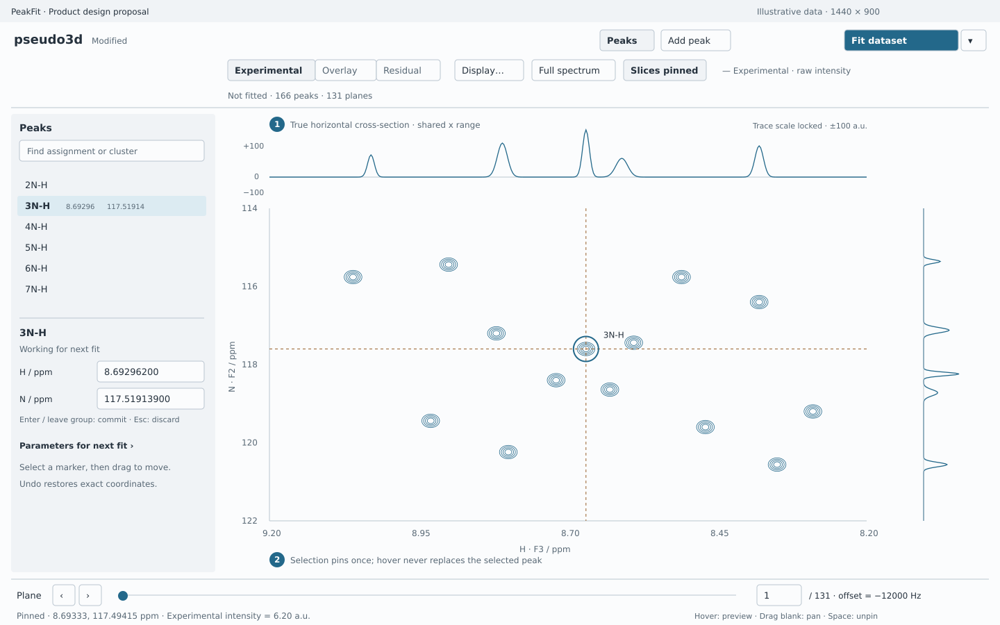
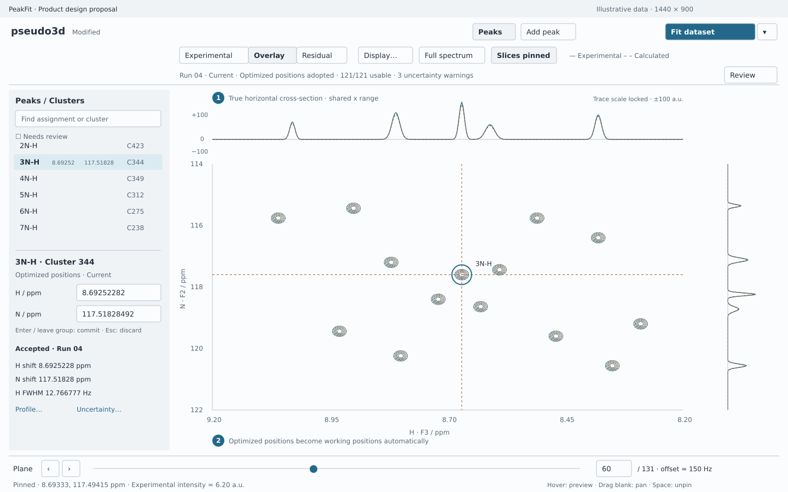
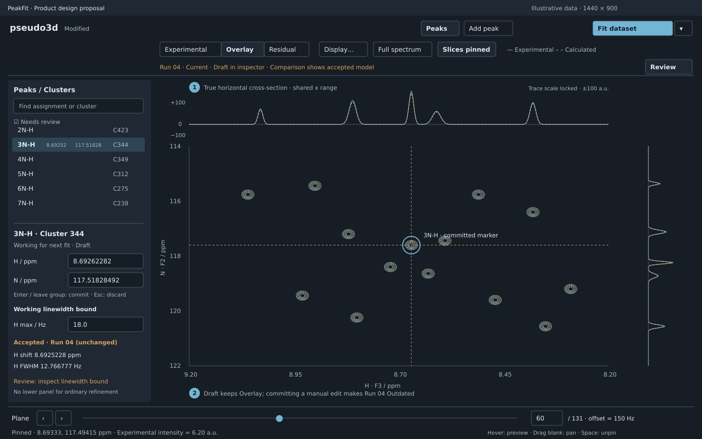

# PeakFit GUI Design Specification v2.0

**Status:** approved production design baseline; implementation proceeds in complete
vertical slices. **Date:** 29 October 2026.
**Focused revision (30 October 2026):** lightweight analysis persistence with
verified external spectral sources, explicit evidence retention and capability-checked
reopening. Compact refinement and automatic fitted-position adoption remain in force.

**Technology decision:** PySide6 + Qt Widgets + PyQtGraph, accepted by the project
owner after hands-on evaluation. Framework selection is closed. React supplies the
visual and compositional reference; the improved Qt trial supplies the interaction
and scientific-rendering reference. This document specifies the target application,
not a claim that these workflows are already implemented.

## 1. Product direction and evidence

PeakFit is one scientific workspace: **open → inspect → edit → fit → review →
refine → quantify uncertainty → save/export**. The spectrum stays visible through
the workflow. There are no separate editing and results applications, dashboard,
wizard on every fit, or hidden changes of scientific scope.

The design follows the domain vocabulary in [CONTEXT.md](../CONTEXT.md).
An intensity profile means fitted peak amplitudes across the series dimension;
crosshair intensity and integrated volume are different quantities.

The reviewed evidence is:

- [Final Qt design challenge](https://github.com/gbouvignies/PeakFit/blob/ea98e5c7002bcf94ce5582aa051bea865820960a/experiments/gui-v2/reports/04-final-qt-design-challenge.md)
  and the final React [light overview](https://github.com/gbouvignies/PeakFit/blob/ea98e5c7002bcf94ce5582aa051bea865820960a/experiments/gui-v2/evidence/final-challenge/react-1280-light.jpg)
  and [dark inspector](https://github.com/gbouvignies/PeakFit/blob/ea98e5c7002bcf94ce5582aa051bea865820960a/experiments/gui-v2/evidence/final-challenge/react-1280-dark.jpg).
  Keep their quiet background, joined comparison selector, deliberate spacing,
  short labels and clear primary action. Do not copy their persistent Apply button.
- [Improved Qt interaction trial](https://github.com/gbouvignies/PeakFit/blob/ea98e5c7002bcf94ce5582aa051bea865820960a/experiments/gui-v2/reports/05-qt-interaction-trial.md),
  including commit `ea98e5c` and its interaction implementation in
  `experiments/gui-v2/qt_canvas.py`: separate hover/selection, continuous native
  slices, pinning, atomic movement, precise edits and Undo. Subsequent replay-harness
  corrections do not change the product interaction decision.
- [Current desktop guide](gui.md), [architecture](architecture.md),
  [whole-dataset validation](validation/gui-dataset-fit.md), and
  [completed scientific review contracts](gui-design.md). Existing whole-dataset
  fitting and canonical outputs are foundations, not disposable prototypes.

Concrete problems to resolve: production `gui.workspace.SpectrumWorkspace` puts
both slices in a side column and editing in a lower panel, separating peak browsing
from editing. The React rail groups them better. The Qt trial combines everything
in one experimental `Canvas`; neither prototype supplies complete persistence,
refinement or MCMC semantics. Production `gui.editing.PeakInspector` already has
the desired whole-group commit behavior. Preserve that behavior while changing its
placement. Preserve `CompletedFit`/`FinalFitOutcome` as scientific truth.

Historical reports retain their original conclusions and limitations. Their
statements that framework acceptance remained open are superseded by the owner's
decision above. Historical experiment links are immutable Git commit permalinks,
so integration into main does not depend on copying `experiments/`. Native revision
evidence lives with this document in [the compact-view record](validation/gui-v2-refinement.md).
No experiment is merged or copied wholesale into production.

## 2. Permanent workspace

**Recommend one collapsible left rail containing peak/cluster navigation and the
selected-peak inspector.** Reading an assignment, choosing a peak and editing its
coordinates is one task. Keeping those controls together avoids a second side
panel and leaves the right edge available for the vertical spectral cross-section.
This also follows the preferred React composition. A right inspector would push
that cross-section away from its axis or compete with it for width. Handedness
does not justify a user preference or freely dockable layout system here.

The rail is open for a newly opened analysis with peaks, closed for spectrum-only
inspection, and subsequently remembers the user's choice. Selection updates its
contents without opening it. A visible **Peaks** toggle restores it. At initial
launch on a small screen it may start closed; later resizing never changes the
user's panel choices.

| Area | Permanent responsibility |
| --- | --- |
| Header | Analysis/dataset name, saved/modified state, Peaks toggle, Add peak, primary **Fit dataset** action and adjacent settings chevron. File/Edit/View/Analysis/Help commands live in normal menus. |
| Comparison strip | Joined **Experimental / Overlay / Residual** selector, **Display…**, **Full spectrum**, **Pin slices** state, short layer/unit legend. The selector stays in place when modes are unavailable, with an explanation. |
| Result line | One compact line: run identity/currentness, usable/total clusters, convergence and review-warning counts; **Review** reveals concise selected-cluster diagnostics in the rail. Before fitting: “Not fitted · 166 peaks · 131 planes”. During fitting this same line carries job progress and Cancel. |
| Left rail | Search and peak list; after fitting, a **Peaks / Clusters** switch and Needs review filter. Below the list: selected identity, working coordinate editor, concise accepted-result comparison. Independent scrolling preserves useful list space. |
| Spectral area | Dominant 2D spectrum, horizontal cross-section directly above it, vertical cross-section directly to its right. Their frequency axes align exactly with the 2D viewport. |
| Plane strip | Previous/next, slider, exact one-based plane field, count and experiment-specific plane value/unit. A 2D dataset shows “Single plane”; no inactive slider. |
| Status line | Preview/Pinned, sampled coordinates, raw intensity or residual with units, short contextual gesture hint. Long failures remain available in run details, not a disappearing toast. |

The upper trace is a row at the sampled vertical coordinate; the right trace is a
column at the sampled horizontal coordinate. Neither is a projection or sum.
Plot tick labels use the loaded axis/nucleus names, not hard-coded H/N/F2/F3.

### Contextual surfaces

- **Peak inspector:** always the selected working peak, never the hovered peak.
  Name and unfolded ppm coordinates form one edit group. An expandable Parameters
  section gives working starts, bounds and fixed/vary flags. Accepted values are
  read-only, explicitly labeled by run, with value, unit and uncertainty status.
  No selection shows a short instruction, not empty input fields.
- **Concise review stays in the rail:** cluster members, convergence/usability,
  one or two warning lines and working parameters sit beside the selected peak.
  A pinned warning summary remains visible while longer inspector content scrolls.
  Normal refinement opens no lower panel. Navigation retains at least four visible
  rows; coordinates and parameter groups scroll independently of that list.
- **Lower analysis panel:** starts closed and opens explicitly for Profiles,
  Uncertainty plots, wide parameter/correlation tables or run History/provenance.
  It is primarily a plot/wide-information surface, not a permanent diagnostic text
  area. Background work never opens/resizes it. Closing it restores spectrum space.
- **Fit dataset dialog:** a short-lived review of the actual scientific problem,
  with advanced settings disclosed below essentials. It opens for initial setup or
  explicit Settings; repeating a reviewed fit does not reopen it.
- **Display popover:** display contour threshold/spacing/count, labels, exact fitting
  samples, appearance/accessibility stroke weight. It never contains fit settings.
- **Open/import and export dialogs:** native file selection followed by compact
  validation or export choices. Errors identify the file, row/axis and remedy.

Use ordinary splitters and layouts. Do not add detachable docks, a ribbon, separate
permanent toolbars for each plot, or an extensible panel framework.

## 3. Representative application states

The accompanying annotated compositions use illustrative signals and values;
they are design drawings, not new fit evidence or production screenshots.

### A. Before fitting: inspect and establish the peak list

The left rail exposes useful peak controls immediately. Only Experimental is
available. A selected peak pins the slices; a user can resume preview without
losing that selection. No empty result table or cluster list reserves space.

### B. After fitting: compare first, investigate on demand

Successful completion selects Overlay and automatically shows optimized positions
in the markers, list and inspector. It preserves viewport, selection and panel
visibility; a selected-peak pin follows the optimized peak once, while a free
inspection pin stays fixed. The total model includes every usable cluster.
The rail can switch to clusters, show warnings and guide review. Selecting a
cluster highlights its members and exact recorded samples; it does not isolate
its model or automatically zoom. **Frame cluster** is an explicit action.

### C. Refinement: visible working changes and retained evidence

The revised drawing keeps the full-height spectrum and puts concise diagnostics,
working parameters and warnings in the left rail. An **uncommitted** coordinate or
parameter draft leaves the valid current Overlay/Residual visible, labeled as
accepted evidence; no provisional model is calculated. A committed manual edit
makes that run Outdated and switches the live spectral views to Experimental.
The lower panel stays closed through ordinary inspection, editing and refitting.

At 1280×800, use a 300–320 px rail (320 px in the native check), about 96 px upper
trace and 115 px right trace. The native Cocoa check had a 1280×772 client area and
an approximately **740×478 px 2D plotting rectangle**, with coordinate/linewidth
fields and the selected overlap cluster's real uncertainty warning visible.
See the [native refinement view](validation/gui-v2-refinement/native-refinement.webp)
and [validation scope](validation/gui-v2-refinement.md). This validates density,
not an implemented full application: the fit action is an explanatory stub, with
fixture replay a separate probe command. Save, MCMC and real refit integration
remain release gates.

At 1440×900, give extra space to the spectrum rather than enlarging text panels.
A lower plot panel normally opens at 220 px, never reducing the 2D plot below
350 px high at 1280×800. Below that size, show wide information in a separate
explicit window if needed rather than squeeze the spectrum into a strip. Target
minimum window 1040×720 with collapsible rail/details and at least 500×280 px of 2D
plot. Large fonts may require closing a panel. Later resizing preserves choices.

## 4. Scientific state and result lifecycle

| State | Meaning and visible behavior |
| --- | --- |
| Hover | Transient peak identity; halo and row wash. Never changes selection, editor contents, input revision or Undo history. |
| Slice preview | Sampled row/column follows pointer, or a hovered list peak; status says Preview. Does not select a peak. |
| Pinned sample | Explicit sampled location. Survives hover, mode and plane changes. Pin and selection are independent: selecting a peak pins once; moving the pinned sample afterward leaves that peak selected. |
| Selection | Stable peak ID, or run-local cluster identity with members. Owns inspector context. Selection is not a scientific edit. |
| Draft | Uncommitted text or drag position, visibly marked Draft. Keep the valid accepted comparison and committed marker visible. A drag uses a distinct ghost marker; a text draft does not move the marker. No scientific revision or model recomputation until commit; Escape removes the draft without display transitions. |
| Working inputs | Committed peaks, model settings, bounds/freedom, source data and plane mapping used for the next fit. Undoable edits; separate from results. |
| Accepted result | Atomically published completed run with exact submitted input snapshot and a recorded fit-derived working state. Optimized working positions and accepted result arrive together, Current. No Apply/transfer/accept step. Acceptance means retained evidence, not scientific endorsement. |
| Outdated result | Working scientific inputs changed after that run. Preserve its numerical inspection, provenance, warnings and export. Disable live Overlay/Residual and sampling from the working workspace. |

Saving a project is independent of fitting: **Modified** means unsaved analysis;
**Outdated** means working state no longer matches the verified run-derived state.
Show both when applicable. Exporting results does not mark the analysis saved.
Plot navigation and panel changes never
mark a result outdated. Display preferences can be saved without being scientific
edits. Assignment renaming conservatively marks results outdated too: names can
participate in parameter constraints. Stable IDs preserve original run labels and
prevent duplicate names from becoming identity collisions.

### Atomic completion and automatic optimized positions

A successful whole-dataset completion is one transaction:

1. Preserve the exact submitted source fingerprints, ordered planes, stable-ID
   mapping, **initial unfolded positions**, settings, initial bounds/masks and
   immutable completed outcome. This is the problem actually solved.
2. Validate usable finite final chemical shifts against the recorded axis descriptors
   and stable-ID mapping. Prepare a complete post-fit working snapshot: replace each
   eligible peak's **pair** of unfolded positions with its optimized pair; derive
   displayed aliases using the existing spectral conversion. Never shift by a
   rounded display delta or create/remove/reidentify a peak.
3. Publish accepted outcome, post-fit working positions and their provenance mapping
   atomically. Spectrum markers, peak-list coordinate columns and inspector update
   in the same UI delivery. The active result stays **Current**. The project becomes
   Modified until saved. Selection and viewport survive; a pin following the selected
   peak moves once to its new nearest native sample, while a free inspection pin stays.

A completed run may contain usable non-converged fits: adopt their valid positions
with the existing convergence warning. Unreliable uncertainty does not by itself
make a finite usable position ineligible; adopt it and retain the warning. A peak
with unusable/missing/non-finite/unmappable positions retains its prior pair and
gets a specific warning. Do not update only one axis. Fatal result/source/identity
validation failure publishes neither new positions nor a new active result.
Canceled or failed jobs leave all working positions and the previous result intact.
An all-unusable completed run changes no positions and offers no model comparison.

**Currentness is not raw equality with initial seeds.** Record both the execution
input revision `I` and its verified, run-owned completion transition `T_run(I)=W`.
The accepted run is Current only while sources, scientific settings, identities and
committed working values match that recorded `W`, and no subsequent manual
scientific revision has invalidated it. The only automatic difference allowed by
`T_run` is the validated fitted-coordinate replacement above. Bounds, masks,
cluster membership and corrections in the accepted record remain those actually
used; the transition never recertifies them as prepared for a new fit.

Subsequent fitting starts from these current optimized coordinates and prepares
**fresh clusters, masks and valid bounds**. It must not reuse preparation made for
initial positions. Shape starts/settings remain explicit working settings; this
revision introduces no hidden transfer of linewidths or other fitted parameters.
No “Use fitted positions/values as starts” command is needed for ordinary positions.

Manual edits, including moving an optimized position, invalidate comparison and
remain undoable. Undo restores exact working values but does not recertify the
old run. Automatic adoption is not an ordinary Undo entry that silently restores
pre-fit positions under a Current label. History provides **Restore working state
from this run…** for deliberate restoration: it restores the recorded post-fit
state with sources/settings verified, resets any incompatible edit history, and
records the restoration. Exact pre-fit positions remain inspectable/exportable;
restoring them as working seeds is an explicit manual change and makes the fit
Outdated. Reopening restores these relationships, never infers them from rounded values.

### Repeated fitting and bounded history

Keep **one active full result resident**, one running job and a bounded display
cache (initial budget 256 MiB; excluding raw source/active scientific arrays).
Older results load on demand, not into an accumulating in-memory list. The memory
bound scales with one dataset/result, not the number of attempts. Page the history
list rather than instantiate every row/payload.

Every attempt has a compact project journal entry: run/parent identity, timestamp,
settings, exact initial/final coordinate snapshots and final nonlinear parameter/
error tables, status (completed/canceled/failed), concise diagnostics/statistics,
and available evidence level. Completed
full payloads are written to project storage or a recoverable temporary session
store before older resident data are released. Saving moves/copies that journal
and retained payloads into the analysis project; linked spectra remain external.
Temporary recovery is not presented as a saved analysis.

Retain full numerical/reconstruction payloads for the **latest ten completed runs**
by default, subject to a **1 GiB historical-payload budget**; the active run is
always retained, even if it alone exceeds that budget. Older unmarked runs become
**Summary only**: keep their compact journal/coordinates/parameter tables/settings/statistics, remove
historical sample/model payloads, and show that loss of capabilities explicitly.
MCMC evidence follows the protected retention policy in Section 10.
A deliberate **Keep full evidence** flag exempts a named run from automatic pruning
and shows its disk cost. This is a history detail action, not a pre-fit prompt.
Never delete separately exported evidence. Reuse immutable unchanged project
payloads across runs/generations; reference external spectra without copying them.
Do not store full calculated spectra or persistent display caches. The 1 GiB budget
counts historical numerical payloads, including chains, but excludes the active run
and Keep full evidence runs from eviction. It is not a total project-size ceiling:
show active, historical and protected bytes separately and warn when protected
evidence exceeds the budget. Saving never silently downsamples or prunes evidence
to meet a size target.

No Save/Discard/Cancel interruption occurs on the third or any routine later fit.
History shows the retention policy and each run's Full / Summary-only / Pinned
status. Pruning happens only after successful publication, not on starting a
replacement; crash/cancel retains the old active result. Actual disk-full/write
failure is actionable and blocks further evidence eviction rather than silently
losing the sole result. Closing unsaved work retains the normal save guard.

## 5. Interaction and navigation contract

| Input | Action |
| --- | --- |
| Move over spectrum | Continuous sampled slice preview while unpinned; peak hover feedback independently of pin state. |
| Hover list row | Highlight corresponding marker; preview slices at that peak only when unpinned. No selection or scrolling of the list. Clear feedback on leave. |
| Click blank spectrum | Pin sampled crosshair; retain selection. Dragging from blank space pans and must not create a pin on release. |
| Click marker/list row | Select stable peak and pin nearest native sample to its working position. Reveal an offscreen peak with minimum pan, preserving zoom. Keyboard row navigation does the same. |
| Drag already-selected marker | Preview free continuous ppm movement with a ghost marker and Draft label; keep accepted comparison, update nearest native slices; release commits one edit and marks results Outdated. Escape or window deactivation restores the exact pre-drag position/pin. Unselected-marker drag pans. |
| Drag pinned crosshair | Move sampled inspection position; no peak edit. Unpinned crosshair cannot capture pan gestures. Peak handle takes precedence when coincident. |
| Wheel / trackpad | Zoom about pointer; continuous wheel input coalesces to latest view. Do not also change a focused numeric field under the pointer. |
| Full spectrum | Reset ppm ranges only; retain plane, selection and pin. No ambiguous “Reset” that restores scientific inputs. |
| Pin slices / canvas Space | Toggle preview/pinned. Resuming preview keeps selection and editor contents. Space in text inputs remains ordinary input. |
| Add peak / canvas A | One-shot placement cursor; next click places a working peak with a unique placeholder name and selects it. Escape cancels without history. No automatic peak picking. |
| Delete/Backspace in canvas/list | Delete selected peak, one undo entry, no routine confirmation; text fields keep normal text deletion. Multi-selection for deletion is list-only with native modifier keys and a visible count. |
| Double-click marker or Enter in list | Focus coordinate editor, opening the rail explicitly if needed. |

Picking uses a consistent logical-pixel tolerance across hover, click and drag,
tested at multiple device pixel ratios. Coincident peaks present one small anchored
chooser with assignment, coordinates and cluster; arrows/Enter choose, Escape
closes. Prefer this over repeated-click cycling: the complete choice is visible
and accessible. An overlap cluster is not a single peak and receives no editable
centroid. Hovering a cluster highlights its members, with no arbitrary slice choice.

Navigation preserves ppm orientation (normally descending), axis calibration and
folding. Working coordinates remain unfolded; indirect-axis aliases use the
existing scientific conversion, direct positions never wrap. Selected/hover labels
show folded and unfolded coordinates when different. Peak placement and dragging
are not snapped to sample centers; only the inspection crosshair is snapped.
Cross-sections follow the visible frequency ranges and have no independent pan.

Plane navigation preserves original acquisition order, including equal or unordered
plane values. The exact index is always visible. No values file means “Plane 1 of
131 · no plane values”, not invented physical units. Selection of a profile point
returns to its original plane. Plane changes keep ppm ranges and pinned row/column.

### Precise edits without Apply

Enter or leaving the complete editing group commits all valid changes together.
Tab/Shift+Tab inside it retains the draft. Escape discards the whole group. Clicking
another peak, hiding the rail, saving/exporting or fitting first resolves the draft.
A valid no-op creates no Undo entry and no scientific revision. Valid/invalid drafts
do not hide an otherwise current comparison; a small Draft label identifies that
the editor differs from the displayed accepted model. Escape leaves mode/scale
unchanged. Commit is the single point where comparison becomes Outdated.

Invalid input remains visible with a short inline error and the offending field
identified. Do not partly commit it or silently replace it with the previous value.
Actions requiring committed inputs stop with “Correct this value or press Escape”.
Spectrum/plane navigation and cancellation remain available; no focus trap.
Menus, popovers and loss of application focus are not accidental group exits.
Deletion explicitly discards that peak's draft, then deletes its committed record.

Store float64 values without display rounding. Unchanged fields retain their exact
value; no-op focus/formatting never changes science. Coordinate fields display
eight decimal places by default and reveal full round-trip precision on focus/copy.
Accept scientific notation and either an unambiguous local decimal separator or
dot; do not accept thousands separators or ambiguous mixed punctuation. Exports
use canonical round-trip dot-decimal values. Reject non-finite numbers. Show ppm,
Hz, degrees and dimensionless units as appropriate. Bounds and fixed/vary state are
explicit; FWHM is not silently interpreted as sigma or an apodized apparent width.

### Small command set and keyboard access

Menus expose Open dataset, Open analysis, Import peaks/plane values, Save analysis,
Save as, Export, Undo/Redo, Add/Delete peak, Fit dataset, Review/Profile/Uncertainty,
Full spectrum and display preferences. Context menus are shortcuts to these same
commands, not separate features. Show precise Undo names such as “Undo move 3N-H”.

Use platform-standard Cmd on macOS and Ctrl on Linux for Open, Save, Undo and
Redo (Cmd+Shift+Z / Ctrl+Shift+Z; Ctrl+Y also works on Linux). Fit uses
Cmd/Ctrl+Return; Full spectrum Cmd/Ctrl+0; assignment search Cmd/Ctrl+F.
Ctrl+Page Up/Down changes plane on both platforms; visible previous/next buttons
remain available on keyboards without those keys. Arrow keys in lists navigate;
canvas arrows move the pinned sample one point; explicit axis/range fields in
View support navigation without a pointing device. Escape acts on the current
draft/gesture/dialog, never silently cancels a numerical job.

Every visible command is keyboard reachable; focus order follows header → rail →
plots → open details → plane strip. Labels have buddies; the comparison selector
is one accessible choice group. Provide a keyboard-shortcuts help sheet. Plot
accessibility exposes sampled values, selected identity and numerical tables;
screen-reader access must not depend on reading contour geometry.

## 6. Opening real data and managing assignments

The empty window offers **Open dataset…** and **Open analysis…**, with a short
recent list. Opening a dataset accepts an optional peak list and plane-values file
in the same compact form, while allowing later import. Initial supported spectra
are the existing 2D/pseudo-3D NMRPipe inputs; do not claim arbitrary nD import.
Readers remain the authority for supported peak formats. A preview shows shape,
axis names/units, plane count and sample assignments before replacement commits.

Validate dimensions, axis metadata, finite coordinates, plane-value count and row
parsing off the GUI thread. Explain unsupported formats, incomplete files and
ambiguous axis mappings before publishing a workspace. When peak axis order is
not established by file metadata, require an explicit mapping with preview; never
guess from the field names alone. A failed import leaves the existing analysis
intact. Large imports show cancellable progress; do not publish half-loaded data.

No peak list means inspection and manual placement are available, with Fit disabled
and an explanation. Automatic peak picking remains an experimental separate workflow.
Import peaks offers explicit Replace / Append after showing counts; Append allocates
new stable IDs. Duplicate assignments are allowed with a warning and disambiguating
coordinates/ID. Missing assignments receive unique editable placeholders. Renaming
never silently merges peaks. Working membership can change after moving/adding
peaks; accepted cluster IDs belong only to their original run.

The Peaks list searches assignment text and stable identity; the Clusters list
searches members and run-local cluster ID. Search/filtering never deletes data or
changes scientific scope. A selected item hidden by filtering remains identified
in the inspector with **Reveal in list**. Need-review navigation follows a stable
order with Previous/Next and count. A user review acknowledgement is separate from
numerical warnings; it cannot erase them or make an outdated run current.

## 7. Fit setup, execution and acceptance

**Fit dataset always fits the whole working dataset**, independent of selection,
viewport and display mode. First use opens Settings for scientific review. Thereafter
the main button (and Cmd/Ctrl+Return) repeats with the last reviewed settings,
committing valid inspector drafts and asynchronously preparing the current optimized
working positions afresh. The adjacent chevron offers Settings; no routine confirmation
dialog intervenes. New invalid bounds or newly omitted/ambiguous peaks stop with
an actionable review, rather than silently reusing old masks or excluding peaks.
The settings dialog reviews all peaks and every source plane;
v2 initially provides no plane exclusion workflow. Show resolved lineshapes per
axis (including processing-derived assumptions), statistical noise and its method,
clustering contour as both noise factor and absolute intensity, and optimizer
passes. Default to two passes, with cross-talk updates only between passes, as
in the current GUI. CLI defaults are unaffected.

Expanded Scientific settings exposes effective starts, units, bounds, fixed/vary
flags, position windows, solver, iteration limit and tolerance. Models requiring
phase/coupling parameters reveal those controls only when relevant. Imported
multi-step configurations show their actual ordered steps and effective schedule;
the simple pass field is replaced, not shown as a competing control. Supported
settings must round-trip through the engine configuration; never silently discard
unrepresented settings. Dialog settings are a draft until Run fit; Cancel discards
them without invalidating a current result. Run commits the reviewed settings and
starts that exact problem. Changing a draft setting invalidates preparation.

Before **Run fit**, asynchronously prepare the exact input snapshot, show cluster
and point counts, missing/excluded peaks with reasons, resolved models and bounds,
and errors/warnings. Repeated fits show this preparation summary in the result line
and continue automatically when valid; materially new omissions/ambiguities require
explicit review. No peak is silently omitted. Run remains disabled for invalid
inputs or obsolete preparation. The reviewed snapshot is the executed snapshot.
Statistical noise must be finite and positive; an override records its value and
source. Display-contour noise/threshold changes never alter clustering, samples,
statistical noise, starts, bounds or run readiness.

During fitting, keep pan/zoom, plane navigation and read-only inspection available.
Pause scientific edits, replacement and sampling, with a short reason. Show actual
stage/pass/cluster and elapsed time. Use determinate progress only when the engine
provides a denominator; correction/finalization stages may be indeterminate. Do not
invent ETA from cluster count. Cancel stays visible in the result line even with
details closed. Cancel requests stop and reaping; until acknowledged show Canceling.
No partial run becomes accepted. Crash/failure identifies the stage and preserves
the old analysis and full diagnostic log. Closing a running analysis offers
Keep running / Stop and close, then the usual unsaved-analysis choice.

The completed outcome and automatic optimized positions are published once, as
specified in §4; canceled or failed execution never adopts positions. Numerical usability, optimizer
convergence, uncertainty reliability and scientific validity remain separate.
Usable non-converged models may be displayed with warnings. Unusable clusters
remain navigable with reasons and no fabricated parameters. Some usable clusters
produce **Incomplete total model · X/Y usable**; no usable clusters means no model
comparison. “Complete” means all fitted clusters usable, not all observed signal
explained. Default Overlay only when there is an evaluable model.

## 8. Comparison and scientific review

One selector controls **all spectral views**, including crosshair-intensity profiles:

| Mode | 2D and aligned 1D behavior |
| --- | --- |
| Experimental | Signed original data; no fitted contribution. |
| Overlay (default after fit) | Experimental plus sum of every usable accepted cluster, common contour levels and common trace units/scales. Selection never changes this sum. |
| Residual | Native experimental data minus that same total model, displayed as `(D − M) / σ_stat`. Signed residual contours by default in 2D and residual samples/traces in both slices. Crosshair profiles use the same difference and units. |

Observed/model layers differ by color and stroke pattern; sign also has a visible
encoding. The legend explicitly describes the combination: measured positive solid,
measured negative dashed; calculated positive dashed, calculated negative dotted.
Color still separates measured-negative from calculated-positive.

**Residual default: signed contours**, initially at ±3, ±5, ±8, ±13 and ±21 σ_stat,
positive ochre solid and negative blue dashed. Display can lower/widen those levels;
they are distinct from experimental contours and scientific clustering thresholds.
The legend always states the first level: absence of a contour means below the
visible threshold, not zero residual. Do not draw zero/noise-level contour forests.
The [real-data comparison](validation/gui-v2-refinement.md) found contours clearer
for locating signed mismatch at overview and overlap scales on planes 1/60/131;
the raster made weak/correlated noise more visible but obscured sparse structure.
This is a design assessment of that dataset, not a universal statistical result.

A contextual **Display → Residual rendering → Raster** remains available for
noise-field inspection, with an explicit blue/neutral/ochre −3/0/+3 σ scale and
saturation indicators. No extra permanent control. Both renderings use the same
native total residual; no smoothing, denoising or sample interpolation. Contour
geometry interpolates crossings, not observations. Missing samples stay absent.

### Stable signed 1D scale

Use a symmetric signed range `[-S,+S]`, a visible zero and labeled values/units.
Measured and calculated traces use the **same range**, as do the horizontal and
vertical amplitude axes; no independent normalization. Before fit use original
intensity units; after fit keep those units unless σ_stat display is explicitly
selected and labeled. Converting units converts S without changing visual gain.

At load, obtain a rounded-up dataset-wide maximum absolute experimental intensity
off Qt and set S with a modest margin. When a new accepted model first exceeds
that range, expand once to accommodate it, with a visible scale update; never shrink
on completion. Keep S fixed through continuous hover, list navigation, pan/zoom and
plane changes. A user can explicitly **Fit current traces** or enter S through
Display/context menu to inspect weak peaks; this resets the range once, then locks
it again. Model/observed extrema are considered together. No per-pointer or per-plane
rescaling. Residual has a separate persistent range, initially ±8 σ_stat, also locked.

Clipped positive/negative samples receive edge indicators and exact values on
inspection; no silent clipping or automatic pumping. Preserve each mode's range
when switching away and back. Slice updates extract only native row/column data;
full-plane/dataset extrema are not rescanned on hover. Native residual values and
accepted projection remain unchanged. Exact fitting masks remain optional/off by
default and are not residual support. Model tails remain visible without silent cutoffs.

**Recorded optimizer residual** is separately labeled in cluster Review:
`D_cluster − terminal_neighbor_corrections − cluster_model`. It can differ from
the whole-spectrum difference because terminal corrections need not equal final
neighbor models. Its statistics never come from the display raster. No local-fit
residual is presented as a total-model residual. Details show sample counts,
parameter freedom, noise, termination reason, bounds, analytical errors and
uncertainty warnings. Unavailable values say Unavailable with a reason, never zero.

Needs review includes engine-reported failures/non-convergence, unusable outcomes,
unreliable uncertainties and parameters at bounds. Numerical thresholds and their
definitions are inspectable and versioned; no invented universal “fit score”.
Recorded residual statistics may guide ordering but cannot prove absence of
structured residuals. The user can flag suspicious residual structure/assignments
and add a short note. Acknowledgement records review without hiding the evidence.

On a plane/mode/revision change, remove mismatched calculated/residual graphics
immediately. Show the experimental plane as an explicitly labeled temporary
fallback (“Residual requested · preparing plane 60”), never under a misleading
Residual label. Coordinate-matched calculated slices may arrive before the model
plane, but each pending view is labeled and never reuses another plane's values.
Only the latest valid request is installed. The mode, zoom and pin survive work.

## 9. Refinement and intensity profiles

Review a flagged cluster → frame it explicitly → inspect residual and parameters →
edit a draft while comparing accepted evidence → commit → **Fit dataset** → see
optimized positions and review the new run. Concise diagnostics stay in the rail;
wide tables/plots open below only on request.
The inspector labels **Working for next fit** and **Accepted · run …**. It shows
differences without pretending that typed linewidths have already been fitted.
Changing a model rebuilds its applicable working fields, with a preview of removed
settings; incompatible bounds are errors rather than silently adjusted guesses.

Whole-dataset refitting is the single production refinement command in v2. Cluster
selection supplies focus, not scope. An isolated cluster optimization cannot
silently replace part of the accepted dataset, because cross-talk and global
completion must remain coherent. The existing isolated Local fit workflow is
retired from the primary v2 UI; its exports remain readable as explicitly local
numerical evidence. A future local-trial feature needs a separate reviewed contract.

Profiles provides an explicit quantity choice:

- **Crosshair intensity:** native observations and matching total model, or total
  residual in Residual mode. Header gives sampled location and units.
- **Peak amplitude:** signed accepted amplitude per original plane with its
  uncertainty availability. Header gives assignment, stable ID and run identity.
  This is a parameter profile, so the spectral comparison selector does not
  transform it into “residual amplitudes”; the quantity label remains visible.

Points remain unconnected by default; repeated/unordered plane values remain
distinct selectable observations. Preserve source index in tooltips and tables.
No response law, normalization, integration or interpolation is implied. A
parameter profile from an outdated run stays read-only and explicitly labeled;
a crosshair/model profile is disabled when the model comparison is outdated.
Analytical and MCMC intervals have separate names and explanations; they are not
interchanged automatically.

## 10. MCMC uncertainty workflow

From a usable current result, **Uncertainty…** opens the lower panel. Default scope
is the selected peak's whole overlap cluster; no selection requires an explicit
choice of cluster(s) or All fitted clusters. Display all included members. Sampling
is post-fit analysis of a named parent run, not a replacement optimizer or a way
to repair invalid data. Unusable clusters cannot be sampled; non-convergence or
identifiability warnings remain prominent and are not cleared by running MCMC.

Review resolved parameter freedom/bounds, likelihood, priors/noise, exact sampled inputs
and terminal correction context before Run. Show walkers, steps, burn-in policy,
seed and worker limit with validated defaults from the scientific implementation;
never hard-code scientifically impossible walker counts. Explain whether sampled
amplitude intervals include nonlinear uncertainty or are conditional. If the
executor cannot establish that meaning, mark that quantity unavailable.

Use the existing numerical sampling workflow through a validated request, off Qt.
One numerical job at a time. Navigation remains available; scientific editing is
paused during sampling. Progress reports real sampling steps; Cancel retains the
parent fit. Partial chains, if retained, are labeled Incomplete and cannot produce
apparently final intervals. No automatic acceptance from completion alone.

Uncertainty shows trace plots, marginal distributions, correlations, interval
definition/level, effective sample size and diagnostic method/limitations. Report
R-hat only where its independent-chain assumptions and implementation are valid;
ensemble walkers must not be mislabeled independent chains. “Not assessed” is
preferable to invented confidence. Keep diagnostic warnings beside intervals.
Profiles may explicitly switch to available MCMC intervals, recording the method.

Sampling results bind to immutable parent run, cluster IDs, configuration, correction
context and source fingerprints. Refit does not relabel old chains as current.
Completed MCMC marks its parent **Keep full evidence** and exposes the storage cost,
so routine fit-history pruning cannot silently remove expensive uncertainty evidence.
Retain complete chains, sampling configuration, diagnostics and interval definitions
losslessly by default; do not silently thin, truncate or replace chains with summaries
on Save. Show their estimated and actual bytes separately from fit evidence. An
explicit removal of chains must warn which plots, interval recalculations or continuation
capabilities will be lost, preserve existing summaries/provenance, and mark the evidence
level accordingly. Retained incomplete chains are labeled and included in storage
accounting; they never imply a resumable sampler or final intervals.
Saved analyses must reconstruct and validate an executable sampling problem before
offering sampling; numerical review alone is insufficient. Arbitrary pickled
continuation objects are never loaded from a user-selected file.

## 11. Save, reopen and export

**Save analysis** creates a lightweight analysis directory with a `.peakfit`
suffix, referencing original spectral files externally. Saving must be fast and
space-efficient even for very large NMR datasets: neither first Save nor Save as
copies the original spectra. This is a project, distinct from canonical scientific
exports. Initially one analysis contains one dataset and peak list; switching
datasets replaces the analysis or opens another window. Multiple independent
projects may reference the same dataset; saving one never writes into the sources
or changes another project. No shared asset registry or managed source store is needed.

### Project contents and size

Save committed working peaks with stable IDs and unfolded positions, effective
settings/bounds/freedom, compact attempt journal, complete scientific results for
retained full/pinned runs, exact review payloads, provenance, review notes/state,
retained sampling chains/diagnostics and modest view state (plane, pin, selection,
ranges, panel sizes). Retention levels and budgets in Sections 4 and 10 apply both
in memory and on disk; Summary-only entries are explicitly labeled. Preserve
complete evidence for a retained full run rather than silently reducing precision
or dropping observations on Save.

Use a versioned JSON manifest with project-payload checksums and explicit shape,
dtype, axis, cluster/peak and ordered source-plane mappings. Completed quantities
remain authoritative in canonical `summary/fit.json` (currently 4.1.0); lossless
NPZ review arrays retain exact sampled indices, observations, analytical sample
model/residual evidence and terminal corrections. Preserve evaluable model/processing
descriptors, exact input snapshots and the verified post-fit working transition
without duplicating fitted parameters into another authority. Initial positions
belong to the run input; optimized positions belong to its outcome; working
positions are editable state linked by stable IDs. Chain payloads use the sampling
writer's supported lossless format. Numerical arrays load without pickle. See
[existing persistence evidence](gui-design.md#persistence-direction-and-compatibility).
The exact manifest schema remains an implementation deliverable.

Original full spectral arrays and full calculated spectra are not project payloads.
Reconstruct calculated views on demand from verified descriptors and results;
discard display caches. Exact fitted-sample evidence is essential scientific state,
even when substantial; it is not a reason to embed the full dataset. Store resolved
plane values/units and their ordered source-index mapping, plus small scientific
metadata required for review, so these do not depend on an external text file.
Imported peak-file paths remain provenance; committed peaks are stored in the project.
Show fit-evidence, history and MCMC storage costs and Save progress/cancellation.
Reuse unchanged immutable payloads within the project; routine Save must not
rewrite large unchanged review arrays or chains. Save as copies retained project
evidence as needed, preserving external source identities and rebasing relative paths.

### External source identity and verification

For every spectral source, record its original absolute path, a usable path relative
to the project directory where possible, source role/format, byte size, verification
time and a strong content fingerprint (SHA-256 with algorithm/version recorded).
For a multi-file dataset, fingerprint every required data/metadata file with an
ordered member manifest; a directory name alone is not an identity. Record scientific
metadata: dimensions/shape/dtype, axis order, nuclei/units/calibration, processing
and series/plane mapping. The fingerprint must identify the source actually loaded
and used by each run; never attach a later file's digest to an earlier result.
Keep run identities immutable and relink locations separate from those identities.

Compute fingerprints off Qt when establishing source identity, preferably while
reading the data. Confirm the files did not change during reading/hashing; a changed
source requires revalidation before publishing a verified identity. Cache digests
with file identity, size and modification metadata. Routine Save reuses verified
fingerprints and checks cheap metadata; it does not reread/hash large unchanged
sources. Metadata checks are change detection, not proof of content equality.
If changes are detected, preserve the saved run identity, mark the link unverified
and require content verification before further source-dependent work. Saving
retained evidence remains possible while sources are missing or unverified.

Reopen resolves recorded relative and absolute paths as candidates and verifies
content fingerprints and scientific metadata off Qt before enabling source-dependent
capabilities. A matching path, timestamp, filename or shape alone is insufficient.
Missing, moved, changed or unreadable sources offer **Relink source…**, explicit
candidate selection, verification progress/cancellation and a clear outcome.
A moved identical source can restore capabilities without refitting; a mismatched
replacement cannot inherit the old fit or silently rewrite its provenance. It must
be treated as changed scientific input for a new fit. Do not scan disks or substitute
similarly named files automatically. Canceled/failed verification leaves numerical
review available. Update link locations only after successful verification.

### Atomic publication

Save writes a new validated generation, flushes payloads and manifest durably,
and atomically switches the project manifest only when complete; interruption
leaves the last saved generation usable. Save as uses staging and final publication.
Do not remove payloads referenced by the last good generation before publication;
cleanup follows success. Never overwrite the sole good copy in place or mark Saved
before success. Disk-full/permission failures preserve the modified workspace with
an actionable error. External sources are read-only dependencies, outside the save
transaction; a completed Save does not guarantee their future availability. Closing
unsaved work offers Save analysis / Discard changes / Cancel. Undo history need not
survive reopening; committed working state and retained evidence must.

### Reopening capabilities

Reopening has **three explicit capability levels**, validated independently of
historical Current/Outdated state. A source-unavailable run must not appear as a
verified live comparison merely because its saved working state was Current.

1. **Numerical evidence:** validated retained values, errors, diagnostics, initial/
   fitted coordinates, settings, plane mappings, sampled observations/corrections,
   profiles and retained MCMC evidence are readable/exportable without sources.
   Show exactly which evidence is retained. A Summary-only attempt is a smaller
   subset; no amplitude profiles, chains or sample residuals are invented when pruned.
2. **Verified comparison:** verified linked sources plus supported axis/model/
   processing descriptors and accepted parameters/amplitudes reconstruct an evaluable
   model. Evaluate (never refit/solve amplitudes) at retained samples and compare to
   saved analytical values within declared scientific tolerances before enabling
   Overlay/Residual. Source checksum equality alone does not establish this capability.
   Without verified sources, disable live Experimental/Overlay/Residual, full-spectrum
   slices and figures requiring those sources. Retained sample plots remain explicitly
   labeled sample evidence, never presented as a reconstructed full spectrum.
3. **Validated numerical continuation:** a new fit requires verified spectral inputs
   and fresh preparation from working inputs. MCMC requires an executable exact parent
   problem: sampled observations/indices, terminal corrections, descriptors, bounds/
   freedom, noise, likelihood/priors and parent identities. Display reconstruction alone
   does not establish this capability. With a source unavailable, allow sampling only
   if the retained payload independently reconstructs and verifies that entire problem;
   otherwise disable it with a specific reason. Retained chains alone never guarantee
   sampler resumption. No continuation may invent missing evidence or substitute data.

Reopen performs validation off Qt without segmentation, default preparation,
optimization or amplitude solving; new-fit preparation is a separate action.
Preserve both initial positions and run-derived working state/currentness. If evidence
is valid but source/model reconstruction fails or a descriptor is unsupported, open
labeled **Numerical review only**, explain unavailable actions and offer relinking.
Corrupt project evidence must be reported as such, never repaired by silently
refitting. Unsupported manifest versions are rejected explicitly. Legacy local
results keep their local scope; missing capabilities never imply fabricated models.

**Export portable analysis** is an optional future, explicit operation, separate
from Save analysis, Save as and scientific Export. It would embed verified original
source data with retained project evidence, show estimated size/copy progress and
support cancellation/atomic publication. It is not required for milestone 3 or GUI
v2 acceptance. Standard projects remain linked; users moving one must also make
its external sources available or relink them. Portability must never be achieved
by silently copying sources during Save.

**Export…** separates Working peaks, Accepted fit results, Profiles/tables,
Uncertainty diagnostics/chains and Figure. Canonical JSON/CSV retains existing
schemas and units. Existing fitted-coordinate fields keep their meaning. Add a
versioned companion/table keyed by run/peak ID for `initial_unfolded_ppm`,
`fitted_unfolded_ppm` and adoption status/reason; Working peaks exports current
optimized/manual coordinates and identifies them as working positions. Never
relabel fitted coordinates as original inputs. Scope, run identity and current/outdated status accompany exports;
outdated export explicitly refers to original run inputs. Numerical-only projects
can export retained evidence without claiming graphical reconstruction. Figures
include axes, units, plane and layer legend; export omits hover/selection ornaments
by default and states whether it uses experimental, overlay or residual data.
Exports never rewrite raw spectra. Saving/reopening a complete analysis is a release
criterion, not an optional add-on after GUI v2 is declared complete.

## 12. Restrained visual system

Use Qt layouts, standard inputs and a shared small palette/spacing vocabulary.
Use Fusion for predictable cross-platform control metrics, QPalette for appearance,
and limited scoped QSS for consistent selected/hover/focus states. Keep native menus,
dialogs and standard shortcuts; no custom title bar or scientific canvas renderer.

| Element | Design rule |
| --- | --- |
| Typography | System UI family; 13 px equivalent body/controls, 12 px plot labels/secondary text, 16 px dataset title; respect system font scaling. Semibold for selected identity/section heading only. Tabular numerals in numeric fields/tables. Never reduce labels to fit. |
| Rhythm | 4/8/12/16/24 logical-pixel spacing; 12–16 px panel padding, 8 px field gaps, roughly 30–32 px controls and 28–32 px rows at default scale. |
| Surfaces | One quiet workspace background, one subtle rail/detail surface, thin dividers, 4 px control corners. Avoid nested cards, gradients, shadows and boxes around every value. |
| Hierarchy | One filled blue Fit action; secondary commands outlined or text-with-icon. Destructive actions contextual. Text labels for essential commands; tooltips supplement them. |
| Light palette | Background `#FBFCFD`, surface `#F0F3F6`, text `#25313D`, secondary `#586875`, border `#BAC5D0`, accent `#23688A`. |
| Dark palette | Background `#171D24`, surface `#202833`, text `#E1E7EE`, secondary `#AAB7C4`, border `#4B5B6C`, accent `#73B5D5`. |
| Scientific layers | Measured blue, calculated ochre; both signs patterned as specified above. Preview light blue dotted crosshair, pinned amber dashed crosshair. Hover halo thin; selected ring stronger and persistent. Editing adds a distinct handle and text. |
| State | Neutral Pending; amber Outdated/Warning; red Failed/Invalid. Always include text/icon, not color alone. Current means verified run-derived state match, never “scientifically correct”. |
| Focus/contrast | Persistent keyboard focus outline, distinct from selection; normal text ≥4.5:1 and essential graphics/control boundaries ≥3:1 against adjacent background. Validate actual rendered palettes, including disabled explanations and residual scale. |

The border tokens are decorative dividers. Essential input boundaries and selected
controls use stronger secondary/accent colors where required to meet contrast;
the illustrative layouts are composition references, not contrast certification.

Fine antialiased contours use the proven one-physical-pixel setting as the initial
default; traces/selection/focus remain stronger. Provide an accessible heavier
stroke preference and validate its cost separately. If fine lines are unreadable
on a tested display, readability takes priority: profile/revise rendering before
claiming acceptance. Theme changes preserve data, numerical values, viewport,
selection and caches' scientific identity. Default appearance follows the system;
View offers System / Light / Dark rather than a permanent theme button.

macOS gets the application menu and standard file dialogs; Linux keeps a conventional
window menu and the same content hierarchy. Verify both X11 and Wayland where
supported, 1×/2× and fractional scaling, keyboard-only operation, long assignments,
large fonts and light/dark. Screenshots from one macOS machine do not establish
Linux or accessibility acceptance.

## 13. Acceptance criteria

These are release gates for the implemented slices, not measurements claimed by
this specification. Use the real bundled 131-plane/166-peak dataset and synthetic
fixtures with signed overlap, aliases, unusable clusters and repeated plane values.

| ID | Observable pass criterion |
| --- | --- |
| UX-1 | A scientist can open real data, locate an assignment, pin/unpin slices, edit/Undo, fit, inspect residuals, refine, sample, save, reopen and export using visible commands and short help. A moderated walkthrough requires no instruction on hidden gestures; any missed action becomes a concrete design issue before release. |
| UX-2 | Hover never selects or overwrites a draft; selection/list/marker agree; pin survives unrelated hover; canceled drags leave no history; a completed drag/group edit adds exactly one entry. Test real pointer/keyboard input as well as Qt events. |
| UX-3 | Before fit, after fit and refinement layouts remain readable at 1280×800 and near 1440×900, both appearances; minimum-window operation remains possible. No clipped numeric units, obscured Cancel, panel opening on delivery or lost viewport. |
| UX-4 | Keyboard can perform selection, exact coordinate and sample navigation, editing/cancel/Undo, fit/cancel, save and review. Screen-reader names/state and focus order are checked on both platforms; disabled actions explain why. |
| SCI-1 | Native row/column/plane values match source arrays exactly; cross-section frequency alignment error ≤1 logical pixel after resize/zoom. Repeated plane values retain distinct source indices. Alias round-trips and unchanged coordinate edits preserve original float64 values. |
| SCI-2 | Overlay/model values match the authoritative completed projector within an explicitly tested numerical tolerance; signs, all usable contributions and mask-independent tails survive every mode. No view performs an amplitude solve. Display controls leave prepared scientific inputs byte/value-equivalent. |
| SCI-3 | Total residual equals native `D − Σ usable M`, normalized only by retained statistical noise. Recorded corrected residuals/statistics stay unchanged. Mixed/all-unusable cases show incomplete/no model honestly. Pending views never show mismatched plane/run data. |
| SCI-4 | Drafts, including invalid text, preserve current comparison/mode/scale; Escape removes only the draft. Every committed manual scientific edit invalidates comparison. Undo alone never recertifies. Accepted arrays/parameters remain unchanged; cancellation publishes no partial outcome. |
| SCI-6 | Successful completion atomically adopts every usable valid fitted position by stable ID, preserves exact submitted seeds and result, and stays Current through the recorded completion transition. Mixed unusability retains prior position pairs with warnings. Test aliases, duplicate assignments, non-convergence, uncertainty warnings, malformed mappings, crash/cancel and no-op shifts. Next fit prepares fresh masks/clusters from optimized seeds. |
| UX-5 | Twenty place/fit/adjust/refit cycles require no Apply/transfer or third-run save prompt; routine repeated fits reuse reviewed settings. History remains navigable with explicit evidence levels and bounded memory/payload retention. |
| UX-6 | Hover ≥500 samples across strong/weak peaks, several planes and both signs: amplitude limits remain unchanged, measured/calculated axes agree, mode-specific scales restore exactly and clipping is explicit. |
| SCI-5 | Sampling uses the selected cluster's exact validated parent problem; cancellation, incomplete chains, unavailable intervals and diagnostic assumptions are visible. Analytical and MCMC uncertainty labels/exports retain their actual meanings. |
| SAVE-1 | Save → close → reopen preserves working values, exact review arrays, run-derived currentness, exact initial versus optimized coordinates, original plane identity and retained chains without refitting. Verify model reconstruction by evaluation separately from numerical-only reopening. Corrupt/missing inputs, disk-full, interrupted save and version mismatch have explicit tested outcomes. |
| SAVE-2 | First Save, routine Save and Save as contain no original full spectra, full calculated spectra or persistent display caches. Two independently saved projects reference the same verified dataset without copying or modifying it; Save as rebases usable relative paths and preserves fingerprints. Resolved plane metadata and working peaks reopen without their import files. |
| SAVE-3 | Reopen verifies source content and scientific metadata before enabling comparisons. Test relative-path relocation, absolute fallback, missing/unreadable sources, canceled verification, identical moved sources and changed content with unchanged size/timestamp. Explicit relinking accepts identical content; mismatched sources never inherit results. Source changes during initial read/hash cannot publish a verified identity. |
| SAVE-4 | With sources absent, retained numerical results, sample evidence, profiles, notes and chains remain inspectable/exportable at their recorded evidence level. Source-dependent views/new fits are disabled with reasons. MCMC requires independently verified complete parent evidence; test both sufficient and insufficient retained payloads without refitting or fabricated reconstruction. |
| SAVE-5 | Round-trip and retention tests preserve all full/pinned evidence losslessly, reuse unchanged payloads, and account separately for active/history/MCMC bytes. The ten-run/1 GiB policy never evicts active or protected MCMC evidence, including an oversized active run. Explicit chain removal records lost capabilities. Disk-full, permission failure and interruption before/during publication leave the last saved generation and its referenced payloads usable. |
| PERF-1 | On declared reference hardware, warmed preview and pan target p95 ≤16.7 ms, p99 ≤33 ms from delivered event to paint completion over ≥500 events. Report dropped/coalesced events and actual input rate; this is not input-to-photon latency. Preview issues zero contour extraction/model-plane jobs and no full marker rebuilds. |
| PERF-2 | Cached plane/mode changes target p95 ≤100 ms to a consistent displayed state. Uncached input is acknowledged ≤50 ms and pending state appears ≤100 ms; model preparation may take about 1–2 s on the existing fixture and stays off Qt. Latest request wins under rapid 40-plane navigation. |
| PERF-3 | While loading/projecting/fitting/sampling, target p95 event-loop heartbeat gap ≤33 ms and no unexplained >100 ms stall. Cancel acknowledges ≤100 ms, target worker termination/reaping ≤1 s. Record cold preparation/dialog/finalization costs too; do not omit outliers. |
| PERF-4 | Caches and run retention have measured bounds. Repeated hover and 100 plane round trips do not grow memory monotonically; record RSS/cache footprint, platform, DPR, dataset and cache policy. Larger data may compute longer but cannot silently reduce science to meet timings. |
| PERF-5 | On declared hardware, report first/routine Save and Save as duration, bytes read/written and project size with small and very large external datasets but fixed retained evidence. Instrument routine Save to require zero source-content hashing/copying and zero unchanged evidence/chain rewrites; storage and save I/O scale with project evidence, not source size. Measure initial fingerprinting and reopen/relink verification separately, off Qt with progress/cancellation. |

Existing evidence is a useful baseline, not proof of these gates: Qt native hover
p95 was about 9.8 ms over 21 events, whereas production uncached complete-plane
projection was about 1.35 s and some dialog/finalization heartbeats exceeded 300 ms.
Both need representative end-to-end testing. Synthetic Qt replay is not a native
input latency measurement. Native Linux Qt acceptance is still required.

## 14. Delivery sequence and intentional changes

Each slice includes native visual review, scientific tests, keyboard access and
updated user guidance. Reuse the existing readers, fit pipeline, outcome/projector,
writers and validated sampling code through direct calls. Keep Qt out of numerical
code. Introduce only seams required by the workflow; no generic job/panel/service
framework or prototype monolith transplant.

1. **Open → inspect → edit.** Build the permanent shell, left rail and aligned
   top/right slices on real inputs; preserve preview/pin/selection and precise
   atomic editing/Undo. Deliver a useful spectrum/peak editor with peak export.
   Rehome existing functionality rather than duplicating it. Gates UX-2/3/4, SCI-1.
2. **Fit → compare → export.** Integrate existing whole-dataset preparation,
   cancellation and immutable completion into that shell, including atomic automatic
   optimized positions and interruption-free repeat fitting. Deliver default Overlay,
   synchronized Residual, honest completeness and export. Gates SCI-2/3/4 and
   applicable performance checks. This replaces the old workspace without removing
   a working whole-dataset workflow prematurely.
3. **Save → reopen the same analysis.** Implement versioned manifest/payload writer
   and strict reader together, including external source references/fingerprints,
   verified relinking, atomic save, Outdated,
   journal/spooled history, capability-checked reopening and legacy numerical-only
   review. Gates SAVE-1–5 and PERF-5; chain-specific checks extend in slice 5.
   Establish durable work before expanding long-running analyses.
4. **Find poor fits → refine → refit.** Add cluster navigation, reasons, notes,
   working starts/bounds, rail diagnostics and Profiles. Deliver the
   complete correction loop with whole-dataset refit and saved scientific settings.
   Verify overlaps, changing membership and previous-run evidence.
5. **Sample → diagnose → save/export uncertainty.** Validate executable sampling
   requests from live and reopened results, integrate cancellable sampling and
   genuine diagnostics/intervals. Extend project round-trip tests to chains and
   uncertainty provenance. Gate SCI-5.
6. **Release acceptance.** Run the complete scientist walkthrough, native macOS and
   Linux matrix, large-font/resize/theme checks, persistence failures and declared
   performance protocol. Resolve usability blockers before calling this GUI v2.

Intentional UI changes: move ordinary peak editing to the left rail; align slices
above/right rather than stacking both on the right; replace separate editing/local
fit/profile entry points with one inspector and contextual lower panel; remove
persistent Apply controls and the routine Local fit command. Existing CLI/scientific
outputs and numerical algorithms remain compatible. Users migrate to Enter/focus
exit for edits, Fit dataset for fitting/refinement and Save analysis for reopening;
Export results retains its existing scientific purpose. This design supersedes
earlier layout/delivery proposals but preserves their completed scientific contracts.
Ordinary fitted coordinates now become working coordinates automatically, including
usable coordinates with uncertainty warnings. Original seeds remain run provenance;
the only Currentness exception is the recorded atomic completion transition, never
an exemption for later manual edits. Initial/fitted export distinctions are additive
companions, not changed meanings for existing canonical fitted-coordinate fields.

The approved architecture remains unchanged. This revision replaces the text-heavy
refinement panel, two-run interruption policy, draft-driven comparison hiding,
raster default, per-preview autoscaling and manual fitted-position transfer.
Standard Save now references external spectra instead of requiring embedded inputs;
there is no implemented v2 project format to migrate. Moving a project may require
moving its sources separately and verified relinking. Canonical exports stay compatible.

Remaining acceptance concerns are full production fit/save/MCMC integration,
retention/reconstruction failure paths, and native Linux/large-font accessibility;
they require implementation validation, not another framework or layout campaign.
