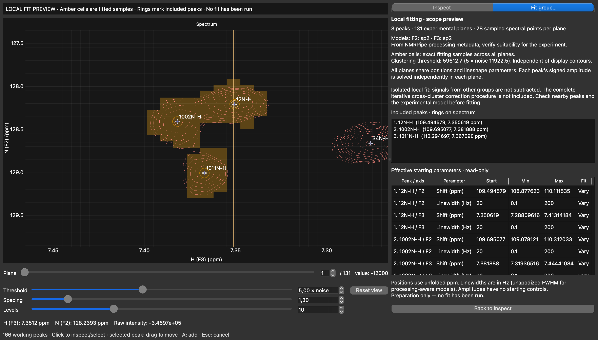
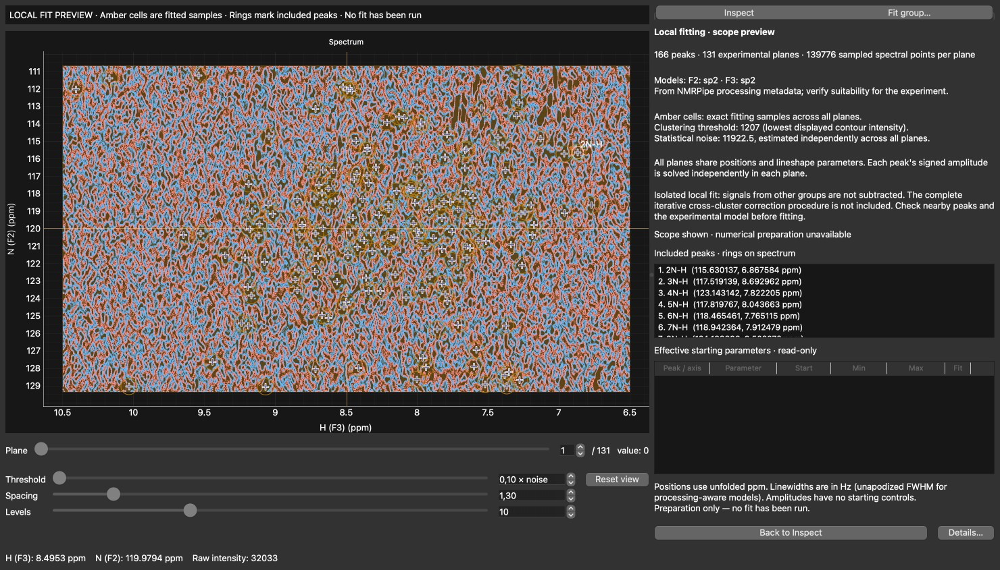
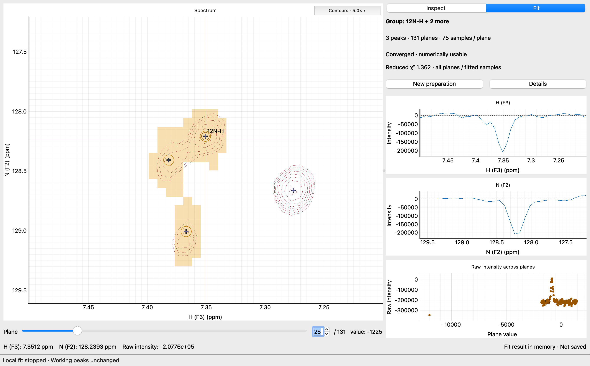

# Desktop spectrum viewer

Launch the desktop application with a 2D or pseudo-3D NMRPipe spectrum:

```bash
uv run peakfit gui examples/02-advanced-fitting/data/pseudo3d.ft2 \
  --peaks examples/02-advanced-fitting/data/pseudo3d.list \
  --z-values examples/02-advanced-fitting/data/b1_offsets.txt
```

Both options are optional. `uv run peakfit gui` opens an empty application window.
Use **File → Open spectrum** to open or replace the current spectrum, and the same
menu to load a peak list or plane values afterward. A missing peak list never
starts automatic peak picking. Other dimensionalities are rejected with an error.


Native macOS capture; [dark appearance](images/spectrum-viewer-dark.png) is also available.

## Navigation

- Drag the spectrum to pan; scroll to zoom about the pointer. **Reset view** or
  **Ctrl+0** restores the full spectral range.
- Click to place the crosshair, or drag either crosshair line. It snaps to sampled
  points so the two orthogonal traces and raw plane profile inspect the same data.
- Use the plane slider/spin box or **Ctrl+Page Up / Ctrl+Page Down**. Plane numbers start at
  1; the adjacent value is the experimental coordinate supplied by `--z-values`,
  or the original zero-based plane index when no values file is supplied.
- Use the sliders for visual adjustment of threshold, geometric spacing, and level
  count; adjacent spin boxes allow precise entries. The threshold slider is
  logarithmic (0.1–1000 × the first plane's estimated noise), with fine relative
  adjustments at low thresholds. Slider arrow keys make small changes; Page Up /
  Page Down make larger changes when a slider has focus. Blue solid contours are
  positive; red dashed contours are negative. Changes are briefly coalesced.
- Imported peaks appear as crosses. Hover to see a name and displayed coordinates;
  enable **View → Peak labels** for assignments. Indirect positions fold into the
  sampled window using PeakFit's coordinate conversions. Direct positions do not wrap.

Both right-hand traces follow the visible spectral ranges during zooming and
panning: the upper trace follows the horizontal (direct) axis, and the second
follows the vertical (indirect) axis. Both retain descending ppm orientation and
automatically scale intensity to the visible region. Navigate in the main spectrum;
the traces are inspection panels, with no independent pan/zoom. Both inspect the
crosshair position on the selected plane. The bottom panel shows
raw sampled intensity at the crosshair across all planes, not fitted amplitudes.
The larger point identifies the current plane. Points are deliberately not joined:
experimental coordinates may repeat or arrive out of order. Values have no assumed
physical units; their interpretation depends on the experiment.

Plot backgrounds and labels follow Qt's system palette, with contrasting contour,
trace, and crosshair colors for light and dark appearances. The horizontal splitter
lets you allocate space between the spectrum and inspection panels.

## Working peak coordinates

Click a marker to select its assignment. Coincident markers open a chooser. The
compact inspector edits the name and unfolded ppm coordinates together with Apply
or Enter; Escape restores the committed fields. Valid pending fields also apply
before selecting another peak, placing a new peak, dragging, or exporting. Invalid
fields remain visible with an actionable message. Delete removes the selected peak;
Edit → Undo/Redo restores working records without affecting spectrum navigation.
Peak-history Undo/Redo and peak deletion are unavailable while inspector text is
pending. Apply the text or press Escape to restore the committed fields first;
an inline hint explains this. Native text-field undo remains available.
Choose **Add peak…** (or A with spectrum focus), then click once to place a peak.
The instruction strip above the spectrum highlights **PLACING PEAK**, and the
same button becomes **Cancel placement**; click it or press Escape to cancel.
Inspector fields pause during placement and become editable again when it finishes.
The strip otherwise explains selection, navigation, or editing the selected peak.
Select a peak before dragging it: an open-hand cursor advertises movement. The ring and label preview the new position while the original cross
remains as a reference. Release commits one undoable move; Escape restores it.
Dragging an unselected marker pans. Peak coordinates retain fractional precision
and dragging preserves the original unfolded chemical-shift representation.

Imported shapes are discarded, and working peaks are not fitted results.

## Export and unsaved edits

**File → Export peaks…** (Command+S on macOS, Ctrl+S elsewhere) writes a canonical
PeakFit CSV (`name,F1_ppm,F2_ppm`) that can be loaded by the GUI or existing fitting
commands. Coordinates retain unfolded values and round-trip float precision;
quoted names, duplicate assignments, and names such as `001` and `NA` are preserved.
Exports contain names and coordinates, not internal identities, undo history,
plane values, or fitting configuration. Imported files are never changed implicitly.

The window's modified indicator and status bar identify unsaved edits, including
typed inspector fields. Opening another spectrum, replacing a peak list, and closing
the window offer Export/Discard/Cancel (the native dialog labels Export as Save).
Canceling export or encountering a write error keeps the working list. Undo/redo
continues across exports; returning to the saved coordinates clears the indicator.
Native text-field undo and deletion remain local to text; A and peak deletion
shortcuts require spectrum focus. Selection, zoom, crosshairs, and plane navigation
never enter peak history. Internal identities survive rename, move, and undo, but
are newly allocated on import; they are not scientific parameter identifiers.


[Drag preview with the original marker retained](images/peak-editing-drag.png).


## Compact contour controls

Plane navigation and the precise numerical **Threshold** remain visible below the
spectrum. **Contours…** opens an anchored popup containing the logarithmic threshold
slider, spacing slider/value, and level-count slider/value. Arrow keys adjust the
focused slider; Tab moves between controls; Escape or clicking outside closes the
popup. Changes update the display immediately through the existing debounced worker.
Opening it does not change plot geometry. Threshold uses first-plane noise for its
scale; it is not the independently estimated statistical fitting noise.

During preparation, threshold changes still update the exact group and sampled mask.
Once submitted, a fit retains its original scientific inputs: contour changes during
execution or result inspection affect display only. Spacing and level count always
affect display only.

## Local fitting scope preview

Select an existing peak, then choose **Fit** beside **Inspect** in the
right-hand workspace. A compact group header replaces the peak editor; the F3
trace, F2 trace, and raw intensity across planes stay in their original positions
through preparation, execution, and results. **Inspect** restores the editor.
**Details** explicitly replaces the plots with scrollable numerical inspection;
**Close details** or returning to Inspect restores the same plots and navigation.
The header reserves the same height in every state, and details never resize the
main spectrum. Valid pending peak fields apply before
preparation, following the existing editor convention; invalid fields keep the
editor visible. Preparation does not execute optimization or change peak coordinates.

PeakFit constructs fresh scientific peaks from a snapshot of **all working peaks**,
resolves the existing lineshape models from NMRPipe processing metadata, estimates
noise from **all planes**, and uses the regular clustering algorithm. Safe internal
names and an explicit ID/assignment mapping keep duplicate assignments distinct.
The selected peak identifies its connected cluster, including every other working
peak in that cluster. The region combines thresholded signal from any plane with
small neighborhoods around working peaks; it is not a rectangular crop.

Amber cells show the **actual sampled fitting mask**, aligned with the spectral
samples, and rings highlight all included peaks. The preview lists group members,
plane/sample counts, resolved axis models, noise and clustering threshold, and the
nonlinear starting values, bounds, units, and fixed/variable flags from the same
parameter preparation function used by the pipeline. Positions remain unfolded;
direct-axis coordinates outside the sampled extent are rejected instead of wrapped.
The clustering threshold is the **absolute intensity of the lowest displayed
contour**, shared with the viewer's Threshold control (whose scale uses first-plane
noise). The optimizer's statistical noise is estimated independently from all planes;
changing the contour threshold does not change that estimate. No model or parameter
editing controls are exposed yet. Programmatic local preparation
supports only global and axis/parameter-wide wildcard rules (`*`, `*.*.lw`,
`*.F2.cs`, and the same pattern forms in fit-step fix/vary rules). It rejects
`parameters.peaks`, name-targeted patterns, and `parameters.from_file` with an
actionable error: assignment names cannot safely target the generated scientific
IDs, especially with duplicate assignments. Use the CLI for those configurations;
CLI constraint handling is unchanged.

The local fit is **one isolated pass across every experimental plane**.
Positions and lineshape parameters are shared across planes; signed amplitudes are
solved independently per peak and plane, with no amplitude starting controls or
assumed response law. Models inferred from processing metadata need scientific
review; a successful preparation does not validate their suitability for the data.
Signals from other clusters are **not** subtracted, and the complete iterative
cross-cluster correction procedure is not included. Check surrounding peaks before
using a local fit; a missing peak or significant external signal needs attention.

Panning, zooming, and plane navigation remain available. Preparing or dismissing a
preview does not change committed peaks, undo history, source files, or spectrum
samples. Selecting another member keeps the same prepared group without recomputing it.
During scope review, selecting an outside peak or clearing selection dismisses the preview and returns
to Inspect. Peak edits, peak-list replacement, and plane-coordinate changes also
dismiss it. Snapshots retain working IDs/assignments, spectrum identity and shape,
spectral metadata, plane coordinates, the effective absolute clustering threshold,
and fitting configuration. They are preparation inputs, not completed results
or a persisted session.

Changing **Threshold** while the Fit workspace is open updates membership, mask,
member rings, and effective parameters. Rapid slider changes are coalesced after a
short pause (150 ms); the previous scope stays visible at reduced opacity, marked
as updating until the new exact scope is ready. Spacing, number of levels, and displayed plane affect
rendering only and never redefine the cluster. The all-plane noise estimate is
reused for the unchanged dataset. Returning to Inspect cancels any pending update.

Preparation and numerical contour extraction run outside the GUI event loop in
one serial background lane. Each kind of request retains only its latest pending
version, and obsolete results are discarded. Working records and spectral metadata
are captured before submission. Only the selected cluster's data is materialized;
all-plane segmentation, boundary merging, and sampled-point order are unchanged.
Returning to Inspect, changing selection before a scope is ready, replacing the
spectrum, or closing the window invalidates the corresponding work without waiting.
Qt paths, widgets, and graphics are constructed only on the GUI thread.




## Scope and performance

Manual editing changes one shared peak list across all experimental planes.
Local optimization and numerical result inspection are available. Completed
model/residual graphics and session persistence are not yet implemented. Existing
Matplotlib viewers and static plots remain available unchanged.

The viewer keeps the `Spectra` object in memory. Panning and zooming reuse retained
Qt graphics; raw traces and plane navigation remain available while work is pending.

Low-threshold contours remain fully available. Existing contours stay visible while
their replacement is computed, and the complete new set is installed together.
There is no contour-vertex cutoff. Progress uses a reserved one-line status area;
status changes do not move the spectrum or its controls.

Numerical preparation is separate from scope visualization. If a selected group's
data/correction arrays would exceed 128 MiB, its exact segmentation mask, all member
markers, model metadata, and sample counts still appear. No dense point-by-plane
arrays are allocated, and the parameter table remains unavailable. A compact status
explains that numerical preparation is unavailable; **Details**
provides the full explanation, required memory, and advice to use the CLI or a
higher threshold for numerical preparation. No region is truncated. Internally,
`PreparedLocalFit.scope` always contains geometry and membership; `cluster` and
`parameters` are explicitly absent when only the lightweight scope is available.

Fixed-height header and status areas keep the plots stable during progress,
warnings, and scope updates. Details open inline only on request.
The [native comparison](development.md#gui-responsiveness) covers the original
viewer and this workspace down to 0.1× noise.



Running preparation/contour work is not forcefully interrupted; it finishes in the
background and its obsolete result is ignored. Optimization uses a separate,
terminable process described below. Shutdown does not wait in the Qt event loop.
The first all-plane noise estimate still has substantial temporary memory use.

## Execute a reviewed local fit

After reviewing the prepared group, choose **Run local fit**. It executes the
exact sampled data, shape objects, starting values, bounds, and parameter freedom
shown in the preview. It does not repeat clustering or parameter preparation.
A scope-only preparation cannot run; the disabled button and **Details** explain
why. Configurations with no variable nonlinear parameters are also rejected.

One dedicated spawned process executes the existing VarPro single-cluster engine,
followed by the existing analytical evaluation and completed-outcome finalization.
Only the selected cluster and input metadata are transmitted, not the full spectrum.
The existing preview/contour worker remains independent. Status reports startup,
running time, completion/failure, and cancellation; it does not invent percentages.
**Cancel fit** terminates and reaps the numerical process, then restores editing.
No partial result is retained. Exiting during execution asks before canceling it.
Canceling any close, peak-discard/export, or result-discard confirmation keeps the
fit running. Shutdown begins only after every confirmation is accepted; results
that finish during an earlier dialog are checked by the final result-discard guard.

While fitting, zoom, pan, crosshair inspection, plane navigation, and ordinary
contour controls remain available. Switching Inspect/Fit and selecting another
peak retain the active fit. Scientific edits, Undo/Redo, peak-list/plane-coordinate
replacement, and opening another spectrum pause until the fit stops. The instruction
strip explains this restriction. Contour changes affect rendering only once a fit
has been submitted; its original fitting threshold and mask remain fixed.

The completed Fit workspace distinguishes **converged**, **usable but not converged**,
and **unusable** outcomes. Its compact header shows numerical usability and reduced χ², labeled as an
all-plane statistic over fitted samples. The termination message, evaluation
counts, χ², observation/parameter counts, and degrees of freedom are in **Details**.
Convergence describes optimizer termination and is not styled as scientific success. The read-only
table in **Details** switches between starting/fitted nonlinear parameters (including bounds and
fixed/variable flags) and independently recovered signed amplitudes for the displayed
experimental plane. Use the main plane controls to inspect other amplitudes;
repeated/unordered plane values retain their original plane identities.
**Details** retains model assumptions, statistical noise, the submitted threshold,
warnings, optimizer settings, software/run identity, timings, and child peak memory.
Convergence is an optimizer termination condition, not proof of scientific adequacy.
Graphical model/residual comparisons remain deferred to Step 2B.

Working peaks, their undo history, and spectrum samples never change on completion.
The result separately owns the original input snapshot and stable GUI identities,
effective starting parameters, sampled data and exact grid indices, frozen nonlinear
values, amplitudes, model/residual arrays, analytical statistics, diagnostics, and
copied model geometry. Future visualization/export will not need to repeat fitting.
Only one completed result is retained. A new fit requires confirmation before
replacing it; a canceled or failed attempt keeps the previous result, accessible
through **Retained result**. **New preparation** starts another review.

**Results are in memory only and cannot yet be saved.** A single persistent footer
notice identifies a retained unsaved fit, including while inspecting working peaks. Closing or replacing the
spectrum requires confirmation before discarding a completed result. Exporting
working peaks does not export the fit. Later scientific edits mark the retained
result outdated and remove its current-spectrum scope overlays; numerical inspection
still uses its original inputs. Obsolete background deliveries never replace it.
Keeping a result and applying fitted coordinates remain separate operations;
applying fitted coordinates is not available in this step.




## Next visualization step

This layout leaves the main-spectrum area available for an Experiment / Overlay /
Residual selector. No model projection or model/residual graphics are implemented
here. Future local-model contours should evaluate retained scientific lineshapes and
amplitudes on a bounded display grid: irregular fitted masks can be too sparse for
useful contours. Predictions outside the fitted samples must be distinguished;
initial residual assessment remains restricted to the actual fitted samples.
