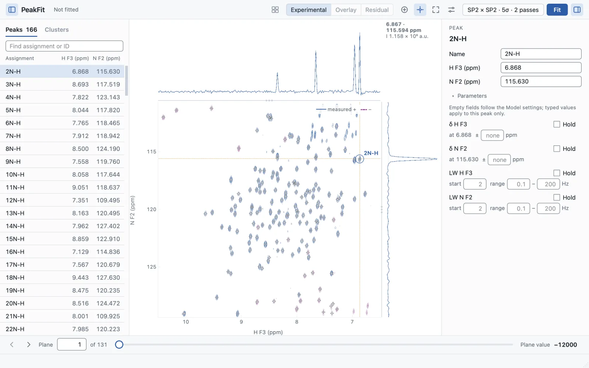
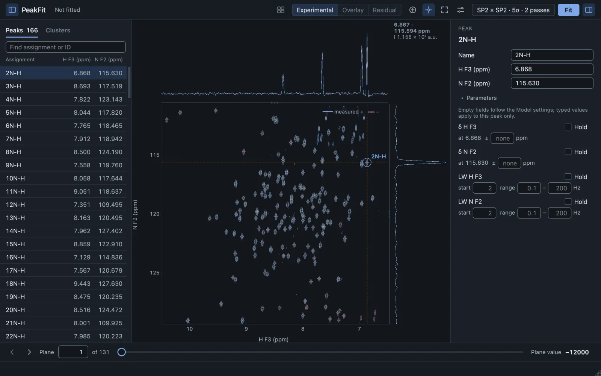
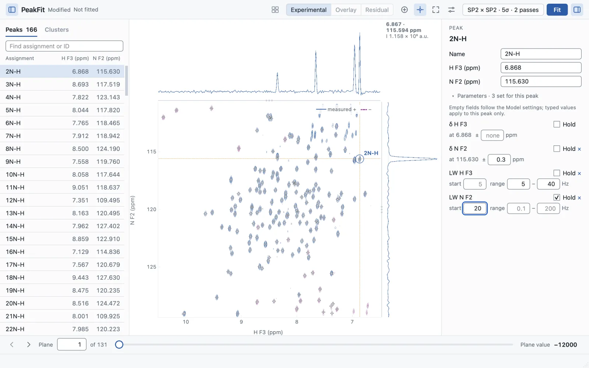
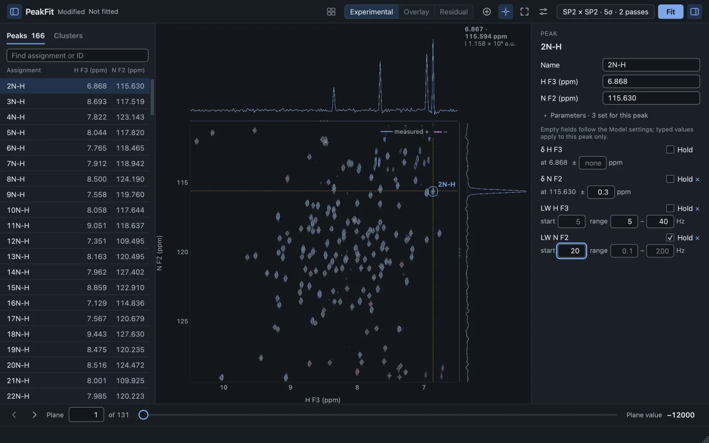
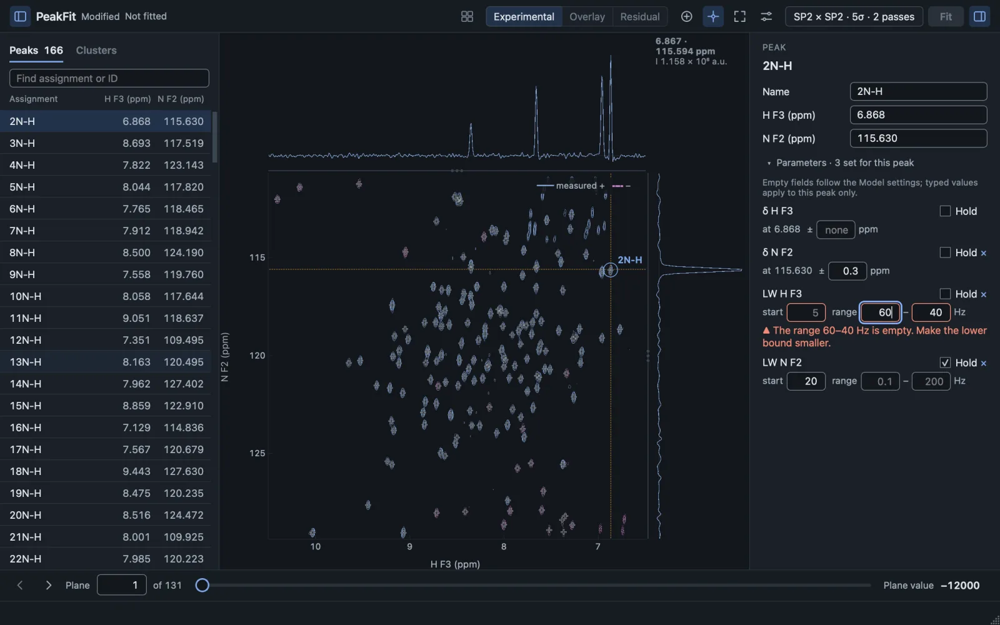
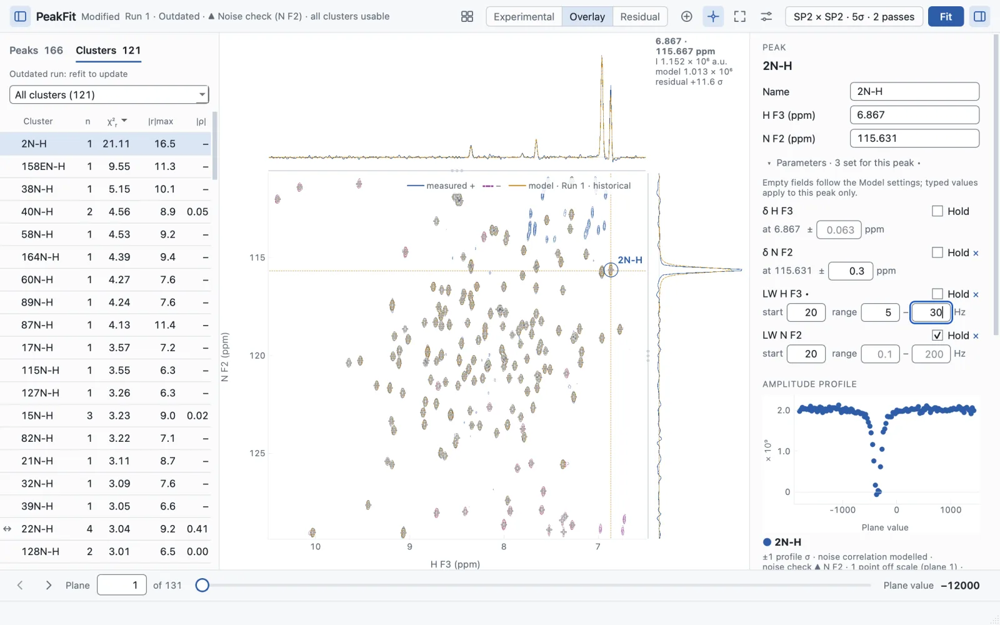
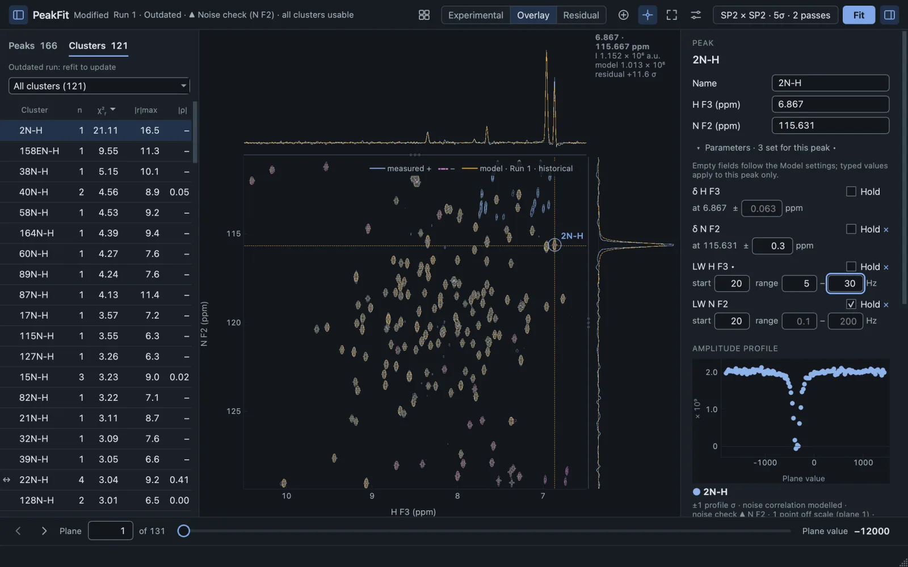
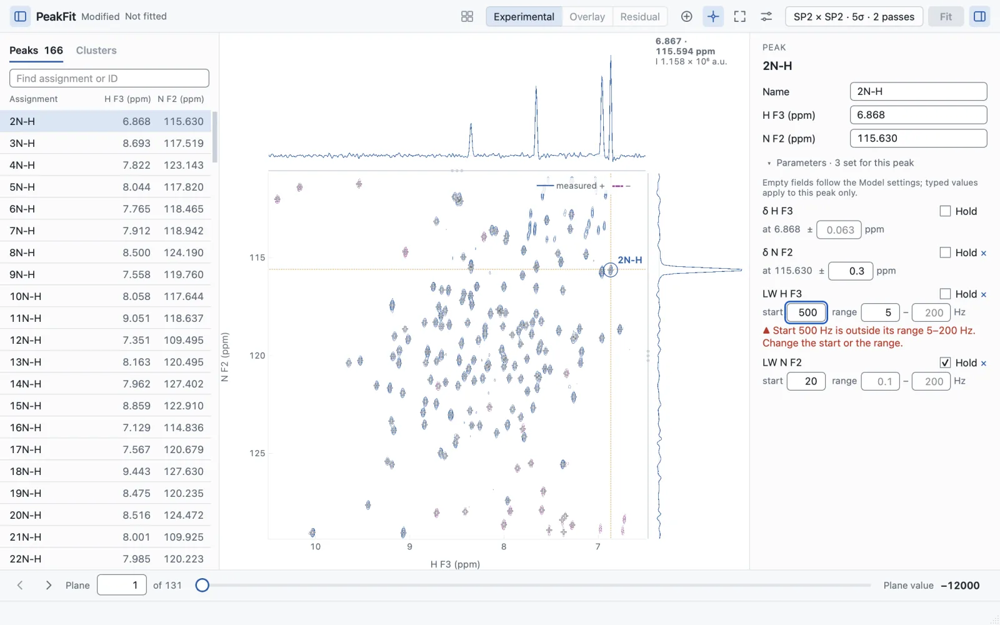
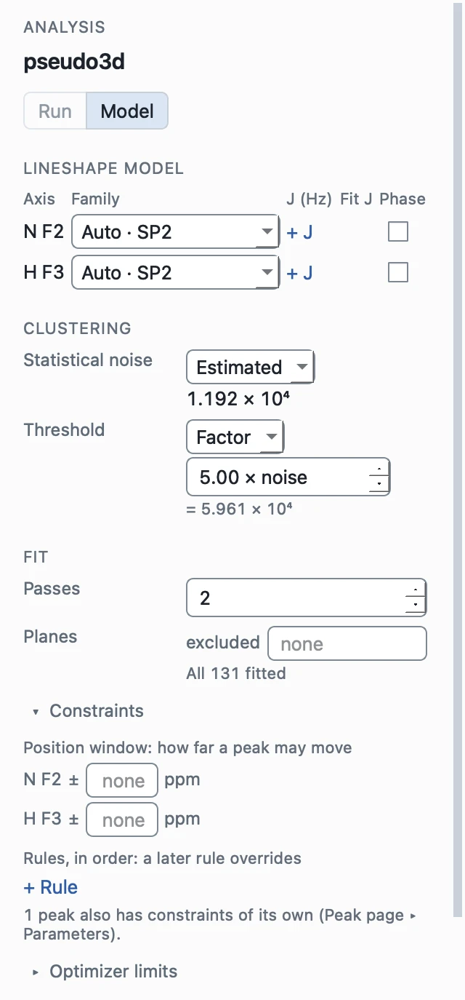
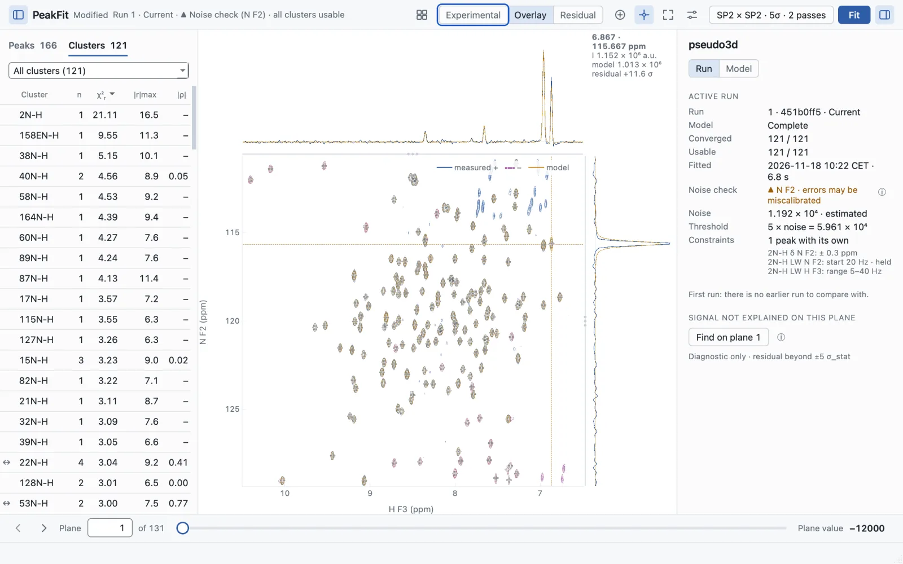

# Peak page Parameters: native workflow record and `peakfit fit` equivalence

Visual, geometric and numerical record of a peak's own constraints, edited in the
Peak page's **Parameters** section (spec §7). The decision is in
[decisions.md](../decisions.md) (2026-11-17, “A peak's own constraints belong to the
working peak”). Sizes are Qt logical pixels.

## How it was run

- **Code:** branch `dev/peak-constraints` after merging `main` (W4 #231, #233,
  #234) and the final review (run numbers in tooltips, own J bounds in clustering).
  PySide6/Qt 6.10.1, Fusion style.
- **Machine:** macOS 27.2.1 on Apple silicon, built-in Retina display, DPR 2.0.
- **Captures:** `uv run python tools/capture_peak_parameters.py --output <dir>`
  (native Cocoa) drives the real window on the bundled `02-advanced-fitting`
  dataset (131 planes, 166 peaks), selects 2N-H and saves each state at 1280×800
  and 1160×720, light and dark, 32 in all:
  1. Parameters as loaded: every value greyed, from the Model settings;
  2. the peak's own constraints: a ¹⁵N position window of ± 0.3 ppm, a ¹H linewidth
     range of 5–40 Hz, the ¹⁵N linewidth held at 20 Hz;
  3. a typed range of 60–40 Hz (a draft: explained, Fit disabled);
  4. a committed start of 500 Hz that the 5–200 Hz range excludes (a preparation
     problem: explained under the parameter, Fit disabled with the peak's name);
  5. the Model page counting the peak with constraints of its own;
  6. the GUI's own two-pass fit with those constraints, and its Run page;
  7. the Peak page after that fit (no difference from the run);
  8. the ¹H linewidth range changed to 5–30 Hz: marked • against the run.
- **Review:** I looked at every capture. The first run found Hold out of line on
  parameters without ×, a three-line note once the inspector scrolled, and a
  problem message that repeated its parameter's name and sent the user to the
  section they were in; the Run page listed limits without units. Each was fixed
  and the captures rerun. The final review reran all 32 on 2026-11-18; the figures
  below are from that run.

## Measurements

From `gui-peak-parameters/measurements.json` (32 captures):

| | Value |
| --- | --- |
| Inspector viewport (no scrollbar / scrollbar) | 320 / 310 |
| Parameters section minimum width (any state) | 261 |
| Sideways scrolling, clipped labels | none in any capture |
| Fit enabled while a value is invalid or a limit cannot be fitted | never; its tooltip names the peak, the parameter and the reason |

## Equivalence with `peakfit fit`

`tests/test_gui_model_settings.py::test_a_desktop_fit_applies_each_peaks_own_constraints_as_peakfit_fit`
fits a six-plane dataset with two planes excluded, an axis-wide linewidth rule and
own constraints on two peaks that share one assignment in the desktop (a window and
a range on one, a held start on the other), and `peakfit fit` with the TOML that
names them. The engine configuration is the TOML's, peak for peak, and every
recorded number of the outcome is bit-identical (`assert_array_equal`). Each Peak
page edit gives the engine configuration of its TOML
(`tests/test_gui_peak_parameters.py`, five cases).

`tests/test_gui_peak_constraints.py` states the effective start, bounds and vary of
each combination of Model rules, own bounds and starts, windows and Hold (the table
in [constraints and fit steps](../constraints-and-fit-steps.md#combined-example)),
that a fit step's fix/vary applies last, and that a doublet's clustering footprint
follows a peak's own J bound as it does in `peakfit fit`. One difference is
deliberate and pinned
(`test_peakfit_fit_moves_the_same_start_to_its_bound_without_saying_so`): a typed
start outside its range blocks the desktop fit, while `peakfit fit` fits from the
bound (#235).

## Captures (1280×800)

Each in light and dark. As loaded, and with the peak's own constraints:

A typed range that cannot be used:

Differs from the run (its tooltip names the run by number, as
`test_a_peak_edit_is_one_undoable_edit_that_outdates_the_run` checks):

A committed start the range excludes, the Model page and the Run page (light):

