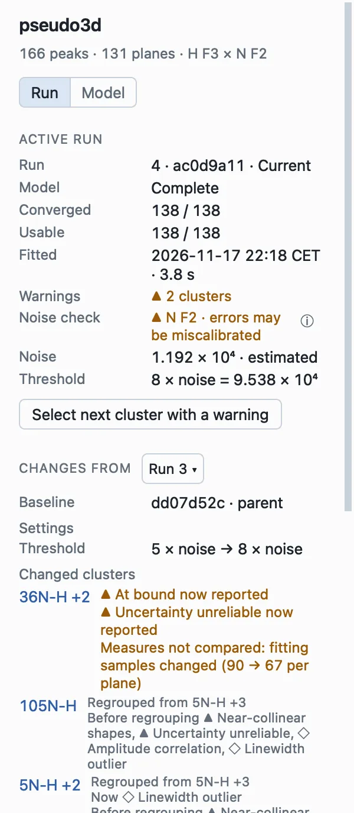
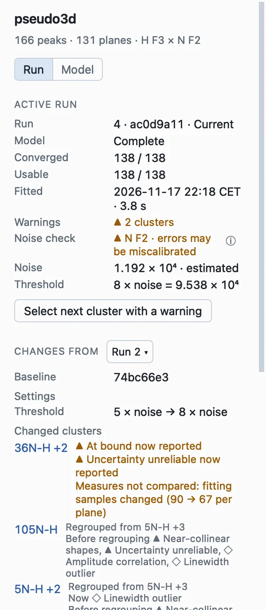
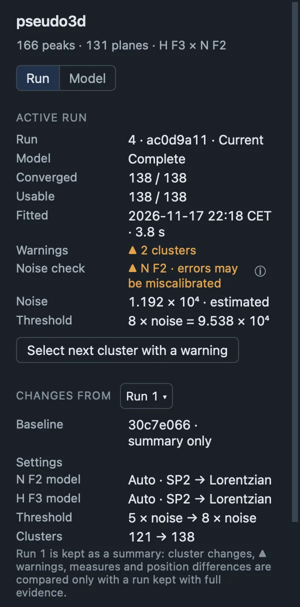
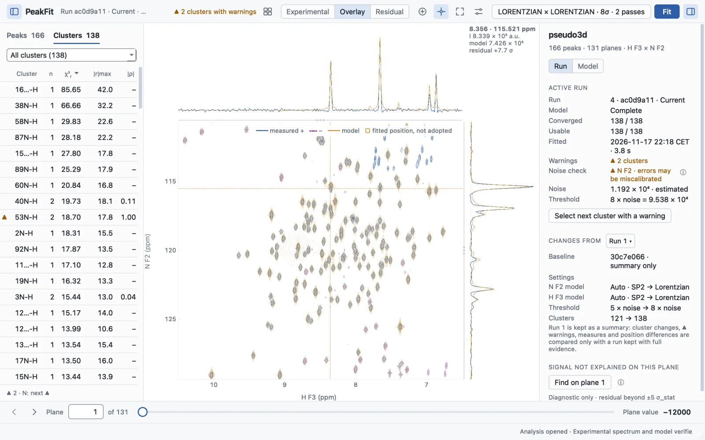
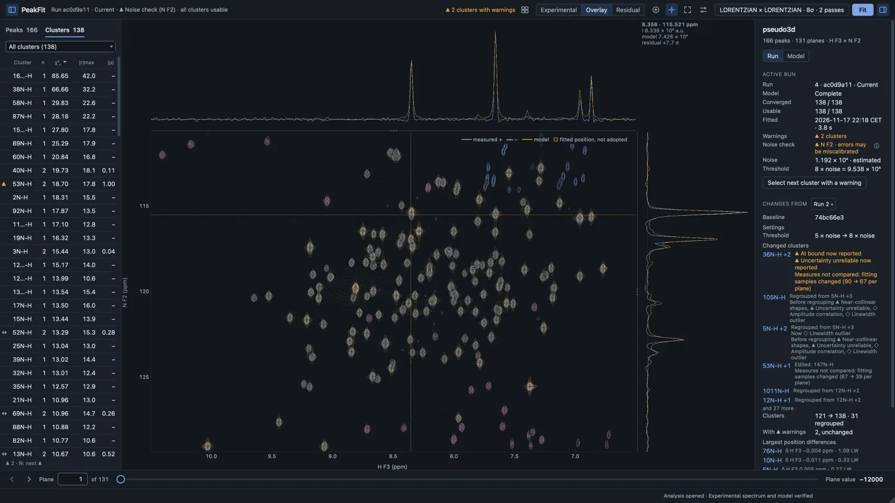

# Run page baseline selector: native evaluation (#218)

The **Changes from run N ▾** selector, reviewed on macOS natively (not offscreen)
on the bundled `examples/02-advanced-fitting` dataset.

## Workflow

Four GUI fits in one session:

1. defaults (Automatic → SP2 on both axes, 5 × noise);
2. family Lorentzian;
3. 147N-H moved by hand, then refit;
4. threshold 8 × noise.

The analysis was then saved and reopened. To show a Summary-only baseline without
eleven fits, run 1's full evidence was removed from the reopened session's history,
which is the state retention leaves once ten later runs exist. Run 1's journal entry
was kept.

The Run page was captured against three baselines:

- run 3, the parent (the default);
- run 2, with full evidence;
- run 1, summary only.

Each baseline was captured at 1160×720, 1280×800 and 1920×1080, in light and dark:
18 window and 18 inspector captures. I looked at every one.

## Measurements

| Check | Result |
| --- | --- |
| Working state (peaks, settings, active run, Current, Undo/Redo, Modified), hashed before and after each choice | unchanged in all 18 states |
| Clipped labels in the inspector | none |
| Sideways scrolling | none |
| Comparison on the Qt thread after the stored run is read off Qt (138 clusters) | about 3 ms |

## What the captures show

- **Run 3 (parent):**
  - Settings shows "Threshold 5 × noise → 8 × noise".
  - Measures for the warned cluster are withheld with "fitting samples changed (90 → 67 per plane)".
- **Run 2:**
  - The same settings difference appears.
  - 53N-H +1 reads "Edited: 147N-H": run 3 recorded that move and run 4 kept it.
  - Clusters reads 121 → 138, 31 regrouped.
  - The largest position differences are listed.
- **Run 1 (summary only):**
  - Settings shows both axes "Auto · SP2 → Lorentzian" and the threshold change.
  - Clusters reads 121 → 138 from the recorded counts.
  - One line names what is compared only against a run kept with full evidence.
  - No ▲ warnings row, measure or position is shown.

## Fixes from this review

- The Baseline row no longer repeats "Run N", which the heading's menu already shows. It now reads "dd07d52c · parent" on one line.
- "summary only" no longer breaks across lines.
