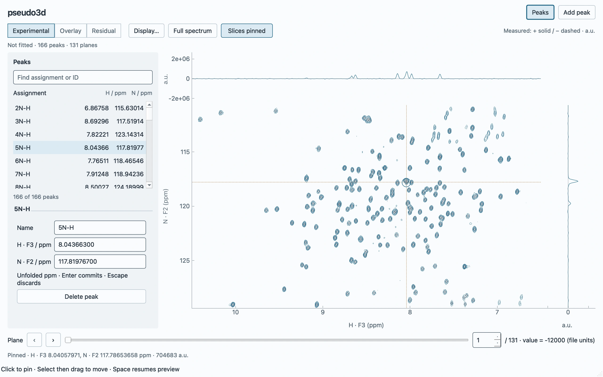
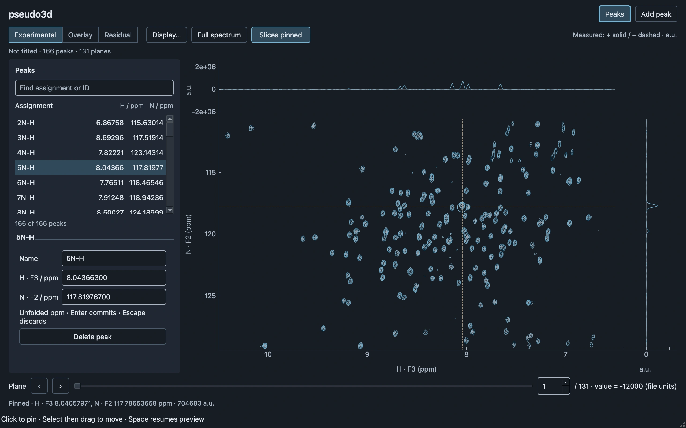

# GUI v2 milestone 1: production validation

Production **open → inspect → edit**, implemented from the approved design.
`peakfit-editor` is separate from the existing
`peakfit gui` fitting application. This validates the first vertical slice, not
fit/save/MCMC release acceptance.

## Native workspace

The committed captures are actual exposed Cocoa/Fusion widgets at 2× DPR, obtained
with the live widget's grab; no SVG, browser replica or offscreen backend is used.
They are WebP quality 95. Native menu/title bars are omitted by widget capture.
The input is the bundled 131×256×546 NMRPipe data, 166 peaks and original ordered
plane values. Source checksums, dimensions, timing and actual geometry are in
[measurements.json](gui-v2-editor/measurements.json).

| Requested window | Actual client size | 2D viewport | Evidence |
| --- | --- | --- | --- |
| 1280×800 | 1280×800 | 740.5×430.5 logical px | Light/dark above |
| 1440×900 | 1440×846 | 900.5×476.5 logical px | [Light](gui-v2-editor/editor-1440-light.webp), [dark](gui-v2-editor/editor-1440-dark.webp) |
| 1040×720 | 1040×720 | 501.5×350.5 logical px | [Light](gui-v2-editor/editor-1040-light.webp), [dark](gui-v2-editor/editor-1040-dark.webp) |

macOS constrained the tall window to the available screen height; the recorded
size is authoritative. The rail remains independently scrollable, with at least
four list rows and accessible coordinate fields at the minimum size. Later
resizing retains the user's rail choice. Alignment tests compare mapped native
frequency coordinates in all three views to within one logical pixel after zoom
and resizing. The 1280 workspace leaves less vertical spectrum space than the
refinement design probe because it includes normal menus/status and the plane
strip; it meets the milestone's minimum plot geometry.

## Demonstrated workflows and scientific protection

Native accessibility/mouse/keyboard review opened the validated source preview,
selected a row, used Cmd+F, searched `5N-H`, navigated to `15N-H` with the keyboard,
and entered its precise editor with Return. A committed H shift changed from
`8.858997` to the float64 parsing of `8.859097123456789`
(`8.859097123456788` in round-trip display). Cmd+Z in that clean field restored
`8.858997`. Physical Ctrl+Page Down changed plane 1 to plane 2 and retained the
selection/pin; the value changed from −12000 to −1800 in file units. View →
Appearance → Light was exercised through the native menu. Repeated accessibility
queries, selection and edit/Undo remained stable after the list fix below.

Two native findings were repaired before final evidence: a clean QLineEdit was
consuming peak Undo, and the tree-based assignment widget could crash in Qt's
Cocoa accessibility attribute traversal. The final flat QListWidget retains row
objects during ordinary edits, has no hierarchy/model reset, and exposes complete
assignment/coordinate text. This is a validated correction on this machine, not a
claim that every platform's screen reader has passed.

Targeted executable checks additionally cover:

- Native experimental row/column equality on planes 1, 60 and 131; original
  acquisition order for duplicate/unordered plane values; indirect aliases and
  direct non-wrapping coordinates; read-only source arrays.
- Independent hover, selection and free/selected pin state; closed-rail selection;
  filtered selection/reveal; navigation with invalid draft text.
- Complete-group commit, Tab retention, Escape, unchanged float64 coordinates,
  scientific notation and exact CSV round trips through the existing reader.
- Continuous drag ghosts and cancellation, one release/one undo entry, actual Qt
  held-button marker drag and background pan routing. A raw drag-distance guard
  prevents a throttled scene move from becoming a release pin.
- One-shot placement, deletion of a selected draft, named undo/redo and monotonic
  scientific revision; no contour/marker rebuild during 500 sample updates.
- Canceled/failed asynchronous loading retaining the previous workspace, coherent
  replacement, theme invariance and bounded/latest-request contour delivery.
- Pure `DatasetCompletion` contracts: original seeds/outcome retained, optimized
  post-fit Currentness, duplicate assignments/stable IDs, usable non-convergence
  and uncertainty warnings, invalid/unusable whole pairs and fatal revision/source/
  identity mismatch. This contract does not launch fitting or publish a UI result.

## Performance and bounds

Run `uv run python tools/validate_gui_editor.py` with the window exposed. This uses
500 deterministic scene deliveries per theme at a 16 ms interval, through the
actual preview coalescer to a queued callback after native paint. Completion is
matched to the requested sampled coordinates. These are **delivered-event-to-paint**
measurements, not OS input-to-photon timings. Natural native hover events can also
arrive; the recorded preview/coalescing counts therefore need not equal the
synthetic timer count. One superseded light request is reported, not discarded
from the evidence silently.

Reference environment: macOS 27.2, ARM64, Cocoa, Fusion, Qt/PySide6 6.10.1,
PyQtGraph 0.14.0, Python 3.14.5, 2× DPR; bundled data and checksum records above.
The full JSON retains all outliers and actual acquisition rate.

| Measurement | Observed |
| --- | --- |
| Light preview, 500 events at 62.43 Hz | p95 14.47 ms; p99 15.33 ms; max 17.15 ms; 499 painted, one superseded |
| Dark preview, 500 events at 62.42 Hz | p95 14.04 ms; p99 14.86 ms; max 15.88 ms; 500 painted |
| Preview scientific/display work | Zero contour extraction jobs and zero full marker rebuilds |
| Cold isolated input reading/validation | 79.1 ms; production performs reading off Qt |
| Initial widget installation + first contours | 271.1 ms wall time; includes native setup and paint |
| Planes 1/60/131, cold or initial cache | 13.7 / 29.3 / 30.4 ms to settled state, including a 10 ms harness settling interval |
| Cached plane navigation, 100 round trips | p95 14.53 ms; p99 15.44 ms, including a 1 ms settling interval |
| Latest request after 40 rapid plane choices | Plane 40 consistent in 28.3 ms |
| 10 ms heartbeat during preview/navigation | p95 gap 18.55 ms; p99 20.77 ms; max 35.98 ms |
| Numerical contour cache | 841,960 bytes for three cached planes; hard cap 32 MiB/eight planes |
| RSS | ~601 MiB before warm preview, ~613–614 MiB after; last repeated round trips plateau near 613.8 MiB |

Qt has two active device-cached signed paths; preview does not recalculate them.
RSS includes Python/scientific imports, source arrays, native window backing
stores and Qt raster caches. The hard byte bound applies to numerical geometry,
not a claimed bound on total process RSS or platform-managed graphics buffers.

The first measured implementation had an unnecessary 8 ms delay and p95 near
20 ms. The final Qt-turn coalescer removed that delay; the table reports the final
flat-list code. Tests also run at 2× scale; that is separate from a native 1× or
fractional-scale acceptance claim.

## Checks and remaining limits

The full headless regression suite passed: **410 tests**. Ruff, formatting, strict
type checks, import-linter, wheel/sdist builds and AST Graphify update were run.
The existing CLI/numerical/whole-dataset GUI regression tests remain in that suite.
`uv build` reports the existing uv-build/current-uv version-range warning but
produces both distributions successfully.

This PR deliberately does not add fitting, MCMC, refinement, project persistence,
profiles or history. Peak CSV export is the durable deliverable for this slice;
analysis/session restoration is not implied. The old GUI supplies fitting until
milestone 2 delivers the complete fitting/compare/export workflow.

Remaining acceptance work: native Linux X11/Wayland, 1×/fractional scaling, large
system fonts and a full screen-reader walkthrough; moderation by a scientist;
long imports on large/remote files and cold native widget-install stalls; separate
500-event pan and heavy-stroke profiling. Import cancellation immediately cancels
publication while an already-running file read can finish privately. Trace clipping
currently has a text/triangle status warning rather than dedicated plot-edge
arrows; the narrow right amplitude axis can omit extreme tick labels. These
presentation/accessibility refinements are visible limitations, not changed data
or silent normalization. No full application release acceptance is claimed here.

## PR #68 scientific-state review corrections

Plane-value imports/replacements now mark both the workspace and window Modified,
independently of peak edits. CSV export clears only peak-export dirtiness; it leaves
plane metadata session-only and cannot authorize closing/replacing the dataset.
Cancel is the default loss-guard action, and only explicit Discard allows loss of
that metadata. This adds no persistence or plane-value Undo.

Effective peak-source fingerprints now derive from the stable IDs in the current
working list. Replace supersedes prior peak origins; Append retains the origins of
all current IDs. Undo/Redo and later coordinate edits recover the corresponding
sources, with obsolete/undone origins kept private for Redo. Workspace and canvas
share the effective dataset record; peak Undo leaves later plane imports intact.

Four targeted regression cases cover first/replacement plane imports, close and
dataset-replacement cancellation, export from the loss guard, explicit discard,
and Replace/Append/Undo/Redo/source deduplication with an abandoned redo branch.
They reproduced the reported failures before the fix. The complete suite then
passed with 410 tests. Normal empty-editor launch was confirmed on Cocoa through
the actual console entry function. The existing exposed native validation harness
also passed after the corrections (500 previews per theme, zero contour jobs or
marker rebuilds); the visual composition and rendering code are unchanged.
