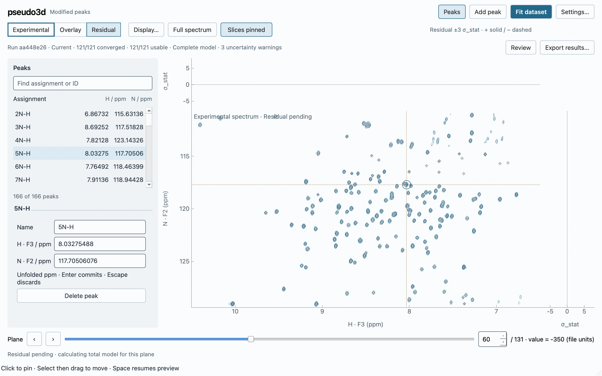
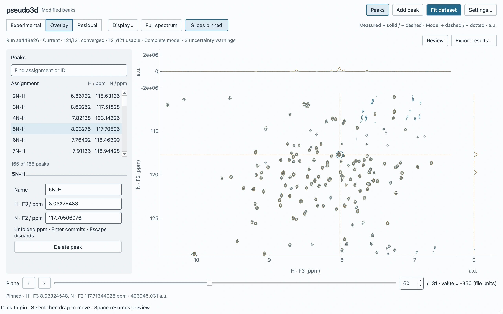
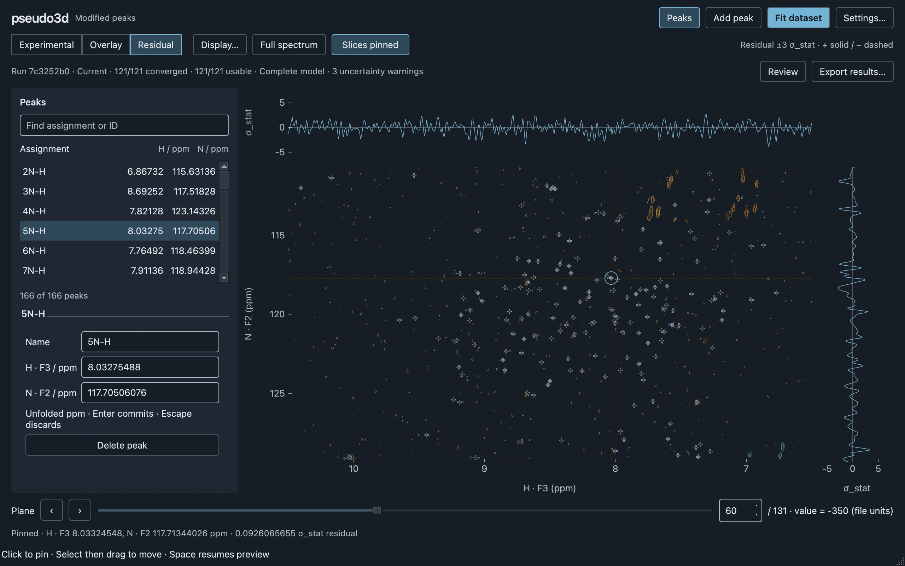

# GUI v2 Milestone 2: fit → compare → export

Native validation on 30 October 2026, including the focused PR #69 review fixes.
The existing workspace architecture and visual composition are retained. No
Milestone 3 functionality is introduced; `peakfit gui` remains available.

## Reproduction and environment

```bash
uv run python tools/validate_gui_editor_fitting.py
QT_QPA_PLATFORM=offscreen MPLBACKEND=Agg uv run pytest
uv run ruff check .
uv run ruff format --check .
uv run ty check --error-on-warning
uv run lint-imports
uv build
```

Apple M5 Pro, 64 GiB RAM; macOS 27.2 arm64, native Cocoa, DPR 2; Qt 6.10.1,
PyQtGraph 0.14.0, NumPy 2.4.1. Measurements run without concurrent tests/profilers.
[Updated raw measurements](gui-v2-fitting/measurements.json),
[original measurements including the outliers](gui-v2-fitting/measurements-before-review.json),
and [targeted profiling evidence](gui-v2-fitting/profiling.json) are retained.

The harness uses visible native QtTest controls and deterministic scene deliveries,
not OS pointer/input-to-photon measurements. Screenshots are native client-area
grabs. Exports use the real modal GUI path; only directory selection is supplied
by the harness. Reader verification runs after the measured application operations.

## Focused review changes

### Current experimental context while projection is pending

The 2D view now shows **current-plane experimental contours** while Overlay or
Residual is pending. Cached experimental geometry is reused independently of
run/mode; on an uncached plane, experimental geometry runs first in the existing
worker lane, followed by model projection. Both stages share request revisions.
Old-plane paths are removed immediately; no old run, old plane or provisional
residual is used as a fallback. Residual slices stay empty until a matching model
exists; the caption/status explicitly identifies pending Residual. Expensive
geometry and model evaluation stay outside Qt, within the existing cache budgets.

Regressions hold projection pending, assert cached and uncached experimental
fallback, change acquisition indices rapidly, replace a run on the same plane,
and deliver obsolete results deliberately. Only the latest request can publish.



[Pending Overlay](gui-v2-fitting/pending-overlay.webp).

### Remove write-only private result files

`retain_result`, private pickle writing, `mkdtemp`, historical-payload bookkeeping
and pruning are removed. They supplied no supported recovery reader and had no
workspace-close cleanup. The active immutable result remains in memory, including
exact submitted seeds and `DatasetCompletion`. Cancellation/failure preserves it;
a successful refit replaces it. Canonical exports remain the way to retain results.
Existing fit-process in-memory IPC is unchanged. Export staging still has its
existing `TemporaryDirectory` owner/lifetime and transactional cleanup tests.

Successful result export marks working peaks preserved **only when their exact
stable-ID tuple matches the exported post-fit tuple**. Closing then requires no
duplicate peak export. Failed/canceled export and exporting an outdated run with
different working peaks leave peak dirtiness unchanged. Plane metadata protection
is unchanged. The native harness exports both the initial and refitted result and
closes normally with no duplicate prompt.

### Stall diagnosis and corrections

The investigation used a minimized native heartbeat loop, cProfile, timed writer/
Qt boundaries, GC callbacks and a short macOS native stack sample. Throwaway probe
scripts/instrumentation were removed; the evidence is in `profiling.json`.

1. **Original navigation outlier:** the old harness issued 100 cached requests in
   one synchronous Python turn, with no event processing whenever cache delivery
   was immediate. The minimized loop occupied **174 ms** and produced a **202 ms**
   heartbeat gap; actual event-delivered rapid input peaked at **21 ms**. RSS calls
   cost 7–22 ms and were not the main cause. The harness now delivers separate
   cached input turns at 16 ms, and reports uncached/cached/rapid stages separately.
   This corrects a self-starved measurement rather than deleting an application
   outlier. The old raw 140 ms observation is retained.
2. **Original export outlier:** `ResultsLoader.load_summary()` redundantly reread
   the just-written large JSON. cProfile measured about **269 ms** in JSON decoding
   and **323 ms** in the reader, coinciding with a **289 ms** heartbeat gap. This
   reread is removed. The canonical writer already validates `FitSummarySchema`
   before writing; artifact checks and atomic publication remain. Native and test
   reader round trips continue to verify scientific output correctness.
3. **Actual modal export startup:** the revised harness exercises the real dialog,
   exposing additional startup contention. Native sampling found the Qt timer
   waiting in `PyGILState_Ensure → take_gil → _pthread_cond_wait` while the export
   worker serialized. GC pauses were about 11–13 ms and spectrum paint probes
   found no matching long pause. Window-modal sheets (272 ms show/hide) and an
   ordinary nested event loop did not help and were discarded. The existing
   application-modal dialog now enters Qt before a zero-duration timer submits
   its writer. A regression verifies progress is shown before work starts.
   The final first-export maximum was **22 ms**. A remaining **114 ms** maximum
   occurred when exporting immediately after refit while comparison projection
   was pending; it remains explicit below, without claiming full latency acceptance.

## Scientific and lifecycle verification

Bundled input: **131 × 256 × 546 native samples, 166 peaks**. The standard two-pass
pipeline prepares **121 clusters** and performs one cross-cluster correction
update. All terminal clusters were usable/converged, with three analytical
uncertainty warnings. All 166 coordinate pairs were automatically adopted and
remained Current; exact seeds stayed immutable. Selection, plane, viewport and
selected/free pin rules are preserved.

Projection matched a separate authoritative projector call with **maximum absolute
difference 0**. Both residual slices are array-equal to native
`(D − total usable model) / σ_stat`. Corrected optimizer statistics remain separate.
The full native workflow covers fit, adopted positions, pending fallback,
Overlay/Residual, cancellation preservation, committed edit/Outdated, fresh refit,
canonical export and close. Exported amplitudes also pass a full reader round trip.

Focused tests protect mixed/all-unusable outcomes, non-convergence, invalid
identity publication, draft/commit/Undo currentness, stale plane/run delivery,
export state protection and **20 additional actual-process refit cycles**. Existing
completion tests cover aliases, duplicate assignments, invalid pairs and uncertainty
warnings. Repository suite: **420 tests passed**, with Ruff, formatting, types,
import contracts and build passing.

## Final isolated measurements

| Observation | Result |
| --- | ---: |
| Load/install and first experimental contours | 407 ms |
| Fit including initial scientific-settings preparation/review | 5.58 s |
| Fresh preparation + refit + atomic publication | 5.47 s |
| Delivered hover → paint p95 / p99 / maximum | 9.65 / 10.27 / 10.66 ms |
| Hover events / painted / superseded | 500 / 500 / 0 |
| Hover contour jobs / marker rebuilds | 0 / 0 |
| Uncached model plane, with experimental fallback | 1.37–1.38 s |
| Cached plane installation p95 / p99 / maximum | 1.41 / 1.78 / 1.83 ms |
| Forty rapid inputs through latest consistent delivery | 1.54 s |
| Cancel acknowledgment / actual process reaping | 1.03 / 35.23 ms |
| First canonical GUI export | 1.80 s |
| Numerical display cache accounting | 6,033,896 bytes |

| Application phase heartbeat | p95 / p99 / maximum (ms) |
| --- | ---: |
| Fit | 10.88 / 12.45 / 59.11 |
| Projection | 10.71 / 11.44 / 21.86 |
| Uncached navigation | 10.91 / 11.39 / 15.94 |
| Cached input turns | 22.91 / 26.59 / 30.27 |
| Rapid navigation | 11.13 / 13.54 / 18.02 |
| Initial export | 12.08 / 18.67 / 22.43 |
| Refit | 10.86 / 11.23 / 40.55 |
| Immediate export after refit | 13.43 / 30.40 / **113.60** |

Cached-plane timings end at consistent graphics installation; hover timings end
after native paint. Geometry/model budgets remain eight entries/32 MiB and eight
native planes/128 MiB. RSS was about 537 MiB after load, stable around 1,070 MiB
through 100 round trips, and 1,071 MiB after more planes. This includes raw/result
arrays, renderer/screenshot allocations and allocator retention, not just caches.
The harness retains the first result to check identity across refit; this is not
a production one-result peak-memory bound.

Screenshot capture/encoding is separately reported: maximum **214 ms** for the
layout matrix and **295 ms** for pending captures. Phase handoffs drain capture
events before projection timing, so this cost is not mislabeled as model latency.

## Visual review and remaining limits

Light/dark captures cover 1040×720, 1280×800 and 1440×900. The spectrum rectangle
is approximately 740×416 logical pixels at 1280×800 and 900×516 at 1440×900. No new
toolbar, permanent panel or fitting window is added.





[Rail warning review](gui-v2-fitting/review.webp),
[scientific settings](gui-v2-fitting/settings.webp),
[minimum-size dark residual](gui-v2-fitting/1040-dark-residual.webp).

The strict no-gap-over-100-ms gate is still not fully met because of the immediate
post-refit export tail above. It is retained as a limitation, not explained away
by p95 or removed from the evidence. Native Linux, fractional scaling, large fonts
and screen-reader acceptance remain unverified on this macOS host. Optional raster/
mask decoration, saved-analysis persistence, historical browsing, MCMC and full
cluster refinement remain outside this focused change. No new persistence or
execution framework is introduced to chase the remaining tail.
