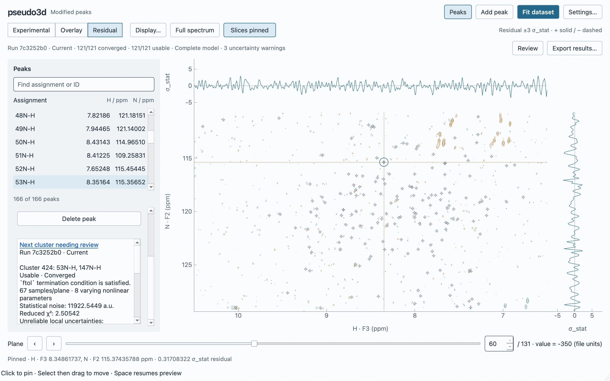

# GUI v2 Milestone 2: fit → compare → export

Native validation on 30 October 2026, using the production `peakfit-editor`
workspace and bundled `examples/02-advanced-fitting/data` inputs. This is a
functional milestone, with the performance/platform limits below; it is not a
claim of complete GUI v2 release acceptance. The existing `peakfit gui` is retained.

## Reproduction and environment

```bash
uv run python tools/validate_gui_editor_fitting.py
QT_QPA_PLATFORM=offscreen MPLBACKEND=Agg uv run pytest
uv run ruff check .
uv run ruff format --check .
uv run ty check --error-on-warning
uv run lint-imports
uv build
```

Reference hardware: Apple M5 Pro, 64 GiB RAM; macOS 27.2 arm64, native Cocoa,
DPR 2. Qt 6.10.1, PyQtGraph 0.14.0, NumPy 2.4.1. Final measurements were collected
without concurrent test/graph runs. [Raw measurements](gui-v2-fitting/measurements.json)
include every stage's p50/p95/p99/maximum heartbeat gap and RSS observations.

The harness dispatches QtTest input to visible Fit/Run/Cancel/mode controls and
uses deterministic scene events through the production preview coalescer at about
62.4 Hz. Paint completion is observed on the exposed Cocoa canvas. These are
native Qt rendering measurements, **not OS pointer or input-to-photon latency**.
Screenshots are native rendered client-area grabs, not design mockups. Canonical
exports are generated and validated in `/tmp`, not committed as large fit fixtures.

## Scientific and lifecycle checks

The real input contains **131 × 256 × 546 native samples and 166 peaks**. The first
Fit action opens the shared scientific review dialog. Its default two-pass run
prepares all **121 clusters**, executes the regular pipeline and records one
cross-cluster correction update. All 121 terminal clusters were usable/converged;
three analytical uncertainty warnings remained explicit. All 166 position pairs
changed automatically, with no adoption warnings. Exact initial seeds remain in
the immutable run, separately from optimized working coordinates.

The harness asserts Currentness after adoption, preserved selection/plane/ppm
viewport, and the selected-peak pin following once. Overlay is automatic. Native
model values match a separate call to the authoritative completed projector with
**maximum absolute difference 0**. Both residual slices are array-equal to native
`(D − total usable model) / σ_stat`. Corrected optimizer residuals/statistics are
retained independently; comparison never solves amplitudes or optimizes again.

A canceled replacement preserves the exact prior result object and working tuple.
A committed edit switches to Experimental/Outdated. Refit uses the changed optimized
working tuple as fresh preparation inputs and returns Current without reopening
Settings. Export uses the canonical writers and adds exact submitted/post-fit
coordinates, stable identity mapping, adoption warnings and currentness at export.

Focused tests additionally cover mixed/all-unusable outcomes, usable
non-convergence, invalid identity publication, free versus selected-peak pins,
drafts/commit/Undo currentness, immutable total projection, rapid stale plane
requests, failure preservation and **20 additional actual process refit cycles**.
The last ten full temporary payloads are retained without third-run interruptions.
Existing completion-contract tests protect aliases, duplicate assignments,
non-finite/missing pairs, uncertainty warnings and no-op transitions.

Repository validation: **415 tests passed**; the final focused editor/fitting check
passed **22 tests**. Ruff, formatting, type checking, both import-linter contracts
and wheel/sdist build passed. Graphify's code graph was updated using AST extraction.

## Measurements

| Observation | Final isolated run |
| --- | ---: |
| Load/install and first experimental contours | 315 ms |
| First fit, including initial settings preparation/review | 5.46 s |
| Fresh preparation + refit + completion retention/publication | 5.49 s |
| Delivered hover → paint p95 / p99 / maximum | 9.09 / 9.75 / 10.14 ms |
| Hover events / painted / superseded | 500 / 500 / 0 |
| Hover contour jobs / marker rebuilds | 0 / 0 |
| Uncached native model planes | 1.30 s |
| Cached plane delivery p95 / p99 | 1.49 / 1.63 ms |
| Forty rapid plane changes through matching final delivery | 1.44 s |
| Cancel acknowledgment / actual process reaping | 0.78 / 41.91 ms |
| Measured numerical display cache footprint | 6,025,776 bytes |
| Fit heartbeat p95 / maximum | 10.84 / 57.07 ms |
| Model projection heartbeat p95 / maximum | 10.98 / 22.45 ms |
| Refit heartbeat p95 / maximum | 10.92 / 45.58 ms |

Cached-plane timings end at consistent numerical/graphics installation, not the
subsequent paint. Hover timings end after native paint. Forty rapid requests reject
obsolete deliveries and finish on acquisition index 39, without mismatched slices.
Display caches are bounded to eight native model planes/128 MiB plus eight contour
geometries/32 MiB; scientific arrays are not evicted or truncated to meet latency.
RSS was about 526 MiB after load, 1,018 MiB through all 100 cached plane round trips,
and 1,025 MiB after visiting additional planes. This includes source/result arrays,
Qt rendering/screenshot allocations and allocator retention; it is not the cache
footprint or a peak-memory measurement. The script retains a reference to the first
result to verify cancellation/refit identity, so its end-of-run RSS is not a proof
of production one-result resident memory.

## Native visual review

At 1280×800 the 2D plot rectangle is approximately **740×416 logical pixels**.
At 1440×900 it is approximately **900×516**. Both appearances and 1040×720 were
captured. The rail stays closed/open according to user choice; fit completion
opens no permanent panel. Review uses the existing inspector scroll surface,
preserves useful peak rows and explicitly navigates clusters needing review.




[Scientific settings](gui-v2-fitting/settings.webp),
[minimum-size dark residual](gui-v2-fitting/1040-dark-residual.webp),
[large light overlay](gui-v2-fitting/1440-light-overlay.webp).

## Known limitations and remaining acceptance

- The strict no-stall performance gate is **not fully met**: export heartbeat maximum
  was 290 ms, and rapid navigation maximum was 140 ms. Their p95 gaps were 17.05 ms
  and 10.87 ms. Exact stall attribution and moving GIL-heavy export work into a
  process remain follow-up work; those maxima must not be hidden by good medians.
  Screenshot encoding itself produced 215 ms heartbeat gaps, recorded separately.
- Uncached projection remains about 1.3 s, with immediate pending graphics and
  responsive inspection. This is computational latency, not a frozen Qt operation.
- This delivery exposes signed residual contours with a configurable first level;
  the specification's optional residual raster and fitting-mask decoration are not
  exposed here. Recorded samples remain available in scientific exports.
- Full history browsing, summary-only journal retention, pinned evidence and portable
  saved-analysis reopening belong to Milestone 3. Temporary full payloads are a
  private recovery mechanism, not a supported file format. Closing guards protect
  unexported active evidence; users should export any result they need to keep.
- Native Linux/X11/Wayland, fractional scaling, large-font and screen-reader
  acceptance have not been established on this macOS host. The existing GUI stays
  available while these and broader functional parity are verified.
- MCMC, parameter/bound editing in the working inspector and full cluster refinement
  are deliberately outside this milestone. Convergence/Currentness are not claims
  of scientific validity; the scientist must review lineshape assumptions/warnings.
