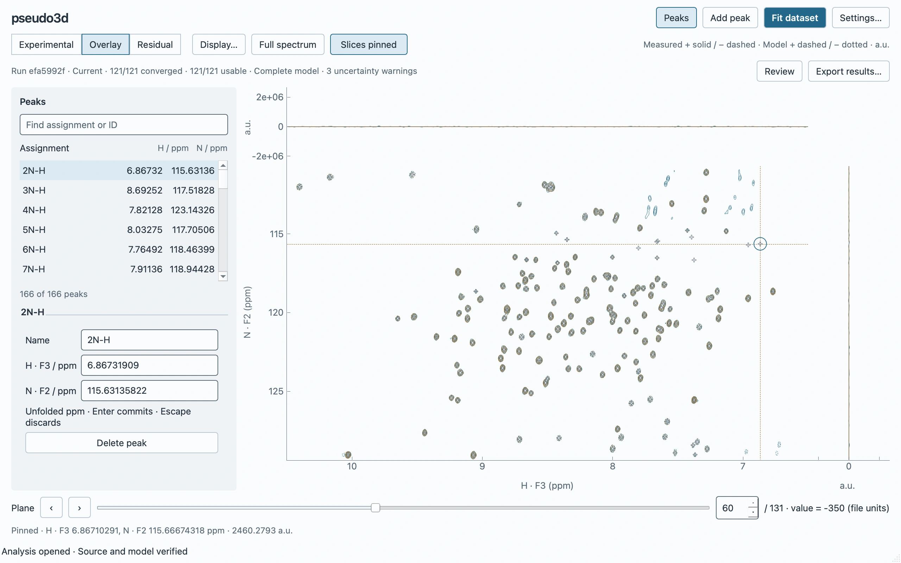
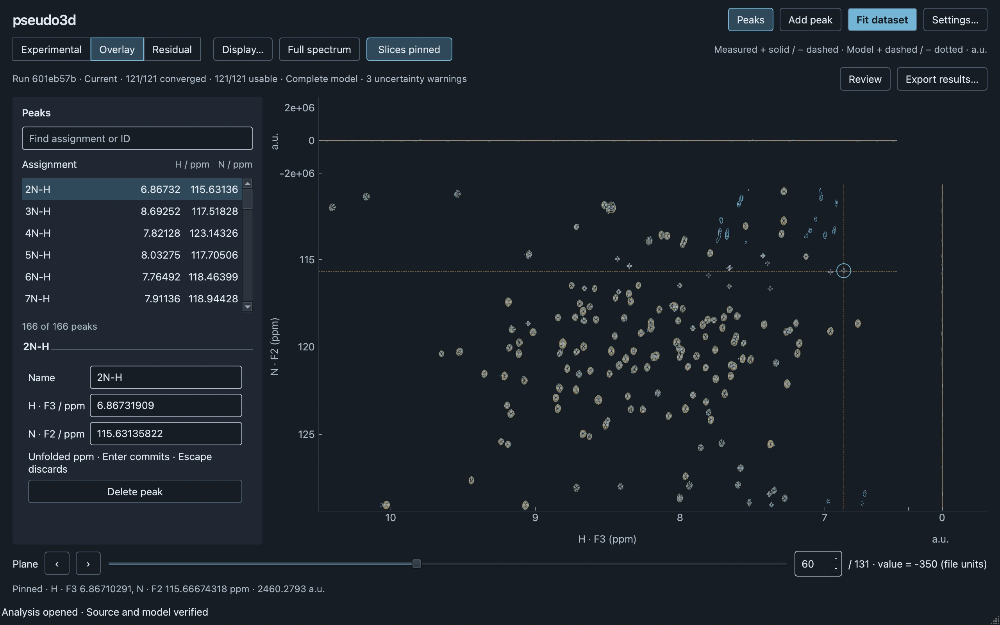
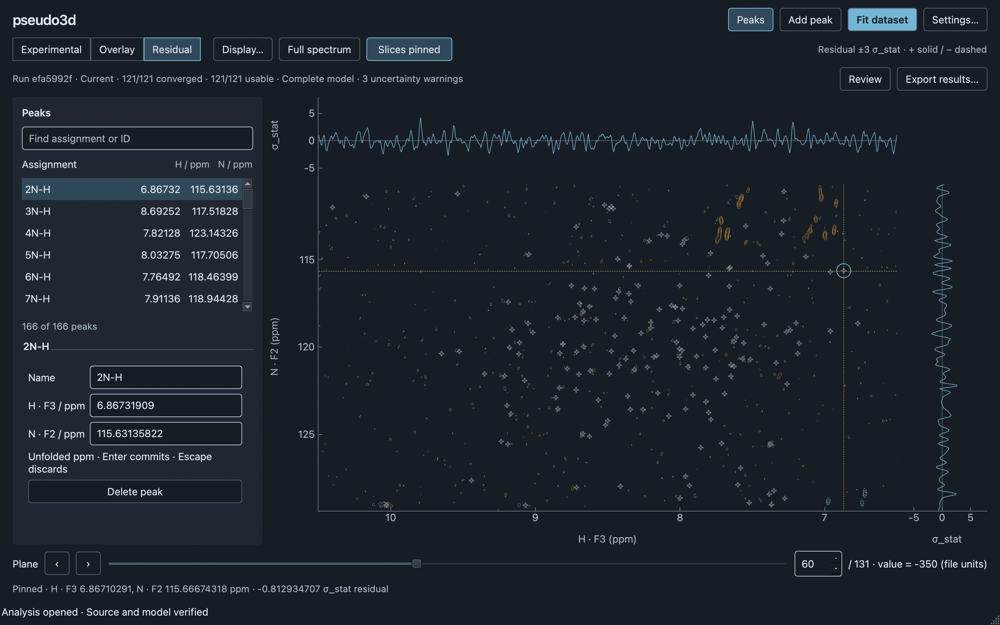
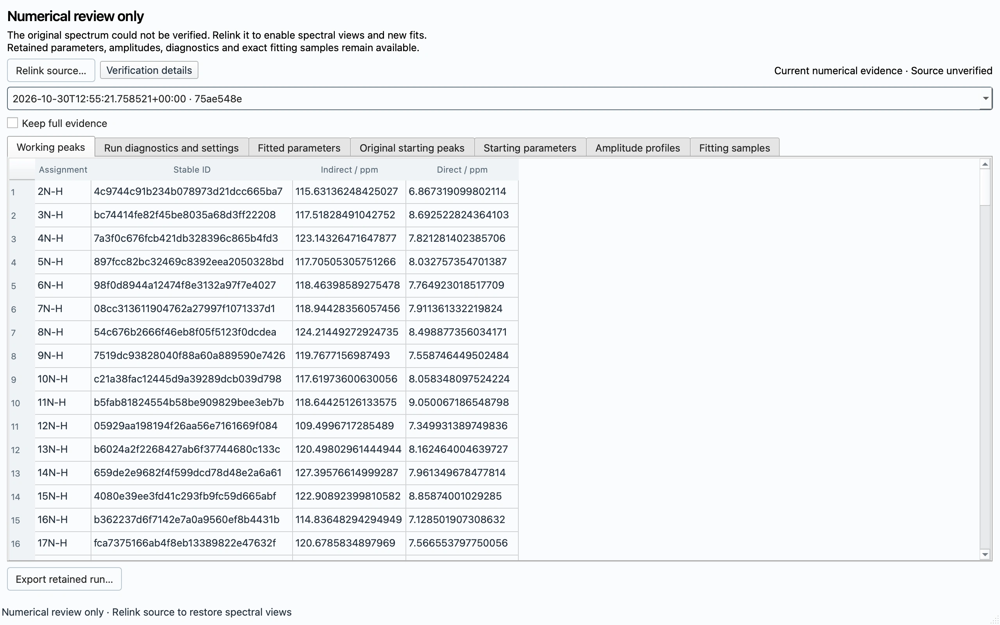

# GUI v2 Milestone 3: save, reopen and continue

Native Cocoa validation on 30 October 2026, Apple M5 Pro (Mac17,9), 64 GiB RAM,
macOS arm64, Python 3.14.5.
Reproduce the workspace with `uv run python tools/validate_gui_persistence.py`.
[Raw workflow measurements](gui-v2-persistence/measurements.json) record a single
workload with ordinary filesystem caching; heartbeat gaps are Qt event-loop
observations, not input-to-photon measurements or a responsiveness guarantee.

The bundled real dataset has 131 planes of 256×546 samples, 166 working peaks and
121 clusters. Both axes resolve to SP2, with two optimizer passes. The native
scenario uses the actual process-based Fit action and durable accepted-result
publication, saves, repeats Save, uses Save As, reopens, inspects overlay/residual,
edits a peak, performs a real refit and enters numerical-only review. File chooser
selections are deterministic; the workspace, workers, scientific data and disk I/O
are real. Source verification, Currentness and normal numerical-mode closure pass.

| Operation | Elapsed |
| --- | ---: |
| Source load + stable fingerprinting | 0.090 s |
| Initial fit + durable accepted evidence | 8.461 s |
| First Save, copying already preserved evidence | 0.918 s |
| Routine Save | 12.2 ms |
| Save As | 31.7 ms |
| Verified GUI reopen | 2.085 s |

The source is **73,244,672 bytes (69.9 MiB)**.
The project is **37,248,935 bytes (35.5 MiB)**,
versus 87,646,888 bytes (83.6 MiB) before compression. Neither contains an embedded
full spectrum or calculated plane cache; the recorded spectrum member list is empty.
Routine Save hashes/reads zero source-content bytes, rewrites zero immutable evidence
files and writes only the 219,738-byte working manifest. The reuse
regression fails on source hashing or unchanged evidence rewriting.

## Review correction: scientific summaries survive eviction

The original reader restored Full journal entries with `parameters=None`. A later
eviction could relabel that entry Summary only after losing its canonical table.
The corrected writer materializes the complete compact contract from that exact
full record **before** publication can prune the payload. It preserves fitted
values/errors/bounds, initial coordinates and freedom, effective settings,
identities/provenance and concise diagnostics/statistics. Existing summary-only
entries survive later metadata-only saves unchanged. Missing full evidence aborts
rather than fabricating a summary.

The end-to-end regression saves ten Full runs, closes/reopens, performs a fresh
optimizer fit, saves, closes/reopens again and inspects the evicted run's numerical
tables. It compares every compact scientific field exactly. Separate coverage forces
byte-budget eviction, so both retention triggers use the same protection.

## Review correction: resident history and temporary ownership

`StoredRun` contains a root and checksummed immutable entry, not decoded arrays.
Reopen checks payload integrity but materializes only the active complete result.
The history list reads metadata. Selecting an older Full run loads one record in a
disposable process; selection changes and inspector closure release that record.
The active result remains independent of historical inspection.

`SessionEvidence` owns one temporary directory. Every accepted result is validated
and durably spooled there before publication/replacement; these are ordinary
`Recovery.peakfit` projects with the same strict reader and atomic generation rules.
Save first rebinds references to permanent files and then cleans temporary evidence.
Normal discard/close queues cleanup after any in-flight writer. Numerical-only
transitions transfer the owner instead of deleting still-linked historical files.
A hard interruption leaves a readable snapshot. **Recover interrupted session…**
selects dead-owner POSIX snapshots and requires a permanent Save as; successful
Save or normal recovered-workspace closure removes the owned scratch directory.
The checkpoint contains a complete validated fit and can precede its final Qt
publication; recovery is explicit, not an autosave of subsequent drafts. A temporary
checkpoint preserves input payload leases until Qt adopts the new history, so late
cancellation cannot invalidate references still held by the previous workspace.
Adoption retires those leases off Qt; Save and closure clean the owned store.

The real-data [before](gui-v2-persistence/history-before.json) and
[after](gui-v2-persistence/history-after.json) measurements run twelve actual native
GUI fits in fresh processes. The baseline uses the approved pre-review source at
`88d2fa2`; compression experiments run separately to avoid contaminating RSS.
Hardware was recorded with `sysctl -n hw.model hw.memsize machdep.cpu.brand_string`.
RSS is current main-GUI-process resident memory from `ps`, sampled after publication,
experimental-view settling and garbage collection. Child-process peak memory is
not included. There are no retained benchmark fixture results in the fit loop.

| Completed fit | Before RSS / MiB | After RSS / MiB | Resident complete runs before → after |
| --- | ---: | ---: | ---: |
| 1 | 1066.8 | 1112.0 | 1 → 1 |
| 2 | 1167.3 | 1257.9 | 2 → 1 |
| 5 | 1465.8 | 1264.7 | 5 → 1 |
| 9 | 1820.4 | 1137.4 | 9 → 1 |
| 10 | 1673.8 | 954.5 | 10 → 1 |
| 11 | 1100.7 | 1217.4 | 10 → 1 |
| 12 | 1673.0 | 1310.4 | 10 → 1 |

Peak sampled RSS was 1820.4 →
1310.4 MiB. RSS is variable because of transient
allocations, allocator retention and bounded display caches; this is not a claim of
constant RSS or total-system memory. The structural invariant is one resident
accepted result regardless of retained history. After closing the twelve-fit
workspace, its temporary directory is absent; verified reopening retains ten Full
disk references and materializes **1** active result.

Durable acceptance now costs time on every fit rather than deferring a large write
until the eleventh. The 12-fit sample took roughly
8.7–10.1 s per fit+acceptance,
versus 5.4–5.8 s for the baseline's first ten;
the baseline's first history-preservation event was
61.9 s. The interface identifies preservation as a separate
stage and remains navigable. Temporary snapshots can duplicate retained project
evidence while owned; they are self-contained for recovery and are cleaned on Save
or closure. Reducing serialization/transfer cost merits the typed-array follow-up.

## Review decision: straightforward lossless compression

[Compression measurements](gui-v2-persistence/compression.json) compare the exact
same 77,709,752-byte scientific document. Each decompression is
checked for byte equality. Times include memory-buffer compression/decompression,
not atomic project publication; the workflow table above measures full operations.

| Representation | Bytes | Compress | Decompress |
| --- | ---: | ---: | ---: |
| Plain JSON | 77,709,752 | — | — |
| Gzip level 1 | 27,249,037 | 0.321 s | 0.064 s |
| Gzip level 3 | 26,040,108 | 0.641 s | 0.050 s |
| Gzip level 6 | 24,946,787 | 1.209 s | 0.060 s |

Level 1 belongs in #70: it removes about 65% of the scientific JSON bytes with a
small, deterministic standard-library wrapper. New project format 1.1.0 writes
`summary/fit.json.gz`; checksums cover compressed bytes, expanded size is bounded
before JSON parsing, and the same scientific schema/algebra/reconstruction checks
still run. There is no precision change. Existing explicit exports remain usable;
compatibility did not dictate this internal-authority choice.

A typed-array scientific authority is recommended as a **separate focused PR**:
small validated metadata and named lossless arrays, reconstruction into the
immutable outcome, and reliable derived exports. It could remove numeric-list
encoding/parsing and temporary allocations that gzip does not address. Changing
that authority together with lifetime and eviction fixes would unnecessarily widen
scientific review. No requirement to preserve prior APIs, CLI/configuration, result
formats or obsolete GUI implementations should constrain that better design.

## Native captures and verification

Focused regressions cover the ten-run eviction cycle, budget pruning, on-demand
history, twelve-fit closure/reopen, interrupted-session adoption/permanent Save,
cleanup ordered behind an in-flight writer and temporary ownership transfer during
capability changes. Existing source relocation/mutation/corruption, exact numerical
round trips, Currentness, reconstruction-without-solving and atomic failure tests
remain. The complete suite passed **447 tests**; the focused persistence/editor
acceptance run passed **53 tests**. Ruff, formatting, strict type checking,
import-linter and package build pass. The build retains its pre-existing uv-build
version-range warning. Changed-file Prek hooks pass; the pre-existing read-only
agent-skill file still prevents the all-file hook command, outside this change.

## Limits

- Native qualification remains macOS Cocoa, 1280×800 logical pixels, light/dark.
  Larger fonts, other platforms and slow/network filesystems need their own runs.
- Only the bundled real workload and a twelve-fit history were measured. Protected
  long histories and substantially larger sources need further qualification.
- JSON parsing still has transient allocation costs. Limits apply to compressed and
  expanded inputs: 512 MiB per JSON, 8 GiB total compressed payloads and 8 GiB expanded
  per NPZ; active/protected runs are exempt from eviction, not reader safety limits.
- Recovery discovery/claiming is conservative outside POSIX; an explicit Open
  analysis still reads retained recovery projects. There is no autosave of every
  later draft, background source registry or MCMC/refinement/portable embedding.
- Exact sample tables show at most 2,000 rows; lossless export preserves all rows.
  Source and Currentness semantics, native workspace and atomic publication remain.
