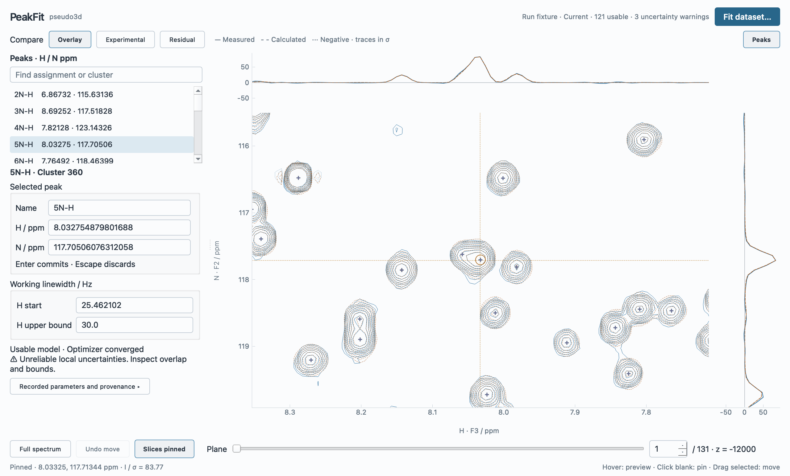

# GUI v2 compact refinement and residual design check

29 October 2026. This is design evidence from a disposable native Qt view, not
production implementation or full GUI v2 acceptance. Framework selection is closed.

## Native compact workspace

The window used Cocoa, Fusion, a 1280×800 outer frame, 1280×772 client area and
2× device pixel ratio. The 320 px left rail leaves a **739.5×477.5 logical-pixel
2D plotting rectangle**, plus aligned top/right slices. No lower panel is open.
The input is the bundled 131×256×546 experimental dataset, 166 peaks and its
previously completed two-pass, 121-cluster SP2 fit. Source fingerprints are in
[the native record](gui-v2-refinement/native-refinement.json). All observed fixture
samples were checked against the actual loaded spectrum and matched exactly.

The selected 5N-H belongs to the genuinely overlapping cluster 360, with a recorded
analytical uncertainty warning. The coordinates shown in markers/list/editor come
from that real completed fit: unfolded N/H = 117.70506076312058 / 8.032754879801688
ppm; original seeds 117.819767 / 8.043663 ppm remain separate. The editable linewidth
start uses an actual fitted value for density assessment; the displayed 30 Hz upper
bound is illustrative UI state, not a claimed original optimization constraint.
The prototype does not establish the production adoption/currentness transaction.

| Native action/check | Result and limit |
| --- | --- |
| Read/search/select and inspect overlap | Assignments, numerical positions, two precise coordinate fields, linewidth controls and short warning fit at normal font size. The spectrum remains usable throughout. |
| Type a coordinate draft | Overlay and Current state remain; no provisional model replaces the accepted spectrum. Escape restores the exact optimized coordinate. |
| Commit +0.0001 ppm, then Undo | Commit selects Experimental and marks the retained result Outdated; Undo restores the exact optimized position without recertifying the result. |
| Edit linewidth upper bound 30 → 35 Hz | Field remains editable/readable. Enter commits the disposable working setting, preserving the old result and making comparison Outdated. No real optimization is performed. |
| Expand long recorded evidence and scroll to end | A 198 px inspector scroll range appears; list and plotting rectangle remain unchanged. [Scrolled evidence](gui-v2-refinement/native-scrolling.webp), [geometry/data record](gui-v2-refinement/native-scrolling.json). |
| Sample data and signed axes | Captured native curve arrays equal source row/column samples divided by the recorded noise; both amplitude axes are exactly ±93.82255029235873 σ after an explicit initial trace-fit allocation. Zero and signed ticks are visible. |

Native input used the app accessibility/mouse/keyboard interface. Pure hover-rate
performance was not rebenchmarked. Initial probe issues with an inherited global
Escape shortcut and an unparented provenance label were corrected before final
captures; no production files changed. ScreenCaptureKit intermittently failed
during native actions, so committed captures use the live Cocoa widget's own grab,
without OS title bars. The two native WebP images are lossless re-encodings of
those PNGs, with decoded pixel equality verified. This is native widget content,
not an offscreen backend render or an SVG masquerading as a native view.

## Residual comparison on actual observations

All candidates use the same `(D − total accepted model) / σ_stat`, native samples,
coordinates and viewport. Contours use ±3, ±5, ±8, ±13, ±21 σ; the raster uses a
blue/neutral/ochre scale saturating at ±3 σ, without smoothing. Both retain signed
1D residuals on the same fixed ±8 σ axes. Overview and overlap crops were captured
on planes 1, 60 and 131. [All 12 capture records](gui-v2-refinement/comparison.json)
include geometry and numerical extrema; the image filename follows each scenario.
The comparison images use WebP quality 85; numerical decisions use the original
float64 arrays, not compressed screenshot pixels.

| Representative scenario | Signed contours | Raster |
| --- | --- | --- |
| Plane 1, overview | [Contours](gui-v2-refinement/plane-1-overview-contours.webp) | [Raster](gui-v2-refinement/plane-1-overview-raster.webp) |
| Plane 1, overlap | [Contours](gui-v2-refinement/plane-1-overlap-contours.webp) | [Raster](gui-v2-refinement/plane-1-overlap-raster.webp) |
| Plane 60, overlap | [Contours](gui-v2-refinement/plane-60-overlap-contours.webp) | [Raster](gui-v2-refinement/plane-60-overlap-raster.webp) |
| Plane 131, overview | [Contours](gui-v2-refinement/plane-131-overview-contours.webp) | [Raster](gui-v2-refinement/plane-131-overview-raster.webp) |

**Recommend signed contours by default.** They expose the location and sign of
structured mismatch with a quiet background and preserve assignment/peak-marker
legibility. In the raster, the whole noise field competes visually with sparse
larger deviations; at overlap zoom, correlated noise and mismatch are both visible
but harder to separate quickly. This assessment holds across the inspected planes,
including the weaker plane-60 overlap. The raster remains useful for inspecting
noise texture and sub-threshold structure; offer it in Display, not another toolbar.

For scale, the fractions of native plane samples exceeding |3 σ| were 2.046%,
1.123% and 1.164% on planes 1/60/131; extrema ranged from −21.90 to +33.20 σ over
these planes. Those values describe this retained model, not a Gaussian-noise test
or scientific validity score. Below-threshold contours are absent, not evidence of
zero residual. The proposed stronger dashed negative styling and clipping indicators
still need implementation visual acceptance; the probe inherits dotted negative
contours and lacks complete clipping indicators.

## Workflow and integration boundary

The inspected sequence is locate overlap → compare → draft/edit → commit → inspect
retained evidence → prepare to refit. It supports the revised density decision.
**Fit dataset remains an explanatory stub**; a separate Probe command replays the
optimized fixture. The prototype does not execute a new fit, save a project, run
MCMC, prune history, or validate cancellation/atomic fit adoption. The complete
researcher workflow and those failure paths are explicit acceptance gates in the
[specification](../PeakFit_GUI_Design_Specification_v2.0.md), not claimed native passes.
The fixed scale was exercised across the twelve plane/mode comparisons; continuous
500-event preview, large fonts, dark native refinement and Linux remain release checks.

Disposable source is archived on `codex/gui-v2-evaluation` at commit
`441bf42656eb8784d27783403e60ffe7c261159e`, path
`experiments/gui-v2/refinement_design_probe.py`. It subclasses the existing trial
instead of copying its monolithic canvas. From that checkout, with the generated
fixture, run `uv run --no-sync python experiments/gui-v2/refinement_design_probe.py`;
Probe → Capture comparisons reproduces the matrix. Later type-only assertions and
explicit ViewBox dispatch preserve the captured rendering/interaction behavior.

For integration into main, carry this report, its relative image/JSON assets and
the revised SVGs with the specification. They have no runtime dependency on the
experiment directory. Historical React/Qt evidence is linked at immutable already
published commit `ea98e5c7002bcf94ce5582aa051bea865820960a`; retain the evaluation
branch/source commit for reproduction rather than merging experimental code.
