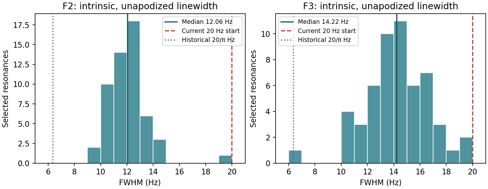
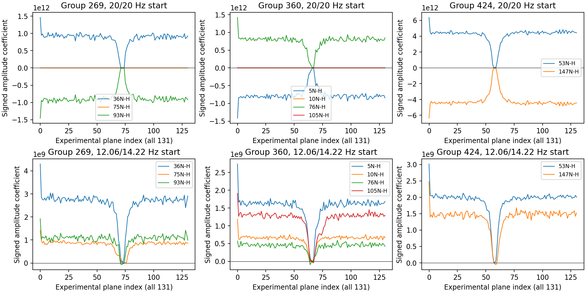

# Intrinsic linewidth initialization and VarPro scaling

Investigation: 2026-10-28, after merged PR #59 (`aa4e2b0`). Python 3.14.5,
NumPy 2.4.1, SciPy 1.17.0; one BLAS thread. No production code, default,
constraint, objective, or runtime dependency changes.

**Finding:** starts matter much more than `x_scale` on this dataset. Robust
isolated-peak medians are **12.06 Hz F2 and 14.22 Hz F3**. These starts reach
well-conditioned alternative decompositions of all three difficult groups;
20 Hz starts remain nearly coincident under every scaling tested. Those
alternatives have *higher* actual-model χ² for groups 269 and 424. Neither
initialization nor numerical scaling can establish their peak assignments.

**Recommendation:** retain the production optimizer and defaults pending
independent review. For these data, narrower representative starts (about 12/14 Hz, or a
single 13 Hz value) are the simplest useful diagnostic alternative. A small
two-start comparison is a more defensible next implementation than automatic
linewidth estimation, parameter scaling or peak-specific initialization. If difficult fits need
multiple starts, retain their competing models and warnings; do not silently
choose separated peaks. The present evidence supports a more representative
starting point and improved basin reproducibility, not a claim of universally
better scientific recovery.

## Evidence and reproduction

[Complete numerical records](linewidth-scaling-results.json) retain input hashes,
axis metadata and every singleton selection decision. The index links three
lossless standard-gzip JSON archives: [controlled fits](linewidth-scaling-results-fits.json.gz),
[frozen-correction sweep](linewidth-scaling-results-sweep.json.gz) and
[synthetic truth](linewidth-scaling-results-synthetic.json.gz). These preserve
optimizer status, actual-model
χ², all target nonlinear starts/endpoints/bounds/errors, shape/Jacobian singular
values, finite-difference checks, signed amplitudes and residual RMS for every
plane. [Generated tables](linewidth-scaling-tables.md) provide the full controlled
comparison, positions and linewidth errors, neighboring peaks and signed ranges.
[Source audit and pinned SciPy references](linewidth-scaling-references.md) explain
the existing implementation and the change-of-units algebra. This extends
[the PR #59 investigation](overlapping-peaks.md), reusing its diagnostics rather
than adding a fitting architecture.

```bash
uv run python tools/validate_linewidth_scaling.py
uv run python tools/summarize_linewidth_scaling.py
QT_QPA_PLATFORM=offscreen MPLBACKEND=Agg uv run pytest
uv run ruff check .
uv run ruff format --check .
uv run ty check --error-on-warning
uv run lint-imports
```

Both scripts write/read the archive layout automatically; `read_results()` in
the summarizer expands the index into an ordinary dictionary without new
dependencies. Compression keeps every evidence file within the repository
500 KB limit without discarding profiles or numerical precision.

The experiment calls production `fit_cluster` and temporarily wraps only its
SciPy call to pass `x_scale`; restoration is tested. Each full run fits all
166 peaks / 121 groups / 131 planes, twice. Masks and bounds are unchanged:
widths [0.1, 200] Hz, centers ±50 Hz; phase/J fitting off; `trf`, analytical
Jacobian, `ftol=xtol=gtol=1e-8`, `max_nfev=1000`. Pass two warm-starts pass one;
external corrections update only between passes. Noise remains
11922.544916060584. Shape models and all acquisition/apodization metadata match.

Full-run endpoints have different external corrections because their fitted
neighbors differ. To isolate the local optimizer effect, a separate sweep uses
identical data with corrections frozen from the completed baseline model. Do
not compare its χ² directly with a different full-run pass. Target masks contain
90/106/67 points and 3/4/2 peaks for groups 269/360/424, respectively, including
75N-H, 10N-H and 105N-H. All masks are hashed in every record.

## Existing initialization and physical interpretation

SP2, SP1 and NoApod start at 20 Hz; Gaussian, Lorentzian and PVoigt at 25 Hz.
Routine fitting takes defaults from lineshape specifications, then applies
configured parameter overrides and constraints. Automatic picking already has
axis/parameter median initialization and bounded warm starts, but also stages
parameters, ties widths/couplings and changes position windows. Those extra
rules are excluded here. Reuse the median concept with quality filtering if
implemented later; importing the automatic-picking workflow would confound it.

SP2 uses `z = aq * π * (lw + 2i*dw)`: `lw` is the intrinsic exponential-decay
linewidth, not the apparent processed-spectrum FWHM. Here F2 is indirect N at
81.043 MHz with acquisition time 60.665 ms and squared sine-bell endpoints
0.400/0.980; F3 is direct H at 799.708 MHz, 63.702 ms, endpoints 0.300/0.980.
The real reader's acquisition duration and direct/indirect conventions are
retained. Observed half-height widths would include finite acquisition and
window broadening and are not used as intrinsic estimates.

Jacobian columns differentiate noise-normalized residuals with respect to ppm,
Hz and, when enabled, degrees. Default TRF scaling is one. Experimental manual
scales are **10 Hz / axis MHz** for shifts, **10 Hz** for widths/couplings and
**10 degrees** for phases. They never depend on absolute chemical shifts and
change neither parameter definitions nor the statistical model. Phases and
couplings are not exercised by this dataset. `x_scale="jac"` uses inverse column
norms; SciPy keeps a running maximum column norm, so its characteristic
`x_scale` cannot increase; it cannot fix collinearity. Final
uncertainties still use production covariance in physical parameter units.

## Isolated-peak intrinsic linewidths

Candidate selection is deterministic: start with all **92 singleton groups**;
use the complete 131-plane acquisition-aware fit and existing external
corrections. Require maximum absolute normalized shape overlap <0.25 on the
union of all fitting masks, external correction norm <10% of data norm,
at least ten planes with model peak-height SNR ≥5, optimizer success,
reduced χ² <2 (counting all eliminated amplitudes), finite linewidth errors
<25% of width, and <2% linewidth disagreement after independent 3 and 40 Hz
restarts with physical scaling on the same corrected data.

The overlap metric must use a common spectral domain: a preliminary metric
normalized only on each singleton's small mask incorrectly classified remote
peak tails as overlapping. This was corrected before selecting peaks; it
changed the screen, not the model. All other numerical screening thresholds
were fixed before inspecting the resulting linewidth distribution. The final
screen accepts **54 peaks**; all 38 exclusions fail the residual cutoff. No
manual peak exclusions are made. This estimates linewidths of a well-fit subset,
not an unbiased distribution for the entire peak population. SNR and shape overlap are recorded even when
they do not reject a candidate.

| Intrinsic FWHM, Hz | Median | Q1–Q3 | Range | Median local SE |
| --- | ---: | --- | --- | ---: |
| F2, indirect N | 12.062 | 11.067–12.869 | 9.490–19.410 | 0.053 |
| F3, direct H | 14.218 | 12.936–15.887 | 6.030–19.736 | 0.053 |



The axes differ by about 2.16 Hz in their medians, but their distributions overlap
substantially. F3 has a broader central distribution. Between-peak variation
is much larger than the conditional local errors: a per-axis representative is
reasonable for a **start**, not as a tied final linewidth. The sole Tukey
1.5-IQR outlier on each axis is the same listed resonance, `1013N-H`:
19.410±0.146 Hz F2 and 6.030±0.130 Hz F3. It is retained; the data provide no
objective reason to remove it merely for being unusual.

Using all 92 singletons gives medians 11.489/13.920 Hz. Tightening reduced χ²
from 2 to 1.5 leaves 11 peaks and gives 12.868/15.780 Hz. Tightening shape
overlap to 0.1 leaves the selected set unchanged. These shifts show selection
sensitivity and possible model mismatch; the very small local errors should
not be mistaken for uncertainty in a universal linewidth. The JSON also
records a stricter SNR subset: peak SNR >60 leaves 13 peaks with medians
11.330/13.218 Hz. Neither axis supports 20 Hz as a central start
in this sample; 6.366 Hz is below the selected F2 range and near the low F3
tail. The historical value is a useful basin control, not an estimate of this
sample's typical intrinsic linewidth.

## Controlled target comparison

Actual-model χ² after two complete passes (all other settings identical):

| Initial F2/F3 Hz, scaling | 269 | 360 | 424 |
| --- | ---: | ---: | ---: |
| 20/20, standard | 20805.212 | 18378.445 | 21313.624 |
| 12.062/14.218, standard | 21577.286 | 17946.844 | 25070.757 |
| 20/20, Jacobian | 20805.212 | 18378.445 | 21313.624 |
| 20/20, physical | 20805.212 | 18378.445 | 21313.624 |
| 12.062/14.218, Jacobian | 21577.286 | 17946.844 | 25070.757 |
| 12.062/14.218, physical | 21577.286 | 17946.844 | 25070.757 |
| 6.366/6.366, standard | 21577.286 | 17946.844 | 25070.758 |

The historical control changes **only the start**, retaining current bounds;
it does not silently introduce historical ±25 Hz windows or narrower width
bounds. The appendix includes the historical control under both other scales.
Every target termination is `ftol`, even when optimality remains large.

| Group | Default F2/F3 separation, ppm | Experimental F2/F3 separation, ppm | Scaled J κ: default → experimental | Optimality: default → experimental |
| --- | --- | --- | --- | --- |
| 269 | 0.0000943 / 0.00000170 | 0.0422085 / 0.00178018 | 9.16e6 → 43 | 3865 → 6.27 |
| 360 | 0.0000550 / 0.0000187 | 0.0319162 / 0.01006966 | 6.71e6 → 25 | 6580 → 0.953 |
| 424 | 0.0000368 / 0.00000283 | 0.0896778 / 0.00318728 | 8.80e7 → 21 | 38653 → 12.8 |

These experimental rows use standard scaling. All default target results carry
uncertainty warnings; the alternative local fits have finite within-bound local
errors and no numerical warning. Absence of a numerical warning is not evidence
of a unique global assignment. See the appendix for all starting and fitted
positions, intrinsic linewidths and errors, including the retained neighbors.



Default decompositions show large opposite signed coefficients; alternative
fits avoid sustained cancellation. No amplitude sign is constrained. Profiles
cover all 131 planes in original order, without per-plane normalization.
The archive also retains conditional amplitude errors and their
residual-inflated variants; these omit nonlinear-parameter uncertainty.
Residual quality remains imperfect in either basin; the appendix reports noise
RMS, and the JSON retains every plane's residual RMS. In particular, a more
plausible-looking decomposition can fit the measured spectrum worse.

## Basin robustness and scaling

For each target, the frozen-correction sweep tests common starts 3, 6.366, 10,
20 and 40 Hz and the experimental per-axis pair under all three scales. It
also varies one axis at a time and perturbs the experimental pair by ±20%.
The sweep preserves complete masks and neighboring contributions.

At starts 3, 6.366 and 10 Hz and at the median pair, all scales find the
alternative local solution. At 20 Hz all find near coincidence. At 40 Hz,
group 269 changes basin with physical scaling, while standard/Jacobian scaling
remain near coincident. Group 360 has an additional poor basin at 40 Hz
(χ² approximately 20258 on frozen corrections), distinct from its 20 Hz basin
(approximately 18382) and better alternative (approximately 17950).
Axis-only changes reveal an interaction: lowering F2 alone reaches the
alternative solution in all groups; lowering F3 alone leaves 269/360 near
coincident but moves 424 to the alternative. A +20% perturbation of the
experimental pair finds another near-coincident basin in 269 (χ² 20964.281),
while −20% retains its alternative basin. These bounds on robustness matter:
the median pair does not remove the surrounding basin boundary.
Thus the result is several minima or limiting near-coincident decompositions,
not a single robust global optimum.

Scaling does not materially improve the 20 Hz endpoints. For example, group
424's final optimality increases from about 38653 to 105717 with Jacobian
scaling; its column-scaled Jacobian remains ill-conditioned. Physical scaling
also leaves this failure mode. Changing units of trust-region steps cannot
supply information absent from nearly collinear shape columns. Optimality
numbers, termination flags, singular values, objective and covariance must be
assessed together; none is a scientific assignment test.

The full-run timing records include three repeats per configuration, excluding
diagnostic finite differences and loading. Reported per-target evaluation
counts and runtimes are in the generated tables. Small differences between
scales are comparable to timing variation and do not justify a production
change by themselves. Median optimizer times (seconds; three repeats) are:

| Start | Standard | Jacobian | Physical |
| --- | ---: | ---: | ---: |
| 20/20 Hz | 1.513 | 1.604 | 1.422 |
| Experimental per-axis | 1.385 | 1.406 | 1.384 |
| Historical 6.366/6.366 Hz | 1.324 | 1.493 | 1.416 |

The baseline range is 1.453–1.613 seconds; small performance rankings are not
stable enough to drive design. Screening and the two restarts of all 92 singletons take a further 0.812 s
after the baseline full fit; a practical initializer would need its own
prepass design. These costs are absent from fitting-only timing comparisons. Full-run controls with a single global 13 Hz,
rounded 12/14 Hz, strict-residual medians and all-singleton medians all reach the
same alternative target basins (χ² differences <0.002). This sample does not
show an accuracy or basin advantage of exact medians over rounded representative
starts, or of two axis values over a suitable single value.

## Synthetic truth and normalization

The independent check uses the experimental SP2 acquisition metadata and complete
target masks, with known listed centers, heterogeneous per-peak intrinsic widths
and independent smooth signed amplitude profiles across 131 planes. The amplitude scale is 30 noise units divided by each shape maximum;
actual peak-height SNR varies with the signed plane profile; seeded independent Gaussian noise is added. Truth widths span
0.65, 1.0 and 1.6 times the experimental medians, further multiplied by
0.85 + 0.15 × peak index. Every initial center is displaced by 1 Hz. Five seeds ×
three groups × three truth regimes × three starts × three scales give **405 fits**.
The nine algorithm configurations share the same noisy spectrum in each case,
and seeds are reused across groups/regimes: 405 fits are not 405 independent
coverage replicates. There are no external peaks in these generated local spectra; all group members
are retained. This is a controlled recovery check, not a model of correlated
processed experimental noise.

All 405 fits report success. After optimal peak permutation, worst position
errors are 0.262/0.197/0.288 Hz in the three truth regimes for every configuration.
Local ±2-SE coverage after matching is 97.8%/97.8%/96.7%, with all position errors
available. Permutation-matched linewidth errors are at most
0.373/0.313/0.510 Hz, with ±2-SE coverage 97.8%/98.9%/97.8%. All linewidth
errors are available; these percentages share the same repeated-noise caveat. A naive named-peak comparison can incorrectly call an equivalent
label-swapped model a recovery failure. The archive retains both named errors
and the matching permutation. Matching measures peak-set recovery; it cannot
certify resonance assignments.

For standard scaling, median evaluations at narrow/central/broad truth are
8/7/6 for 20 Hz starts, 7/6/6 for experimental starts, and 5/6/7 for historical
starts. Twenty-Hz starts swap labels in five of fifteen narrow and five of
fifteen central fits; experimental starts swap in two narrow fits and no
central/broad fits with standard scaling. Scaling can change the label
permutation without changing physical recovery. There is no demonstrated
universal reduction of bias or recovery error from the proposed start; its
benefit here is fewer evaluations and some improvement in retention of initial peak labels. That label retention
is not evidence for scientific resonance assignments.
Five seeds per regime and ideal-model Gaussian noise are insufficient to
establish universal error coverage or performance across NMR experiments.

Common intensity/noise scaling is algebraically redundant. On all three target
20 Hz endpoints under each scale, fixed-parameter normalized residual gaps are
≤3.1e-11 relative and Jacobian gaps ≤1.5e-13; reoptimization changes χ² by
<1e-6 and leaves physical parameters numerically consistent (per-axis Hz gaps
are recorded: maximum center change 6.2e-8 Hz and linewidth change
2.1e-7 Hz). These are justified floating-point tolerances, not a changed
likelihood. No plane is independently rescaled. There is no measured numerical
benefit warranting an additional preprocessing operation.

Optional column-norm scaling was evaluated only for the linear solve at fixed
parameters, reconstructing original-unit coefficients exactly in algebra. Model
gaps are <2e-12 relative and reconstructed amplitude gaps <1.7e-13; numerical
shape rank is unchanged. Common data/noise scaling reconstructs original-unit
amplitudes within 5.1e-16 relative at the same physical parameters. Near-coincident columns retain their high condition
number (group 424 is essentially unchanged); group 360 improves by only about
1.5×. It does not cure collinearity. Do not add a normalized-shape optimizer:
rank-cutoff/minimum-norm conventions and parameter-dependent normalization
derivatives require care, with no demonstrated benefit here.

## Simplest next step and limits

A fixed global width is the cheapest option and 13 Hz works equally well here,
but one sample cannot establish it as a transferable default. Two per-axis medians reuse existing parameter/model
machinery and are a reasonable routine starting strategy when enough isolated
informative peaks exist. A quality screen is needed: automatic-picking medians
currently do not establish fit quality. Explicit user values, fixed parameters
and bounds must take precedence. A fallback for datasets without isolated peaks
would need separate validation; these data cannot establish a universal default.

Peak-specific starts for these overlapping resonances are not justified by an
isolated observed FWHM or by borrowing their final solution. Independent
linewidth information would be needed. A median initializer remains a candidate for future multi-dataset validation,
but has no demonstrated basin or accuracy advantage over simpler fixed narrower
starts here and incurs selection/refitting cost. The measured heterogeneity supports
continuing to **fit individual final widths**, not adding a peak-specific
initializer. A small two-start comparison (representative pair and 20 Hz) is
more transparent for difficult groups than complex adaptive machinery, at
roughly twice local fitting cost. It exposes competing solutions; selecting
the smallest χ² alone still retains questionable cancellation in 269/424.

Remaining limits include one experimental dataset, selection sensitivity,
processed-noise correlations, possible lineshape/model mismatch, fixed masks,
local Gaussian covariance rather than global confidence regions, and ambiguous
assignments across competing basins. No artificial separation, sign restriction,
assignment preference or convergence certification has been introduced.


## Verification

All **300 tests** pass, including eight new experiment-seam cases for physical
units, respecting fixed/bounded widths, all three scaling choices, SciPy
restoration, common data/noise and shape-column scaling, label-permutation recovery and lossless numerical-archive round trips. Ruff lint/format, type checking and import contracts are also checked.
The investigation changes only validation documentation, numerical records,
figures, scripts and focused tests. Production behavior and compatibility are
unchanged. The draft PR is intentionally left unmerged for scientific review.
