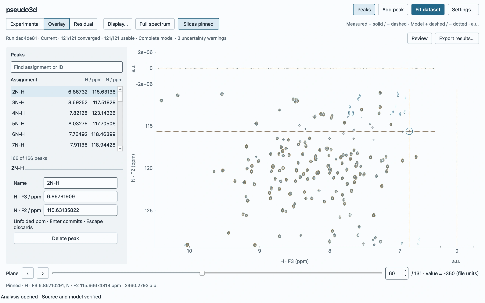
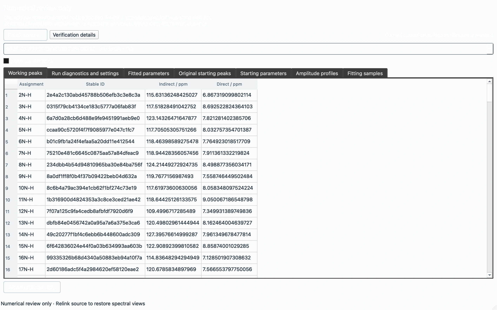

# Lossless scientific storage and interface parity

A subsequent [retention-policy audit](scientific-storage-audit.md) measures the
complete CLI/GUI output directories and each stored array. It recommends compact
published results plus explicit detailed evidence; those retention changes are
proposals and have not changed the implementation measured here.

Validated on 30 October 2026, macOS arm64, Apple M5 Pro, 64 GiB RAM,
Python 3.14.5 and Qt Cocoa. Baseline is merged Milestone 3, `06157dd`.
The bundled real workload is 131 × 256 × 546, with 166 peaks, 121 clusters,
SP2 on both spectral axes and two optimizer passes. The linked spectrum is
73,244,672 bytes. No fit algorithm, model, uncertainty calculation or MCMC
feature changes in this PR.

## Authority audit and decision

| Information | Authority / storage decision |
| --- | --- |
| Final parameters, uncertainties, classification, diagnostics | Immutable `FinalFitOutcome`, owned by its cluster |
| Global parameter tuple and cluster lookup | Duplicated views; reconstruct from clusters |
| Shapes, amplitudes, covariance/errors, model and residual arrays | Exact retained scientific values; typed NPY arrays |
| Model and residual arrays derivable by algebra | Retain their original bits rather than changing rounding on reconstruction |
| Observations, paired indices, terminal corrections | `FinalClusterSamples`; do not infer corrections or amplitudes from observations |
| Resolved geometry, calibration, identities, plane order | Essential reconstruction context; retained explicitly |
| Original source-plane indices after exclusion | Previously lost by CLI; now retained explicitly even when experimental values repeat |
| Initial values/bounds/freedom versus fitted values | Different facts; initial values stay in submitted project inputs |
| Submitted/adopted coordinate evidence | Scientific table linked by stable run/peak IDs; live editable positions/history remain project state |
| Prepared cluster numerical data | Runtime wrappers over retained arrays; no second stored numerical representation |
| Full spectrum and display caches | External linked source and disposable computations; never project payloads |
| Full-run journal parameters | Derived; compact parameter evidence materialized only before full-run eviction |

`fit.storage` implements one ZIP of small metadata and named typed NPY members,
with deflate level 1. Both projects and scientific exports use this codec. The
binary file is independently inspectable with NumPy and ZIP tools. Typed arrays
avoid Python numeric lists, Pydantic numerical-list validation, textual float
encoding/decoding and temporary uncompressed JSON files. It preserves endian,
dtype, shape and numerical bits, including NaN payloads. Fitted parameters are
stored once per cluster; lookup/global views are reconstructed.

The metadata walker handles a fixed scientific dataclass tree and explicit
array/mapping/nonfinite descriptors. It has no object-class registry, plugin
loading, pickle file reader, database, service layer or alternate recovery format.
Readers bound metadata and expanded payloads, inspect NPY headers and byte lengths
before allocation, reject duplicate/unknown members, and check identities,
revisions, dimensions and terminal algebra. Reopening also evaluates recorded
geometry against exact samples without solving.

The [candidate measurements](scientific-storage/after-api.json) compare the same
outcome/sample arrays and metadata:

| Candidate | Bytes | Write | Read |
| --- | ---: | ---: | ---: |
| Stored NPY ZIP | 33,477,563 | 43.8 ms | 77.0 ms |
| Deflate-1 NPY ZIP | 28,931,855 | 484.2 ms | 147.9 ms |
| Uncompressed HDF5 | 33,965,251 | 58.2 ms | 41.1 ms* |

*HDF5 read is an array/metadata materialization lower bound, without outcome
construction or scientific validation. ZIP read includes both. All writes start
with arrays in memory; HDF5 setup does not include reading a ZIP. These are
single cached-filesystem observations, not broad format performance claims.

Current save/history access is whole-run and immutable. HDF5's partial reads,
chunking and append semantics do not justify another object hierarchy or file
lifetime here. Stored ZIP is fastest, but deflate-1 buys another 4.55 MB per run
while preserving a roughly 0.5-second publication time. Its smaller bounded
history and straightforward standard-library codec are the selected trade-off.
Future large MCMC chains may justify a different format for that explicit result
kind; that decision is not made by this fit-storage change.

## Before / after operations

[Baseline API measurements](scientific-storage/before-api.json) and
[refactor API measurements](scientific-storage/after-api.json) come from separate
fresh processes, using the real dataset and actual `save_analysis`/`open_analysis`.
Writes include checksums, fsync and atomic manifest publication. First Save copies
already durable recovery evidence; routine Save reuses immutable evidence.
Historical loading materializes one explicitly selected Full record. Reopen checks
source content, sample order and reconstructed geometry. Exact array byte checks
and reconstruction pass in both versions.

| Synchronous operation | Before | After |
| --- | ---: | ---: |
| Fit | 4.008 s | 3.952 s |
| Durable publication | 2.354 s | 0.513 s |
| Fit through durable acceptance | 6.362 s | 4.465 s |
| First Save | 25.4 ms | 21.7 ms |
| Routine Save | 6.0 ms | 6.0 ms |
| Verified reopen | 0.887 s | 0.611 s |
| Historical-result loading | 0.480 s | 0.165 s |
| Project bytes | 37,248,685 | 29,313,977 |

The project is **21.3% smaller**, publication **78.2% faster**, historical loading
**65.7% faster**. Routine Save was already cheap and is effectively unchanged.
Source and cached display arrays are absent from project evidence.

## Memory, including temporary serialization

The tool sends the already completed record to a **fresh publication process**
using benchmark-owned trusted IPC. That process records its OS RSS high-water mark
before and after saving, without repeating fitting. This prevents fitting's much
larger temporary masks from hiding publication's allocations.

| Isolated publication RSS | Before | After |
| --- | ---: | ---: |
| Pre-publication high-water mark | 264.03 MB | 264.21 MB |
| High-water mark through durable publication | 396.31 MB | 267.14 MB |
| Increment above pre-publication high-water mark | 132.28 MB | 2.93 MB |

The publication-process peak is **32.6% lower**. The incremental high-water mark
falls by about **97.8%**. These are resident-memory observations, not Python object
counts or a general claim about all fitting allocations.

The full synchronous process peak instead measures **1.087 → 1.139 GB**. Sampled
concurrent native GUI + descendant RSS measures **2.033 → 2.399 GB**, with an earlier
refactor run at **2.324 GB**. Thus **there is no measured total GUI-memory
improvement**. These peaks include fitting, transfer, reopened display and refit;
allocator retention and process overlap still matter and require separate profiling.
The sampler sums RSS (shared pages can be counted more than once) every 20 ms plus
`ps` overhead, so it is not a unique physical-memory measurement or a guarantee of
capturing arbitrarily brief peaks. Raw [baseline](scientific-storage/before-native-memory.json),
[refactor](scientific-storage/native-memory.json) and
[earlier refactor](scientific-storage/initial-after-native-memory.json) samples are retained.

## Native workflows and output parity

The [native baseline](scientific-storage/before-native.json) and
[native refactor](scientific-storage/native/measurements.json) use the real
process-based Fit action, durable session preservation, first/routine Save,
Save As, verified reopen, overlay/residual display, manual edit, actual refit and
numerical-only review. File-chooser answers are deterministic; scientific work,
Qt event loop and filesystem operations are real.

| Native action | Before | After |
| --- | ---: | ---: |
| Fit through durable acceptance | 8.647 s | 6.966 s |
| First Save | 0.893 s | 0.952 s |
| Routine Save | 12.0 ms | 11.6 ms |
| Save As | 30.9 ms | 27.0 ms |
| Verified GUI reopen | 1.947 s | 1.623 s |

Routine Save rewrites zero immutable evidence files and reads zero source-content
bytes. Currentness/edit/refit and temporary-store cleanup assertions pass.
First GUI Save remains dominated by process startup/transfer; it was modestly
slower in this sample despite the smaller payload. An earlier native refactor run
measured 6.64 s for fit/acceptance and 0.89 s for first Save; single-run timings
should not be interpreted as stable latency distributions.





Light/dark overlay and residual captures are retained in the same directory.
Visual inspection confirms a **pre-existing** low-contrast numerical-review
heading/control issue in light appearance; the baseline capture has the same
issue ([Milestone 3 baseline capture](gui-v2-persistence/numerical-only.webp)).
It is not changed as part of storage/export work. Numerical tables and
source-independent review remain functional.

`fit.export.write_completed_outputs` is the single scientific export path for
both interfaces. It always writes the binary record and shares optional JSON,
17-place CSV, bounded report and float64 `simulated.npy` writers. Cross-interface
tests call the real CLI and GUI entry points with the same completed record and
settings: scientific archive metadata/arrays, CSVs and simulated samples agree.
Explicit GUI/CLI export-time state and recorded adoption facts are asserted
separately; no GUI working state is invented for CLI. Reports ignore generation time. Separate tests protect duplicate
plane values, source indices after exclusion, nonconverged/unusable results,
unavailable errors, endian/NaN bits, corruption and allocation limits.

GUI-only local/dataset JSON companions and a separate GUI sample-NPZ writer are
removed. The GUI's journal-only JSON dump is removed too; Summary-only entries
remain inspectable but cannot masquerade as complete scientific exports. Protect
or export important full evidence before eviction. The former CLI-only report
and simulated-file options now work in the GUI through the same writer. Simulation
output intentionally changes from float32 NMRPipe to lossless NPY;
calibration and source-plane mapping travel in the scientific archive.

## PR review correction: coordinate provenance and plane identity

The approved [GUI v2 export contract](../PeakFit_GUI_Design_Specification_v2.0.md#11-save-reopen-and-export)
requires initial/fitted/adopted distinctions and Current/Outdated status. The
first PR revision incorrectly treated those distinctions as project-only state.
Removing GUI-specific companions is still appropriate; losing their scientific
provenance is not. The correction adds one shared, versioned stable-ID table in
`scientific.npz`, not another GUI writer.

The table records exact initial unfolded ppm, usable final coordinates, ordered
axis/engine-parameter mappings, original assignments, recorded adopted positions
and adoption status/reason. The same coordinate-resolution rule drives automatic
GUI dataset completion and both exporters. Usable non-converged results adopt
finite valid positions; unusable/invalid tuples retain exact starting positions.
Immutable outcomes are untouched. A separate `export_state` records GUI scope,
Current/Outdated status and the completion's adoption warnings. CLI uses the same
schema, reporting no recorded coordinate transition and `not_applicable` currentness.
GUI API calls without live status report `unknown`. Local manual application is
not inferred from later edits.

`intensities.csv` now explicitly contains `source_plane_index` alongside retained
`plane_index`. Both are zero-based. Repeated experimental values and exclusions
therefore remain unambiguous without opening the binary archive. The real CLI and
GUI paths receive the same source mapping through the existing shared writer.

Focused regressions cover fully usable, partially unusable, usable non-converged
and Outdated exports, exact coordinate round trips, false adoption/parameter-map
rejection and original source indices after exclusions. Re-exporting an Outdated
run changes only explicit export-time state; its scientific arrays and recorded
completion transition remain unchanged.

## PR review: process and phase memory attribution

The original 2.03/2.40 GB observations recorded total RSS only. It is impossible to
assign those exact historical samples to particular PIDs retroactively. The new
probe records each process contribution at every phase high-water mark and adds
settled checkpoints after fit, reopen and refit. The workflow, sources, fits and
publication remain real. Three baseline and four PR controls were run sequentially
in fresh processes on the same machine. Two controls collect Python cycles only
**after** closing, and one pair also counts retained scientific buffers/cache sizes.
These measurement-only flags do not change production memory handling.

[Raw traces and derived summary](scientific-storage/memory-review/summary.json):

| Run | Peak summed RSS / GB | GUI at peak / GB | Scientific worker at peak / GB | Peak phase |
| --- | ---: | ---: | ---: | --- |
| Baseline A | 2.304 | 1.325 | 0.958 | Refit result transfer |
| PR A | 1.955 | 0.975 | 0.959 | Refit result transfer |
| PR B | 2.247 | 1.272 | 0.954 | Refit result transfer |
| Baseline, post-close GC control | 2.008 | 1.294 | 0.693 | Verified reopen |
| PR, post-close GC control | 2.089 | 1.114 | 0.954 | Fit transfer/publication transition* |
| Baseline, live-buffer probe | 2.367 | 1.387 | 0.958 | Refit result transfer |
| PR, live-buffer probe | 2.047 | 1.072 | 0.954 | Initial fit result transfer |

Each total also includes a roughly 21 MB resource tracker. *Phase-file sampling
can straddle a transition: this PID also appears in optimizer samples, identifying
it as the fit worker, not the later archive worker. These are sums of process RSS;
shared pages are counted in each process, so totals are not unique physical memory.
The sampler targets 20 ms plus `ps` overhead and can miss briefer peaks.

**The dominant high-water phase is fit/refit result transfer**, when the GUI and
its roughly 0.95 GB fit worker coexist. Between PR A and B the total peak differs
by 291 MB: GUI RSS differs by 296 MB while the worker differs by less than 5 MB.
The baseline exhibits the same phase and GUI-process variation, with a higher
2.367 GB peak in the repeated probe. The original apparent 367 MB increase is
within this inter-run GUI RSS spread; it does not establish a new storage leak.

The archive worker is separately identifiable by PID during durable preservation.
Across controls it peaks around **418–421 MB baseline versus 320–321 MB PR**,
consistent with reduced publication allocations. The first-fit settled GUI is
about 1.19 GB in both versions, and the reopened settled GUI about 1.34 GB in both.
Post-refit/close RSS varies in both directions between runs.

The live-buffer probe finds **identical** scientific NumPy owners in both versions:

| Settled phase | Baseline bytes | PR bytes | Resident full results |
| --- | ---: | ---: | ---: |
| First fit | 45,647,608 | 45,647,608 | 1 |
| Verified reopen | 32,636,600 | 32,636,600 | 1 |
| Refit | 45,647,608 | 45,647,608 | 1 |

The same probe observes identical settled contour-cache sizes (357,440, 223,120
and 760,620 bytes respectively), and no settled model-grid cache at those sampled
boundaries. This measures NumPy owners reachable through the scientific dataclass/
container graph, not every Python/Qt allocation. The native harness deliberately
retains its original dataset/completion and current workspace for later assertions.

Post-close collection frees 17,399 baseline or 14,738 PR Python objects but changes
RSS by less than 0.1 MB in either control. Thus high RSS is not a direct measure of
currently live scientific arrays or merely collectible Python cycles; allocator
retention, still-live GUI/harness objects and shared-page accounting matter. These
controls do not prove every other GUI allocation is optimal or exclude all leaks.
They identify transient worker overlap plus variable GUI-process RSS as the
high-water driver, and show no larger retained scientific payload. **No concrete
persistent storage allocation regression was identified, so this PR makes no
production memory-handling change or speculative optimization.**

To reproduce a trace:

```bash
uv run python tools/measure_process_memory.py \
  --output /tmp/process-memory.json --phase-file /tmp/phase.json \
  .venv/bin/python tools/validate_gui_persistence.py \
  --output /tmp/native --phase-file /tmp/phase.json
```

Use `PYTHONPATH=<06157dd checkout>/src:tools` for the baseline. Optional
`--collect-after-close` belongs to the validation script only. The sampler's
`--max-rss-bytes 2100000000` gives a red-capable budget check: PR B exceeds it,
whereas PR A does not, and the baseline also exceeds it. This demonstrates why
a fixed threshold on one summed-RSS observation cannot diagnose a storage leak.

## Verification

The complete suite after the coordinate/CSV correction passes **469 tests**.
Scientific round-trip, cross-interface parity, GUI export and recovery checks
remain protected. Ruff, formatting, strict typing, import-linter,
changed-file Prek hooks and wheel/sdist build pass. The build retains the existing
uv-build version-range warning. `graphify update .` refreshes the AST graph with
no API calls. Recovery, source mutation/relocation, ten-run and byte-budget eviction,
interrupted publication, corruption, unsupported models and historical lifetime
regressions remain in the complete suite.

## Reproduction and limits

```bash
# Current implementation, fresh process; --candidates includes container comparison.
uv run python tools/benchmark_scientific_storage.py \
  --output /tmp/storage.json --candidates

# Native Cocoa GUI, with concurrent process-tree RSS sampling.
uv run python tools/measure_process_memory.py --output /tmp/native-memory.json \
  .venv/bin/python tools/validate_gui_persistence.py --output /tmp/native

QT_QPA_PLATFORM=offscreen MPLBACKEND=Agg uv run pytest
uv run ruff check .
uv run ruff format --check .
uv run ty check --error-on-warning
uv run lint-imports
uv build
```

To reproduce the baseline, extract `git archive 06157dd` to a temporary directory
and run the current benchmark script with `PYTHONPATH=<baseline>/src`. Omit
`--candidates` for that run. Native baseline uses the same current validation
script with `PYTHONPATH=<baseline>/src:tools`. Native sampling requires permission
to access the desktop and `ps`. No source file or experimental workspace is changed.

Qualification is one bundled real workload, cached local storage and macOS Cocoa;
other platforms, slow/network filesystems and much larger/protected histories need
separate runs. NPZ materializes a selected complete run; it is not memory mapped or
chunk streamed. Limits remain explicit: 16 MiB scientific metadata, 8 GiB expanded
scientific archive, 512 MiB project JSON and 8 GiB stored project evidence. Exact
sample tables remain capped at 2,000 displayed rows; the scientific archive keeps
all rows. Explicit JSON export still has numeric-list overhead. CLI optimizer
continuation files remain a separate trusted workflow; they are not scientific
authority or files consumed by the analysis-project reader.

Project **2.0.0** deliberately rejects earlier projects; no compatibility layer is
added. Export with the prior application or refit. Binary scientific schema 1.0.0
leaves future result kinds explicit without implementing MCMC or intensity analysis.
